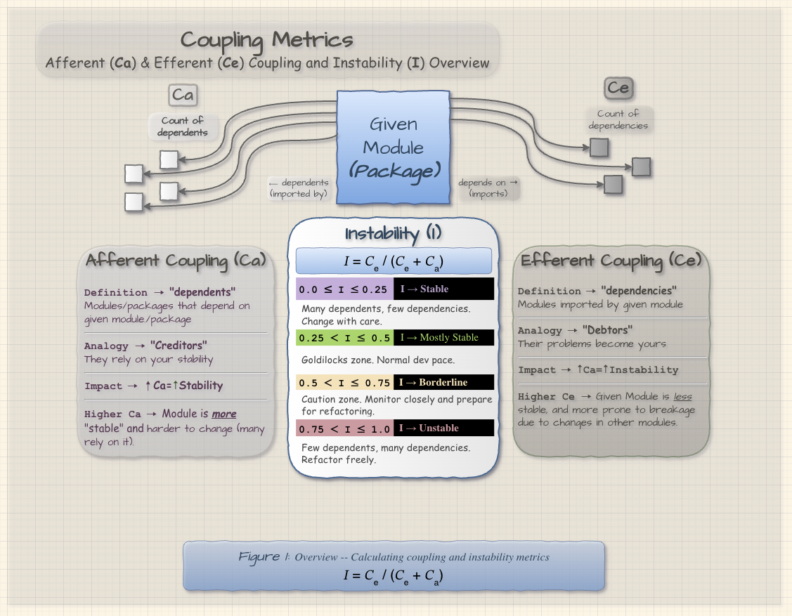
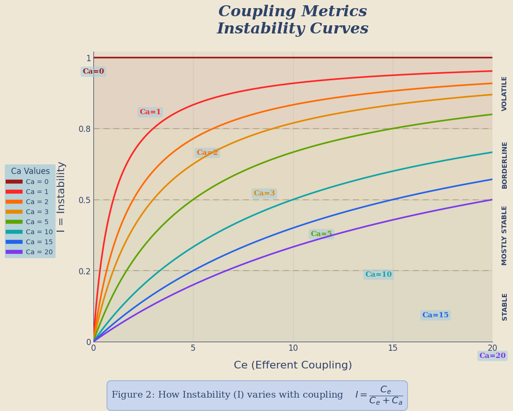
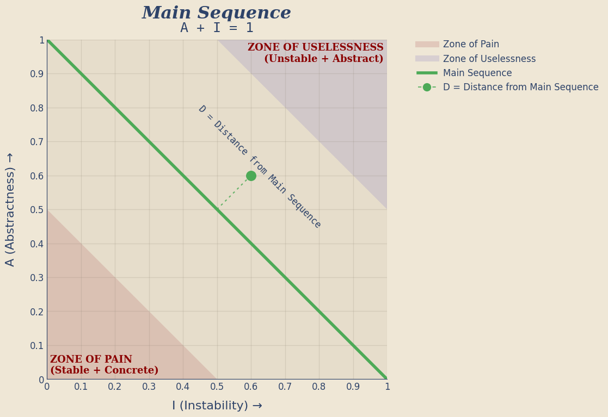
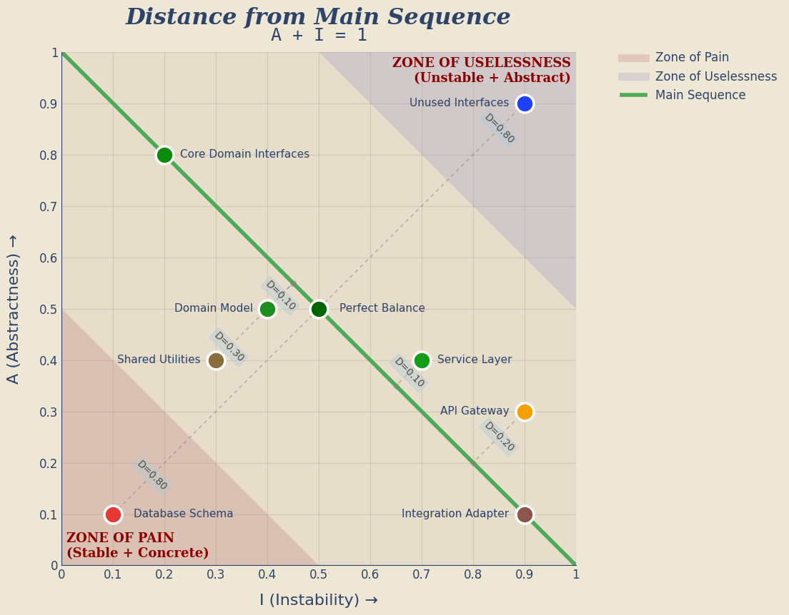

## 📃 Introduction


_This is Part 1 of The Hidden Geometry of Software. [Part 2](https://git-steven.github.io/architecture/coupling/metrics/geometry-cycles-cohesion-complexity/) zooms in on dependency cycles, cohesion and complexity._

Software engineers love to talk about architecture in qualitative terms.

| "This module **_feels_** tightly coupled"
| "That dependency* **_seems_** risky"
| "This design **_appears_** flexible"

But beneath those instincts lies something far more concrete
* 🏗 The structure of software systems **_can be measured_**
* 🏛️ Architectural problems can be predicted and addressed **long before production failures reveal them**.
* 🕰 The formulas behind these metrics have been around since the 1990s
* 🤖 They require no machine learning
* 🧮 Just counting (...and occasionally a little division)

## 🗿 The Architecture that was "pretty good"... until it opened a hellmouth 👹

_For the first six months, even a year, everything felt fast. Our Ruby-on-Rails application was humming along and new features were added daily_
* ⏲ Features shipped quickly
* 🐞 Bug fixes took hours, not days
* 🧑‍💻 Engineers felt productive

_Then, something strange started happening; it began to shift:_
* ⏳ A simple change began taking longer
* 🔗 A feature that should have been isolated to one component suddenly required edits across seemingly-unrelated code; models, controllers, helpers, serializers, background jobs, etc.

_Then the real symptoms appeared:_
* 🧟 Engineers no longer felt productive
* 👥 New engineers joined the team and couldn't make heads or tails of the system.
* ⛓️ Bug fixes triggered unrelated failures.
* 🐞🐞🐞 A "small refactor" broke three features nobody expected to be connected.
* 🔥 Every change started to feel dangerous.
* 🛤️ We suspected **Rails**

## ⛓️ Architecture and Coupling

>  It's a simple complex system. Because it's simple, it's prone to cascades, and because it's complex, you can't predict what's going to fail. Or how. -- _Prax, "Caliban's War" (The Expanse)_

We started digging. We and studied up on _quantitative_ software metrics.  We ran static analysis tools against the codebase, traced dependency graphs, counted the connections between modules. The picture that emerged was not pretty.

Our problem _wasn't_ **Rails**. Our problem was **coupling**; specifically; **_tight_ coupling**

Everyone on the team had _heard_ of coupling, of course. It was one of those concepts that came up in design discussions the way "tech debt" does -- acknowledged in the abstract, never exactly quantified. Now here it was, staring back at us in the real world.

The application had quietly evolved into a **tightly coupled monolith** -- but the monolith part was almost beside the point. The coupling was the disease; the monolith was just the host.

**When software is tightly coupled:**
* A change almost anywhere can trigger side effects somewhere else ⛓️‍💥
* Features that should touch one module require edits across five ✍
* Bug fixes become archaeology ⛏️

### 📏 And the surprising part?
* These structural problems weren't mysterious
* They were **measurable** and **preventable**

## 📊 Coupling Metrics

### 🔢 The Two Numbers Behind Most Architectural Metrics

```text
           𝐶ₐ (# of dependents)
           ▲
           ║
           📦 GIVEN MODULE/PACKAGE
           ║
           ▼
           𝐶ₑ (# of dependencies)
```

Nearly every structural coupling metric derives from two simple counts:
* `𝐶ₐ` (**Afferent** coupling): Count of given module's dependents
* `𝐶ₑ` (**Efferent** coupling): Count of given module's dependencies

### 💨 `𝐶ₐ` (Afferent Coupling)
```text
𝐶ₐ = Count of given module/package dependents
```
* Afferent coupling measures **responsibility**
* If many modules depend on a given module, its stability matters 💧
* Break this module, and others break too ⛓️
* Modules with high `𝐶ₐ` become **structural anchors ⚓**

### 🌬 `𝐶ₑ` (Efferent Coupling)

```text
𝐶ₑ = Count of given module/package dependencies
```
* Efferent coupling measures **vulnerability**.
* The more dependencies you have (`𝐶ₑ`), the more ways your code can break.
* Every dependency introduces:
  - **version risk** -- a dependency update can introduce breaking changes or subtle behavioral shifts that propagate silently
  - **semantic assumptions** -- your code assumes the dependency behaves a certain way; if that contract drifts, bugs appear without any change on your side
  - **upgrade friction** -- each dependency must be kept current, tested against new releases, and reconciled with every other dependency in the graph
* Dependencies are powerful.
* But they are never free.

### 🧮 A Simple Analogy

These metrics behave like a financial balance sheet.

| Metric                     | Analogy                        |
|----------------------------|--------------------------------|
| `𝐶ₐ` *(Afferent Coupling)* | Creditors (who depends on you) |
| `𝐶ₑ` *(Efferent Coupling)* | Debts (who you depend on)      |

* Modules with many creditors must be **_stable_**.
* Modules with many debts are inherently **_fragile_**.

---

## 💦 The Instability Index (I)


From `𝐶ₐ` and `𝐶ₑ` we derive a powerful ratio:
```text
𝐼 = 𝐶ₑ / (𝐶ₑ + 𝐶ₐ)
```

### Instability ranges from `0` to `1`

| I Range           | Stability  | Meaning                           | Change Strategy    |
|-------------------|------------|-----------------------------------|--------------------|
| `0.0 ≤ I < 0.25`  | Stable     | Many dependents, few dependencies | _Change with care_ |
| `0.25 ≤ I < 0.50` | Balanced   | Healthy structural position       | _Normal dev pace_  |
| `0.50 ≤ I < 0.75` | Borderline | Dependency heavy                  | _Monitor closely_  |
| `0.75 ≤ I ≤ 1.0`  | Unstable   | Few dependents, many dependencies | _Refactor freely_  |

## 📈 Instability Curves



The chart above shows how `Instability` changes as `𝐶ₑ` grows for several fixed values of `𝐶ₐ`.

A few patterns jump out immediately:
* When `𝐶ₐ` is **lower**, `Instability` rises very quickly toward volatility. _Modules with few dependents become volatile with even a modest increase in outgoing dependencies._
* When `𝐶ₐ` is **higher**, the curve climbs more slowly. _A module with many dependents can absorb some additional dependencies before drifting into the more unstable bands._
* The `𝐶ₐ = 0` line is the extreme case. _A module with no dependents is structurally free to become maximally unstable._

This is why `𝐶ₑ` is not the whole story by itself.
The same number of outgoing dependencies means something different depending on how much responsibility the module already carries.

Said another way: `Instability` is not merely about *how much you depend on* — it is about that dependency load **relative to who depends on you**.


This leads to one of the most important architectural principles.

### Stable Dependencies Principle

Dependencies should flow **toward stability 💧**.

```text
unstable modules  →  stable modules
```

When stable modules depend on unstable ones, architectural fragility appears quickly.


## 🌐 `A` (The Abstractedness Index)

This metric differentiates types as **concrete** or **abstract** (`interface`/`protocol`/`port`/`type definition`).

```text
A = Na / Nc
```

### 📏 Variables
* `Na` = number of abstract classes and other items like interfaces/protocols/ABCs, etc.
* `Nc` = Total number of classes and other items
* `A` = Abstractedness Index

### 🔬 Interpretation
* `A = 0` → completely concrete; no abstraction
* `0 < A < 1` → mix of abstract and concrete
* `A = 1` → completely abstract

### 🗝 Key Takeaways (`A`)
* Abstraction provides flexibility
* Concrete code provides behavior
* Good architecture balances both

## 🧬 Main Sequence

When plotting **Abstractedness (`A`)** against **Instability (`I`)**, something interesting appears.

Healthy modules tend to cluster along a line defined by:

```text
A + I = 1
```

This line is called the **Main Sequence**.

The conceptual graph below shows the terrain first:

* the **main-sequence line** itself
* the **Zone of Pain** in the lower-left
* the **Zone of Uselessness** in the upper-right
* a small illustrative distance marker showing how we measure deviation from the line

The key idea is simple: modules do not have to sit exactly on the main sequence, but the farther they drift from it, the more likely they are to be structurally imbalanced.



## 🪨 Architectural Danger Zones

### 🏦 Zone of Pain

```text
low A
low I
```

Meaning: **concrete AND stable**

These modules are depended on by many other modules but contain little abstraction.

Examples often include:
- database schemas
- configuration systems
- foundational libraries

Changing them causes cascading impact, hence the name.

### 🤷‍♂️ Zone of Uselessness

```text
high A
high I
```

Meaning: **abstract AND unstable**

These modules contain abstractions nobody uses.

**Example:**
```text
12 interfaces
1 implementation
0 dependents
```
* Beautiful architecture.
* No real purpose.

## 📏 Distance From the Main Sequence

Once we place real modules on the same chart, the picture gets richer.

```text
D = |A + I − 1|
```

The detailed graph below shows:

* the **main sequence**
* the two architectural danger zones
* example modules in and out of those zones
* a dotted guideline from each module to its nearest point on the main sequence
* the **distance value** (`D`) for the more interesting examples

That lets us see not just *where* a module sits, but *how far off-balance* it is.

Some modules live outside the danger zones and are still worth watching. A service layer, API gateway, or shared utility package may not be pathological, but a non-zero distance still suggests the design is drifting away from the ideal balance.



### 🧭 Reading the Distance

`D` tells us *how far* a module is from the main sequence, but the absolute value throws away *which way*. Keeping the sign gives us a second, more useful number:

```text
d = A + I − 1
D = |d|
```

* `d < 0` → concrete and stable → heading for the **Zone of Pain**
* `d > 0` → abstract and unstable → heading for the **Zone of Uselessness**

Martin draws the two zones but does not grade the space between them. The bands below do. A boundary value always belongs to the band nearer zero, so the bands cover `-1` to `1` with no gaps or overlaps.

### Signed distance ranges from `-1` to `1`

| d Range             | Zone                                       | Meaning                                                 | Strategy                                                   |
|---------------------|--------------------------------------------|---------------------------------------------------------|------------------------------------------------------------|
| `-1.00 ≤ d < -0.85` | Severe Pain                                | Concrete and heavily depended on; every change cascades | _Extract interfaces now_                                   |
| `-0.85 ≤ d < -0.65` | Moderate Pain                              | Concrete and widely used; changes are expensive         | _Plan an abstraction layer_                                |
| `-0.65 ≤ d < -0.50` | Approaching Pain                           | Too concrete for how stable it is                       | _Add abstractions for the hot paths_                       |
| `-0.50 ≤ d < -0.35` | Balanced -- heavily leaning to Pain        | Workable, but trending concrete                         | _Watch across releases_                                    |
| `-0.35 ≤ d < -0.20` | Balanced -- leaning to Pain                | Slightly more concrete than its dependents warrant      | _Normal dev pace_                                          |
| `-0.20 ≤ d ≤  0.20` | Balanced                                   | On or near the main sequence                            | _Nothing_                                                  |
| ` 0.20 < d ≤  0.35` | Balanced -- leaning to Uselessness         | Slightly more abstract than its users warrant           | _Normal dev pace_                                          |
| ` 0.35 < d ≤  0.50` | Balanced -- heavily leaning to Uselessness | Workable, but trending speculative                      | _Watch across releases_                                    |
| ` 0.50 < d ≤  0.65` | Approaching Uselessness                    | Too abstract for how little depends on it               | _Review every abstract type_                               |
| ` 0.65 < d ≤  0.85` | Moderate Uselessness                       | Mostly abstractions that few modules use                | _Prune; collapse interfaces into their implementations_    |
| ` 0.85 < d ≤  1.00` | Severe Uselessness                         | Abstract and depended on by almost nothing              | _Delete it or find it consumers_                           |

## 🗺️ Where These Metrics Apply

Remember: tight coupling is a **software** problem, not a monolith problem. These metrics apply everywhere software components depend on each other:

* **Microservices** -- dependencies hide behind network calls rather than imports, making coupling _harder_ to see but no less dangerous. A service with high efferent coupling may rely on many downstream services, and each one increases operational risk.
* **Modular monoliths** -- internal module boundaries can erode silently when coupling goes unmeasured
* **Plugin architectures** -- stability of the plugin API is exactly what `𝐶ₐ` and `I` quantify
* **Libraries and SDKs** -- a library with high afferent coupling carries the weight of every consumer

The shape of the system changes. The math does not.

## 🗝 Key Takeaways

* Architecture is often treated as an art 🖼.
* But beneath the diagrams lies an entire universe 🪐, with its own strange set of rules 🧬.
* Software systems obey structural forces 🧲.

⛓️ **Coupling** is one of them, and like magnetism and gravity, it cannot be ignored.

## ➡️ Next: Part 2

[Part 2: Dependency Cycles, Coupling Between Objects, Cohesion, Cyclomatic and Cognitive Complexity](https://git-steven.github.io/architecture/coupling/metrics/geometry-cycles-cohesion-complexity/) zooms in from packages to classes and methods: dependency cycles, CBO, DIT, LCOM4, WMC, and cyclomatic and cognitive complexity.

## 📚 References

- Constantine, L. L. & Yourdon, E. (1979). *Structured Design: Fundamentals of a Discipline of Computer Program and Systems Design.* Prentice-Hall.
- Martin, R. C. (1994). *OO Design Quality Metrics: An Analysis of Dependencies.*
- Martin, R. C. (2002). *Agile Software Development: Principles, Patterns, and Practices.* Prentice Hall.
- Martin, R. C. (2017). *Clean Architecture: A Craftsman's Guide to Software Structure and Design.* Prentice Hall.
- Lakos, J. (1996). *Large-Scale C++ Software Design.* Addison-Wesley.
- Ford, N., Parsons, R., & Kua, P. (2017). *Building Evolutionary Architectures: Support Constant Change.* O'Reilly.
