## 📏 Introduction


**_Dependency Cycles, Coupling Between Objects, Cohesion, Cyclomatic and Cognitive Complexity_**

In [Part 1: The Hidden Geometry of Software Coupling](https://git-steven.github.io/architecture/coupling/metrics/geometry-coupling/), we measured packages from the **outside**:
* `𝐶ₐ` and `𝐶ₑ`: who depends on you, and who you depend on
* `I`: which way the dependencies point
* `A` and `D`: how far a package has drifted from the Main Sequence

That was the satellite photo. It told us **where** the pain was. It didn't tell us **what kind** of pain it was, any more than a satellite photo tells you the house has termites.
* Is this package welded to its neighbors in a loop? 🔄
* Is this class one class, or three classes in a trench coat? 🧱
* Is this method hard to test, or just hard to read? 🔬

So Part 2 is the home inspection. We zoom in from the package graph all the way down to a single method, one metric per stop:

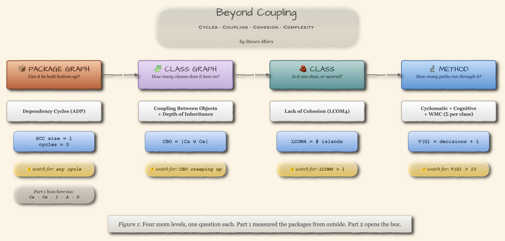

The good news hasn't changed since Part 1:
* 🧮 Every metric below is still just **counting things on a graph**
* 🤖 No machine learning required
* 🚦 Paired with tests and linting, they turn "it works" into "it works, and the architecture still holds" (handy when an AI assistant is writing the code)

### 🧭 How each metric is laid out

Every metric gets the same four parts, in the same order:
* 🔢 **Formula**: how to calculate it
* 🖼️ **Card**: the definition and its thresholds in one picture
* 📖 **Reading it**: what each range means, and what to do about it
* 🛠️ **Linters**: what can check it for you

---

## 🔄 Dependency Cycles

_Zoom level: the **package graph**. Can every package be built, tested and released on its own?_

> THE DEPENDENCY STRUCTURE BETWEEN PACKAGES MUST BE A DIRECTED ACYCLIC GRAPH (DAG). THAT IS, THERE MUST BE NO CYCLES IN THE DEPENDENCY STRUCTURE. -- _Robert C. Martin, "Granularity" (1996)_

### 🔢 Formula

Follow the import arrows out of a package. If you can end up back where you started, that's a cycle. The packages caught in it form a **strongly connected component** (SCC): every member depends, directly or indirectly, on every other member.

```text
SCC      = a group of packages that can all reach each other
cycles   = number of SCCs with more than one package
tangle   = size of the largest SCC                ← the number to watch
RC       = 100 × √(Σ sizeᵢ²) / n                  (sizeᵢ: each cyclic SCC · n: all packages)
```

```text
for each SCC in tarjan(package_graph):    # one linear pass over the imports
    if size(SCC) > 1:
        report it as a cycle
```

* **tangle** says how much of the system is welded into one unit.
* **RC** is Sonargraph's Relative Cyclicity. It puts the whole graph on a `0–100%` scale, and it punishes one big knot more than many small ones: fifty files in a single cycle score `100%`, while the same fifty in twenty-five 2-file cycles score `20%`.

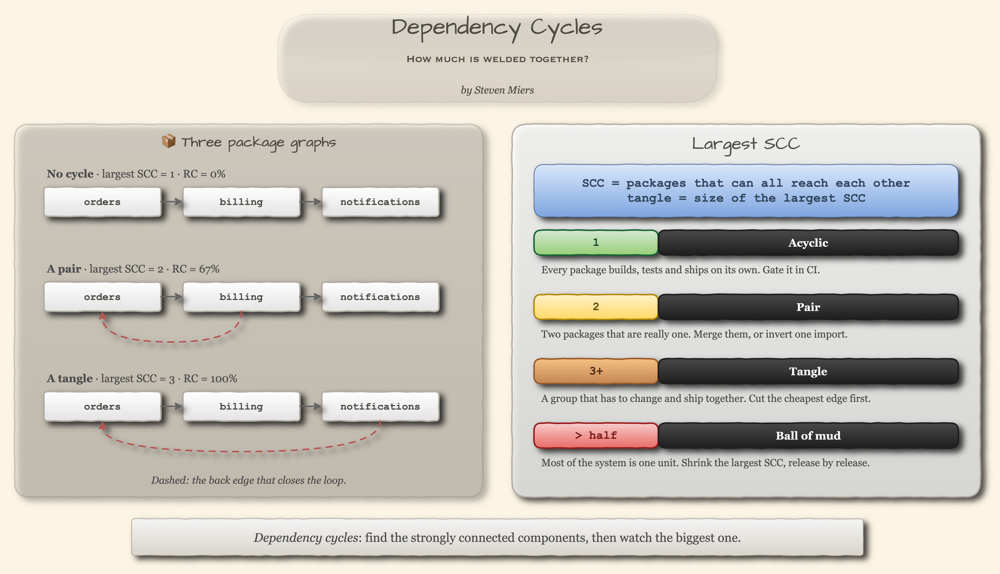

### 📖 Reading it

| Largest SCC        | Rating      | Meaning                                                     | Change Strategy                              |
|--------------------|-------------|-------------------------------------------------------------|----------------------------------------------|
| `1`                | Acyclic     | Every package can be built, tested and released on its own  | _Gate it in CI so it stays that way_         |
| `2`                | Pair        | Two packages that are really one package                    | _Merge them, or invert one import_           |
| `3+`               | Tangle      | A group that has to change, test and ship together          | _Cut the cheapest edge first_                |
| `> half` the graph | Ball of mud | Most of the system is one unit                              | _Shrink the largest SCC, release by release_ |

* **Threshold:** a largest SCC of `1`, which is to say **zero cycles**. This one isn't statistical. It's structural: it falls straight out of the principle.
* **In human terms:** the largest SCC is the biggest chunk of the system somebody has to keep in their head, and retest, for any change inside it.

### ⛓️ Why cycles come first

Part 1's numbers quietly stop working inside a cycle:
* The Stable Dependencies Principle says `I` should **decrease** along every arrow. Walk around a loop and you get `I(orders) > I(billing) > I(notifications) > I(orders)`, an M.C. Escher staircase. **Every cycle contains at least one SDP violation.**
* Each member counts its cycle-mates in `𝐶ₐ` and `𝐶ₑ`, so a package can sit pretty on the Main Sequence while it's welded to an unstable partner.

So check things in this order:
1. **Acyclic first**: no cycles between packages
2. **Then direction**: dependencies point toward stability (`I`)
3. **Then balance**: distance from the Main Sequence (`D`)

### 🧲 Breaking a cycle

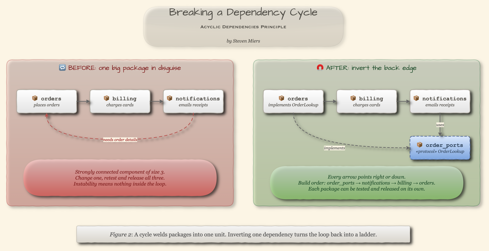

Martin offered two cures:
* **Invert the dependency**: introduce an interface, and let the other package implement it
* **Extract a new package**: move the shared piece somewhere both sides can depend on

What makes inversion work is **who owns the interface**. It belongs with the code that _uses_ it, or in a small package of its own (`order_ports` above). Put it in the implementer's package and you've added a file and kept the cycle.

### 🛠️ Linters

| Ecosystem | Tool                                                              | Checks   |
|-----------|-------------------------------------------------------------------|----------|
| Python    | import-linter `acyclic_siblings`, pylint `cyclic-import` (R0401)  | Packages, modules |
| JVM       | ArchUnit `slices()...should().beFreeOfCycles()`, JDepend          | Packages |
| JS / TS   | `madge --circular`, dependency-cruiser `no-circular`              | Files    |
| Go        | The compiler: an import cycle is a compile error                  | Packages |

A codebase can be acyclic **file by file** and still cyclic **package by package**. Martin meant packages, so check which one your linter means.

---

## 🔗 Coupling Between Objects (CBO)

_Zoom level: the **class graph**. How many other classes is this one tied to?_

### 🔢 Formula

```text
CBO(c) = | dependents(c) ∪ dependencies(c) |
       = 𝐶ₐ + 𝐶ₑ − (classes on both sides)
```

* It's Part 1's `𝐶ₐ` and `𝐶ₑ`, one level down, **with the arrows erased**
* A class that both uses `c` and is used by `c` counts **once**
* Think of it as the class's contact list: how many people you'd have to warn before changing your phone number

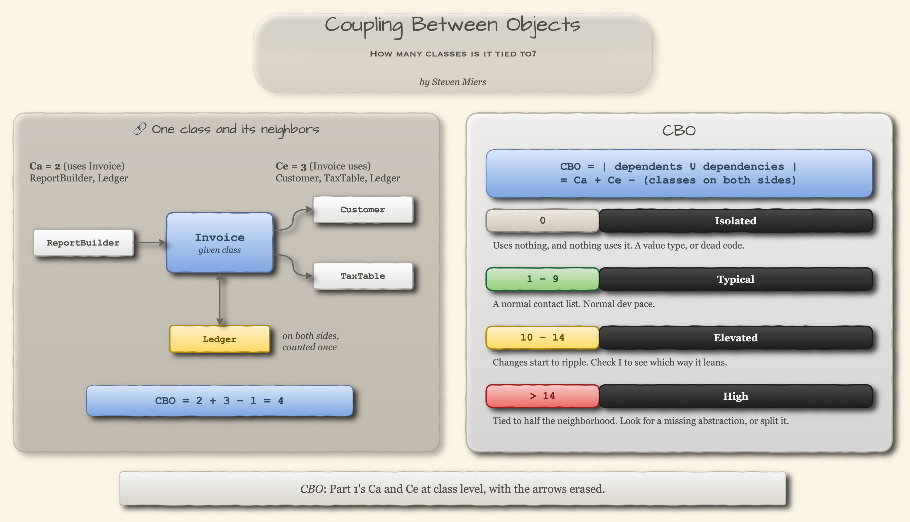

Two things to notice about `Invoice` on the card:
* **CBO says how entangled a class is** (`4`). Part 1's `I` says **which way** it leans (`3 / 5 = 0.6`), which is exactly the part CBO throws away.
* `Ledger` sits on both sides. That overlap is a **cycle**, just at class level. 🔄

### 📖 Reading it

| CBO     | Rating   | Meaning                                                                   | Change Strategy                                |
|---------|----------|---------------------------------------------------------------------------|------------------------------------------------|
| `0`     | Isolated | Uses nothing, and nothing uses it: a standalone value type, or dead code  | _Check that it's actually used_                |
| `1–9`   | Typical  | An ordinary contact list                                                  | _Normal dev pace_                              |
| `10–14` | Elevated | Changes here start to ripple                                              | _Monitor; check `I` to see which way it leans_ |
| `> 14`  | High     | Changes here ripple widely                                                | _Look for a missing abstraction, or a split_   |

* **Threshold:** `9` was fitted on Eclipse by Shatnawi (2010). `14` is expert opinion, from Sahraoui et al. (2000).
* **In human terms:** CBO is the number of other classes you may have to open, understand or retest when you change this one.

### 🔀 Which CBO?

"CBO" isn't one number. Tools count it two ways:

| Variant                         | Counts                       | Who reports it                                  |
|---------------------------------|------------------------------|-------------------------------------------------|
| **Both directions** (used here) | `dependents ∪ dependencies`  | Chidamber & Kemerer's definition; "CBO Modified" in Aniche's CK tool |
| Outgoing only                   | `dependencies`, i.e. `𝐶ₑ`    | ckjm; the CK tool's default                     |

The bands above assume both directions. Outgoing-only counts run lower for heavily used classes, so don't carry a threshold from one tool to another.

### 🛠️ Linters

* **JVM:** CK (Aniche's tool, named after the paper), ckjm
* **.NET:** NDepend, which reports `TypeCa` and `TypeCe` separately
* **Python:** no mainstream class-level tool. Module-level `𝐶ₐ`/`𝐶ₑ` from an import graph (grimp, pydeps) is the practical stand-in.

---

## 🌳 Depth of Inheritance Tree (DIT)

_Zoom level: the **class graph**. How many layers of inherited behavior sit above this class?_

### 🔢 Formula

```text
DIT(c) = 0                                      if c has no parent in your code
       = 1 + max(DIT(p) for each parent p)      otherwise
```

Two choices hide in that definition, and tools make them differently:
* **Does the root count?** Here it doesn't: a class with no parent is `0`, so Python's implicit `object` adds nothing
* **What about multiple inheritance?** Here the **longest path** wins. Some tools count every ancestor instead.

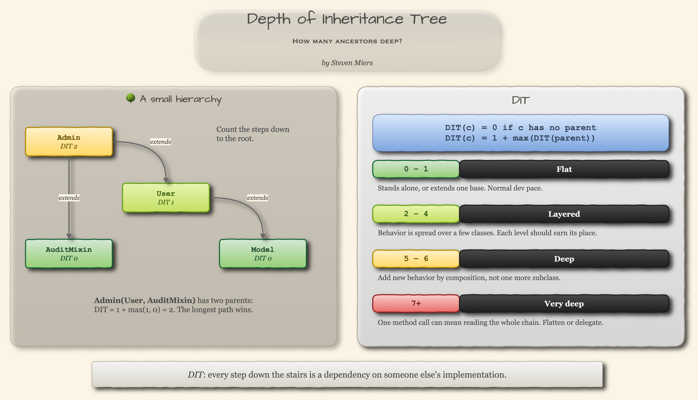

### 📖 Reading it

| DIT   | Rating    | Meaning                                              | Change Strategy                                         |
|-------|-----------|------------------------------------------------------|---------------------------------------------------------|
| `0–1` | Flat      | Stands alone, or extends a single base               | _Normal dev pace_                                       |
| `2–4` | Layered   | Behavior is spread across a few classes              | _Check that each level earns its place_                 |
| `5–6` | Deep      | At the usual vendor limits                           | _Add new behavior by composition, not another subclass_ |
| `7+`  | Very deep | Reading one method can mean reading the whole chain  | _Flatten, or replace inheritance with delegation_       |

* **Threshold:** `5` (Visual Studio) or `6` (NDepend). Both are vendor guidance, not research findings.
* **In human terms:** DIT is roughly how many class definitions you have to read to find out what one method call actually does. Inheriting grandpa's watch is nice. Inheriting his 40 overridden methods, less so.

### 🧲 The tie back to Part 1

* **Inheritance is the strongest efferent dependency there is.** A subclass depends on its parent's _implementation_, not just its interface.
* Inheriting from a concrete class deep in a tree is a dependency on something concrete and stable, a short walk from Part 1's Zone of Pain.
* Frameworks spend the budget before you've written a line: NDepend notes that classes deriving from WinForms `Control` average a DIT of `5.3`.

> Favor object composition over class inheritance. -- _Gamma, Helm, Johnson & Vlissides, "Design Patterns" (1994)_

### 🛠️ Linters

* **Python:** pylint `too-many-ancestors` (R0901), which fires past 7 parent classes by default
* **.NET:** Visual Studio code metrics, NDepend
* **JVM:** CK, ckjm

---

## 🧱 Lack of Cohesion of Methods (LCOM4)

_Zoom level: **one class**. Is it one class, or several sharing a name?_

### 🔢 Formula

Coupling is about the edges **between** classes. Cohesion is about the edges **inside** one. Hitz and Montazeri's LCOM4 builds a little graph for each class and counts the pieces:

```text
nodes  = the class's methods (leave out the constructor)
edges  = two methods share a field, or one calls the other
LCOM4  = number of connected components ("islands")
```

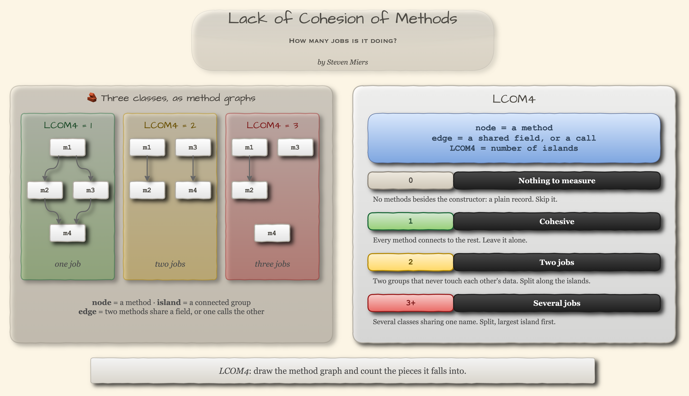

Here it is on a class we've all written, most of us more than once:

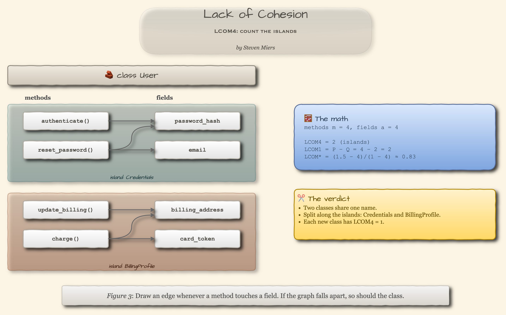

* `User` has two islands: one about credentials, one about billing. They live together like roommates who share a mailbox and nothing else.
* **One call changes the answer.** If `charge()` called `self.authenticate()` first, the islands would merge and LCOM4 would drop to `1`: one method genuinely needs the other.

### 📖 Reading it

| LCOM4 | Rating             | Meaning                                                        | Change Strategy                           |
|-------|--------------------|----------------------------------------------------------------|-------------------------------------------|
| `0`   | Nothing to measure | No methods besides the constructor: a plain record             | _Skip it_                                 |
| `1`   | Cohesive           | Every method connects to the rest, through fields or calls     | _Leave it alone_                          |
| `2`   | Two jobs           | Two groups of methods that never touch each other's data       | _Split along the islands_                 |
| `3+`  | Several jobs       | Several classes sharing one name                               | _Split, starting with the largest island_ |

* **Threshold:** `1`. This one is structural too: a class with more than one island can be split without cutting a single connection.
* **In human terms:** LCOM4 is the number of separate jobs a class is doing. Each extra island is a class waiting to be extracted.
* **Skip the abstract ones.** Interfaces, protocols and abstract bases score high by design, because stubs share no state. Read LCOM4 on concrete classes only.

### 🔀 Which LCOM?

Several different metrics go by the name LCOM. Here are three of them on the `User` class from Fig. 3 (4 methods, 4 fields):

| Variant                                              | Formula                                              | `User`   |
|------------------------------------------------------|------------------------------------------------------|----------|
| Original LCOM (Chidamber & Kemerer; `LCOM1` in Fig. 3) | `P − Q`, floored at 0: method pairs that share no field, minus pairs that do | `2`      |
| LCOM\* (Henderson-Sellers)                           | `(mean methods per field − m) / (1 − m)`             | `0.83`   |
| **LCOM4** (Hitz & Montazeri, used here)              | islands in the method graph                          | **`2`**  |

LCOM4 is the most useful of the three:
* The original's floor at zero hides real splits. Give three methods the field `x` and a fourth only `y`, and `P = 3, Q = 3` reports `0`, "perfectly cohesive", while LCOM4 correctly says `2`.
* LCOM\* is a ratio. It tells you something is off, but not where.
* **LCOM4 hands you the refactoring.** Most metrics say something's wrong. This one draws the dotted line.

### 🛠️ Linters

* **Python:** no maintained tool computes it (the `lcom` package on PyPI had one release, in 2017). A 40-line standard-library version is in the [appendix](#-appendix-lcom4-in-40-lines-of-python).
* **JVM and .NET:** CK and NDepend report the other variants, not LCOM4. SonarQube once computed LCOM4, then dropped it.

---

## 🧮 Cyclomatic Complexity

_Zoom level: **one method**. How many tests does it owe you?_

### 🔢 Formula

Thomas McCabe defined it in 1976 on a method's control-flow graph:

```text
V(G) = E − N + 2P        (edges, nodes and connected components)
     = decisions + 1     (the shortcut, for structured code)
```

```text
V = 1
for each if / elif, for, while, except, case:   V += 1
for each `and` / `or`:                          V += 1
```

* `V(G)` is the number of **independent paths** through the method, which is the minimum number of tests that cover them all
* Tools disagree on whether `and`/`or` count. They count here, as they do in McCabe's paper, radon and lizard.

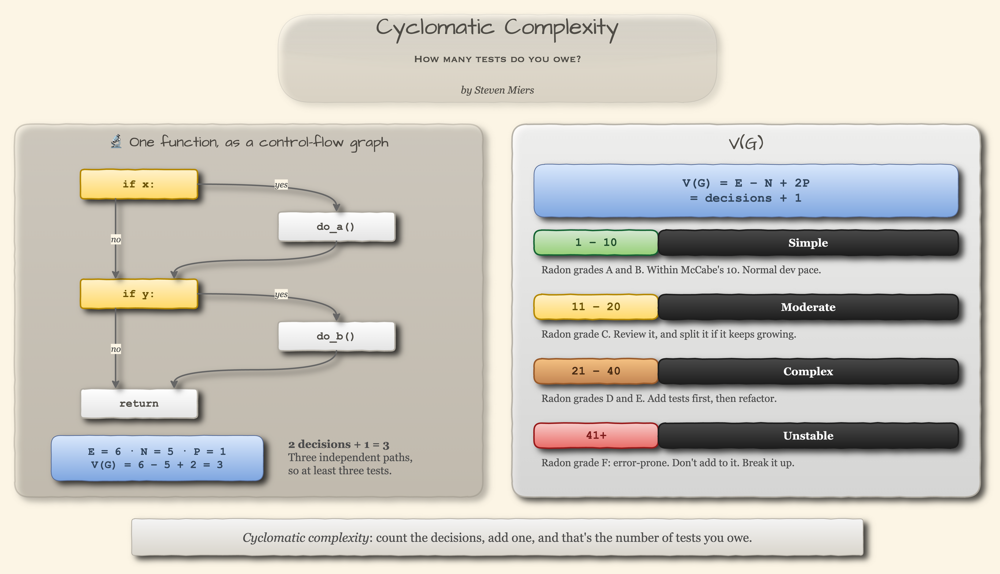

Here's a real function, scored line by line. The `CC` column is cyclomatic; hold on to the `Cog` column for the next section.

```python
def shipping_cost(order: Order | None, rates: RateCard) -> float:
  total: float = 0.0
  if order is not None and order.items:          # CC +2 | Cog +1 (if) +1 (and)
    for item in order.items:                     # CC +1 | Cog +2 (nested once)
      if item.weight > 50 and item.fragile:      # CC +2 | Cog +3 (nested twice) +1 (and)
        total += rates.freight
      elif item.weight > 10:                     # CC +1 | Cog +1
        total += rates.heavy
      else:                                      # CC +0 | Cog +1
        total += rates.standard
    try:
      total = rates.discount(total, order.coupon)
    except KeyError:                             # CC +1 | Cog +2 (nested once)
      pass
  return total
```

Seven decisions plus one: **`V(G) = 8`**.

### 📖 Reading it

| V(G)    | Rating   | Meaning                                                    | Change Strategy                           |
|---------|----------|------------------------------------------------------------|-------------------------------------------|
| `1–10`  | Simple   | Radon grades A and B: low risk, well structured            | _Normal dev pace_                         |
| `11–20` | Moderate | Radon grade C: slightly complex                            | _Review it; split it if it keeps growing_ |
| `21–40` | Complex  | Radon grades D and E: complex, "alarming"                  | _Add tests first, then refactor_          |
| `41+`   | Unstable | Radon grade F: error-prone, unstable                       | _Stop adding to it; break it up_          |

* **Threshold:** `10`, McCabe's own judgment: "a reasonable, but not magical, upper limit." The lines at 20 and 40 are radon's grade boundaries.
* **In human terms:** a function scoring 12 needs at least 12 tests before all its paths are covered. If it has 2, you now know exactly how much you owe.

### 📊 Where to look

Complexity lives in the tail. Here are pip 26.2's internals (1,549 functions), measured with radon:

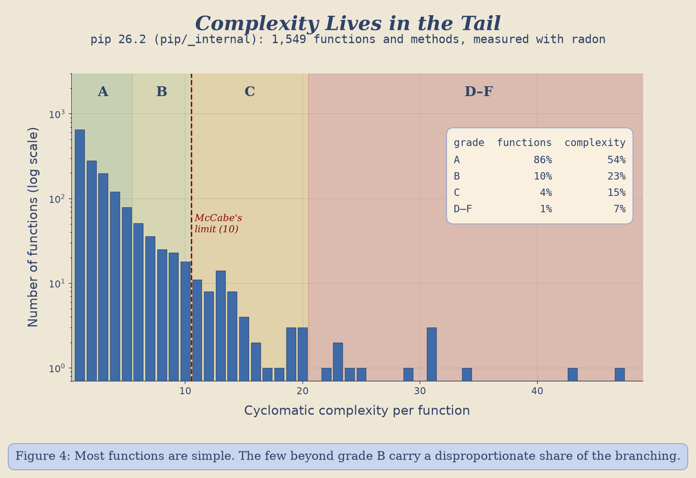

* **86%** of functions get grade A (`V(G) ≤ 5`)
* The **4%** above `10` hold **23%** of all the branching

You don't need to fix the whole codebase. You need to go look at the tail, where the dragons are.

### 🤔 What it misses

* **It's mostly size.** Shepperd (1988) called it "no more than a proxy for, and in many cases is outperformed by, lines of code."
* **It's blind to nesting.** Three `if` statements in a row and three loops nested inside each other both score `4`.

Cyclomatic complexity counts **tests**, not **confusion**. For confusion, see the next metric.

### 🛠️ Linters

* **Python:** ruff `C901` (set `max-complexity = 10`), `radon cc`, flake8's mccabe plugin
* **Any language:** lizard (default limit `15`)
* **JS / TS:** ESLint `complexity` (default limit `20`)
* They don't count alike. The function above scores `8` in radon and lizard, `7` in mccabe and `6` in ruff, so **name the tool along with the number**.

---

## 🧠 Cognitive Complexity

_Zoom level: **one method**. How hard is it to read?_

### 🔢 Formula

SonarSource's metric (G. Ann Campbell) is a set of counting rules, not an equation. Think of it as a bar tab for your brain: every break in the flow adds a round, and the deeper you're nested when you order, the more that round costs.

```text
score = 0
for each break in the flow (if, loop, except, ternary):
    score += 1                  # the break itself
    score += nesting depth      # how deep it sits

each elif / else                    +1   (no nesting charge)
each run of one boolean operator    +1   (a and b and c)
a whole switch / match              +1   (not +1 per case)
try, early return                   free
```

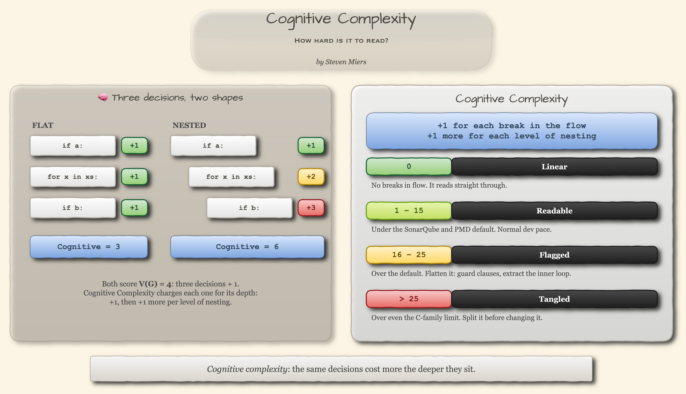

Go back to `shipping_cost` above and add up the `Cog` column: **12**, against a cyclomatic score of 8. Same function, same decisions. The difference is the nesting: the innermost `if` costs `3` here and `1` there.

### 📖 Reading it

| Score   | Rating   | Meaning                                              | Change Strategy                                      |
|---------|----------|------------------------------------------------------|------------------------------------------------------|
| `0`     | Linear   | No breaks in flow; it reads straight through         | _Nothing to do. Enjoy it._                           |
| `1–15`  | Readable | Under the SonarQube and PMD default                  | _Normal dev pace_                                    |
| `16–25` | Flagged  | Over the default limit                               | _Flatten it: guard clauses, extract the inner loop_  |
| `> 25`  | Tangled  | Over even the limit SonarQube allows C and C++       | _Split it before you change it_                      |

* **Threshold:** `15`, and `25` for C, C++ and Objective-C. Both were tuned to cut noise, not derived from data. Campbell's own words: "I guess you're hoping for some scientific formula. I can't give you one."
* **In human terms:** it estimates how much a reader has to hold in their head to follow the function. It's the metric for "I had to read that three times."
* **What backs it:** a 2020 meta-analysis found a correlation of `r = 0.54` with how long people took to understand code. That's understanding, not bugs.

### 🛠️ Linters

* **Any language:** SonarQube rule `S3776`
* **Java:** PMD `CognitiveComplexity`
* **Python:** flake8-cognitive-complexity. Its numbers can drift from the spec (it scores the function above `13`, not `12`).

---

## ⚖️ Weighted Methods per Class (WMC)

_Zoom level: back up to **one class**. How much logic lives in it?_

### 🔢 Formula

```text
WMC(c) = Σ weight(m)    over every method m in c

weight(m) = V(G)    →  the class's total cyclomatic complexity    (used here)
weight(m) = 1       →  just the number of methods
```

Chidamber and Kemerer left the weight undefined on purpose, so tools fill it in however they like. Two "WMC" numbers from two tools can be two different metrics wearing the same name tag.

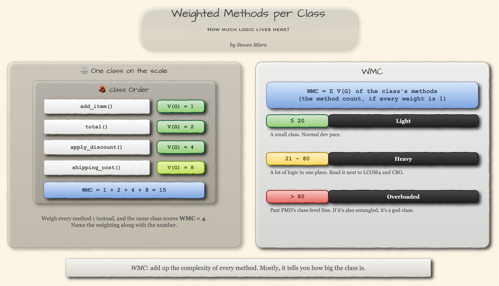

### 📖 Reading it

| WMC     | Rating     | Meaning                                           | Change Strategy                            |
|---------|------------|---------------------------------------------------|--------------------------------------------|
| `≤ 20`  | Light      | A small class                                     | _Normal dev pace_                          |
| `21–80` | Heavy      | A lot of logic in one place; usually a big class  | _Check LCOM4 and CBO before acting on it_  |
| `> 80`  | Overloaded | Past PMD's class-level report line                | _Split it, along the LCOM4 islands_        |

* **Threshold:** `20` was fitted on Eclipse by Shatnawi (2010). `80` is PMD's default for a class's total cyclomatic complexity.
* **In human terms:** WMC is the bathroom scale of class metrics. It mostly tells you how big the class is (El Emam et al. found it tracks lines of code at `ρ = 0.88`), and it won't tell you whether that's muscle or doughnuts. Read it next to CBO and LCOM4, never alone.

### 🛠️ Linters

* **Java:** PMD `CyclomaticComplexity` (class total), ckjm (which weighs every method `1`)
* **Python:** nothing reports WMC by name. `radon cc` lists `V(G)` for every method, so sum them per class.

---

## 🗺️ Putting It Together: The Class Map

Part 1 plotted packages on `A` vs `I`. At class level, the useful picture is **size** (WMC) against **entanglement** (CBO), with cohesion (LCOM4) as bubble size:

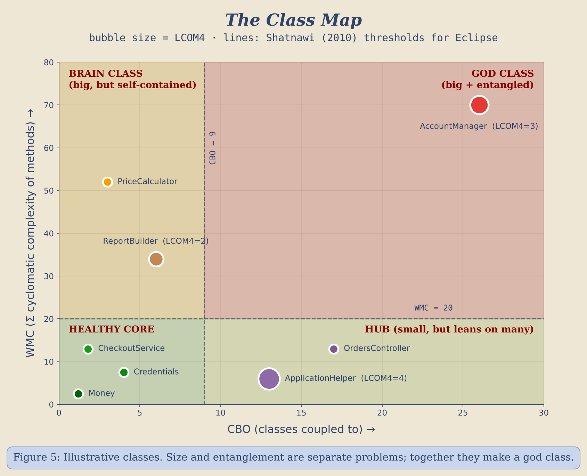

| Zone          | Meaning                       | Typical move                                         |
|---------------|-------------------------------|------------------------------------------------------|
| Healthy core  | Small, loosely coupled         | Leave it alone. Seriously.                           |
| Brain class   | Big, but self-contained        | Extract methods; watch Cognitive Complexity          |
| Hub           | Small, but leans on many       | Check `I`: is it pointing toward stability?          |
| God class     | Big **and** entangled          | Split along the LCOM4 islands first                  |

The lines are CBO `9` and WMC `20`. Treat them as a starting point. Your own codebase's baseline is a better line than anything fitted on Eclipse in 2010.

---

## 📏 Where the Thresholds Come From

| Threshold                 | Origin                                              | Kind                   |
|---------------------------|-----------------------------------------------------|------------------------|
| Largest SCC = 1           | The Acyclic Dependencies Principle                   | **Structural**         |
| LCOM4 = 1                 | The definition: more than one island can be split    | **Structural**         |
| CBO 9, WMC 20             | Shatnawi (2010), Eclipse only                        | Empirical, one system  |
| CBO 14                    | Sahraoui et al. (2000)                               | Expert opinion         |
| `V(G)` 10                 | McCabe: "reasonable, but not magical"                | Practitioner judgment  |
| `V(G)` 20 and 40          | radon's grade boundaries                             | Tool convention        |
| Cognitive 15 and 25       | SonarQube defaults, raised from 10 until quiet       | Tuned for noise        |
| DIT 5 or 6, WMC 80        | Visual Studio, NDepend and PMD defaults              | Vendor guidance        |
| Every other band edge     | Drawn for this article, between the sourced numbers  | Judgment               |

Most of these numbers were chosen the way you choose a thermostat setting: somebody tried a few, and one felt right. The two that hold up best aren't statistical at all. **Zero cycles** and **one island** follow from what the graph means.

Two findings keep the rest humble:
* Once class size is controlled for, El Emam et al. found that the class metrics' link to faults disappears. Big classes have more of everything.
* Radjenović's review found that **process metrics** (churn, who touched what, how often) seem to predict post-release faults better than any static code metric.

So use these numbers as a **flashlight**, not a **verdict**:
* Name the tool alongside the number
* Ratchet against your own baseline, not someone else's blog post (yes, including this one)
* Gate on the structural ones; investigate the statistical ones

## 🚦 Gates and Goals

That last bullet is the whole CI strategy:
* **Gates** (a change isn't finished until they pass): tests, zero package cycles, `V(G) ≤ 10`
* **Goals** (don't make them worse, and say so when you do): LCOM4 = 1 on concrete classes, nothing new in the complexity tail, CBO and WMC no worse than the baseline

```ini
# .importlinter: the cycle gate
[importlinter]
root_package = shop

[importlinter:contract:no-package-cycles]
name = Packages under shop form a DAG
type = acyclic_siblings
ancestors =
    shop
```

```toml
# pyproject.toml: the complexity gate
[tool.ruff.lint]
extend-select = ["C901"]

[tool.ruff.lint.mccabe]
max-complexity = 10
```

```bash
lint-imports                        # gate: fails on any package cycle
ruff check .                        # gate: fails past V(G) 10
radon cc -s -n C src/               # goal: list the complexity tail
python lcom4.py src/app/models.py   # goal: cohesion of concrete classes
```

### 🤖 The same list, for AI assistants

An AI coding assistant's idea of "done" is whatever we tell it "done" means. Tell it "the tests pass" and that's what you'll get: working code, with nothing to stop the one import that closes a loop. So hand it the same two lists, in the instructions file it reads (`AGENTS.md`, `CLAUDE.md`, or whatever your tool calls it):

```markdown
## Definition of done
Gates (all must pass before a change is finished):
- `pytest`
- `ruff check .` (C901 is on, max complexity 10)
- `lint-imports` (no package cycles)

Goals (don't make these worse; call it out if you have to):
- `radon cc -s -n C src/`: no new functions at grade C or worse
- `python lcom4.py <file>`: concrete classes you touch stay at LCOM4 = 1
- Interfaces live with the code that uses them, not the code that implements them
```

The assistant can run every one of those commands itself, so it can check its own work before a human ever sees it.

## 🗝 Key Takeaways

* Every metric here is **counting on a graph** 🕸️: loops in the package graph, neighbors in the class graph, islands inside a class, paths inside a method.
* **Cycles come first.** Inside a loop, Part 1's `I` and `D` stop describing anything real 🔄.
* **CBO** is `𝐶ₐ` plus `𝐶ₑ` with the arrows erased. Use `I` to get the direction back 🧭.
* **DIT**: every level of inheritance is a dependency on someone else's implementation 🌳.
* **LCOM4** is the rare metric that hands you the refactoring. Split along the islands ✂️.
* **Cyclomatic complexity** counts tests. **Cognitive complexity** counts confusion 🧠.
* **WMC** is mostly class size. Read it next to CBO and LCOM4, never alone ⚖️.
* Most thresholds are **somebody's educated guess**. The structural ones (zero cycles, one island) are the ones to gate on 🚦.

The shape of the system changes. The math still doesn't. And the math, thankfully, is still mostly counting.

## 📎 Appendix: LCOM4 in 40 Lines of Python

No maintained Python tool computes LCOM4, so here's one using only the standard library. The sample run is on an `Order` class whose methods split into pricing (`add_item`, `total`, `apply_discount`) and receipts (`send_receipt`, `email_domain`):

```python
from __future__ import annotations

import ast
import sys
from dataclasses import dataclass


@dataclass(frozen=True)
class Lcom4:
  """LCOM4 (Hitz & Montazeri, 1995): the number of connected components in a class's method graph."""

  cls: ast.ClassDef

  def methods(self) -> dict[str, ast.FunctionDef | ast.AsyncFunctionDef]:
    """Methods with a receiver (``self``/``cls``), minus ``__init__``, which touches every field."""
    return {node.name: node for node in self.cls.body
            if isinstance(node, (ast.FunctionDef, ast.AsyncFunctionDef)) and node.name != "__init__"
            and node.args.args and not any(getattr(d, "id", None) == "staticmethod" for d in node.decorator_list)}

  @staticmethod
  def touches(method: ast.FunctionDef | ast.AsyncFunctionDef) -> set[str]:
    """Every ``self.<name>`` (or ``cls.<name>``) a method reads, writes or calls."""
    receiver: str = method.args.args[0].arg
    return {node.attr for node in ast.walk(method)
            if isinstance(node, ast.Attribute) and isinstance(node.value, ast.Name) and node.value.id == receiver}

  def islands(self) -> list[set[str]]:
    """Group methods that share a field or call one another."""
    methods: dict[str, ast.FunctionDef | ast.AsyncFunctionDef] = self.methods()
    groups: list[set[str]] = []
    for name, method in methods.items():
      # A method's reach is itself plus every field and method it touches; overlapping reaches merge.
      reach: set[str] = self.touches(method) | {name}
      groups = [g for g in groups if not g & reach] + [reach.union(*(g for g in groups if g & reach))]
    return [g & methods.keys() for g in groups]


class Lcom4Report:
  """Command line: print LCOM4 for every class in a Python file."""

  @staticmethod
  def run(path: str) -> None:
    """Parse ``path`` and report each class's islands."""
    with open(path) as fh:
      tree: ast.Module = ast.parse(fh.read())
    for cls in (node for node in ast.walk(tree) if isinstance(node, ast.ClassDef)):
      islands: list[set[str]] = Lcom4(cls).islands()
      print(f"{cls.name}: LCOM4 = {len(islands)}  {[sorted(i) for i in islands]}")


if __name__ == "__main__":
  Lcom4Report.run(sys.argv[1])
```

```text
$ python lcom4.py order.py
Order: LCOM4 = 2  [['add_item', 'apply_discount', 'total'], ['email_domain', 'send_receipt']]
```

## 📚 References

- Martin, R. C. (1996). "Granularity." *C++ Report*, Engineering Notebook column. [PDF](https://staff.cs.utu.fi/~jounsmed/doos_06/material/Granularity.pdf)
- Martin, R. C. (2000). *Design Principles and Design Patterns.* [PDF](https://staff.cs.utu.fi/~jounsmed/doos_06/material/DesignPrinciplesAndPatterns.pdf)
- Tarjan, R. (1972). "Depth-First Search and Linear Graph Algorithms." *SIAM Journal on Computing*, 1(2). [doi:10.1137/0201010](https://doi.org/10.1137/0201010)
- hello2morrow (2025). "Designing a metric to detect big balls of mud." [Blog](https://blog.hello2morrow.com/2025/06/designing-a-metric-to-detect-big-balls-of-mud/)
- *The Go Programming Language Specification*, "Import declarations." [Spec](https://go.dev/ref/spec#Import_declarations)
- Chidamber, S. R. & Kemerer, C. F. (1994). "A Metrics Suite for Object Oriented Design." *IEEE TSE*, 20(6). [doi:10.1109/32.295895](https://doi.org/10.1109/32.295895)
- Hitz, M. & Montazeri, B. (1995). "Measuring Coupling and Cohesion in Object-Oriented Systems." *Proc. Int. Symposium on Applied Corporate Computing.*
- Henderson-Sellers, B. (1996). *Object-Oriented Metrics: Measures of Complexity.* Prentice Hall.
- Briand, L. C., Daly, J. W., & Wüst, J. K. (1998). "A Unified Framework for Cohesion Measurement in Object-Oriented Systems." *Empirical Software Engineering*, 3(1).
- El Emam, K., Benlarbi, S., Goel, N., & Rai, S. N. (2001). "The Confounding Effect of Class Size on the Validity of Object-Oriented Metrics." *IEEE TSE*, 27(7). [doi:10.1109/32.935855](https://doi.org/10.1109/32.935855)
- Radjenović, D., Heričko, M., Torkar, R., & Živkovič, A. (2013). "Software fault prediction metrics: A systematic literature review." *Information and Software Technology*, 55(8). [doi:10.1016/j.infsof.2013.02.009](https://doi.org/10.1016/j.infsof.2013.02.009)
- Shatnawi, R. (2010). "A Quantitative Investigation of the Acceptable Risk Levels of Object-Oriented Metrics in Open-Source Systems." *IEEE TSE*, 36(2).
- Aivosto. "Chidamber & Kemerer object-oriented metrics suite." Project Analyzer help. [Docs](https://www.aivosto.com/project/help/pm-oo-ck.html) (source for the Sahraoui et al. CBO > 14 and Visual Studio DIT 5 values)
- SonarSource Community. "How to measure class coupling metric with SonarQube." [Thread](https://community.sonarsource.com/t/how-to-measure-class-coupling-metric-with-sonarqube/2801)
- McCabe, T. J. (1976). "A Complexity Measure." *IEEE TSE*, SE-2(4). [PDF](http://www.literateprogramming.com/mccabe.pdf)
- Shepperd, M. (1988). "A critique of cyclomatic complexity as a software metric." *Software Engineering Journal*, 3(2). [doi:10.1049/sej.1988.0003](https://doi.org/10.1049/sej.1988.0003)
- Campbell, G. A. (2023). *Cognitive Complexity: A new way of measuring understandability.* SonarSource. [PDF](https://www.sonarsource.com/docs/CognitiveComplexity.pdf)
- Campbell, G. A. (2024). Answer on the S3776 default threshold. SonarSource Community. [Thread](https://community.sonarsource.com/t/s3776-reason-for-the-current-default-value-of-15/127103)
- Muñoz Barón, M., Wyrich, M., & Wagner, S. (2020). "An Empirical Validation of Cognitive Complexity as a Measure of Source Code Understandability." *ESEM.* [arXiv:2007.12520](https://arxiv.org/abs/2007.12520)
- Gamma, E., Helm, R., Johnson, R., & Vlissides, J. (1994). *Design Patterns: Elements of Reusable Object-Oriented Software.* Addison-Wesley.
- NDepend. "Code Metrics." [Docs](https://www.ndepend.com/docs/code-metrics)
- PMD. "Java design rules." [Docs](https://pmd.github.io/pmd/pmd_rules_java_design.html)
- Tools: [import-linter](https://import-linter.readthedocs.io/en/stable/contract_types/), [grimp](https://github.com/python-grimp/grimp), [pydeps](https://github.com/thebjorn/pydeps), [radon](https://radon.readthedocs.io/), [mccabe](https://github.com/PyCQA/mccabe), [lizard](https://github.com/terryyin/lizard), [ruff C901](https://docs.astral.sh/ruff/rules/complex-structure/), [pylint R0901](https://pylint.readthedocs.io/en/stable/user_guide/messages/refactor/too-many-ancestors.html), [lcom](https://pypi.org/project/lcom/), [CK](https://github.com/mauricioaniche/ck), [ckjm](https://www.spinellis.gr/sw/ckjm/doc/metric.html), [ArchUnit](https://www.archunit.org/userguide/html/000_Index.html), [madge](https://github.com/pahen/madge), [dependency-cruiser](https://github.com/sverweij/dependency-cruiser)
