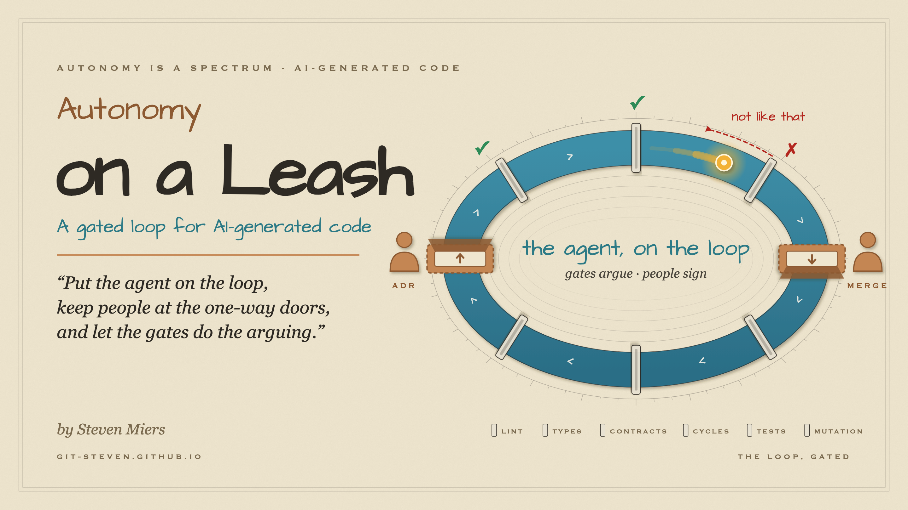
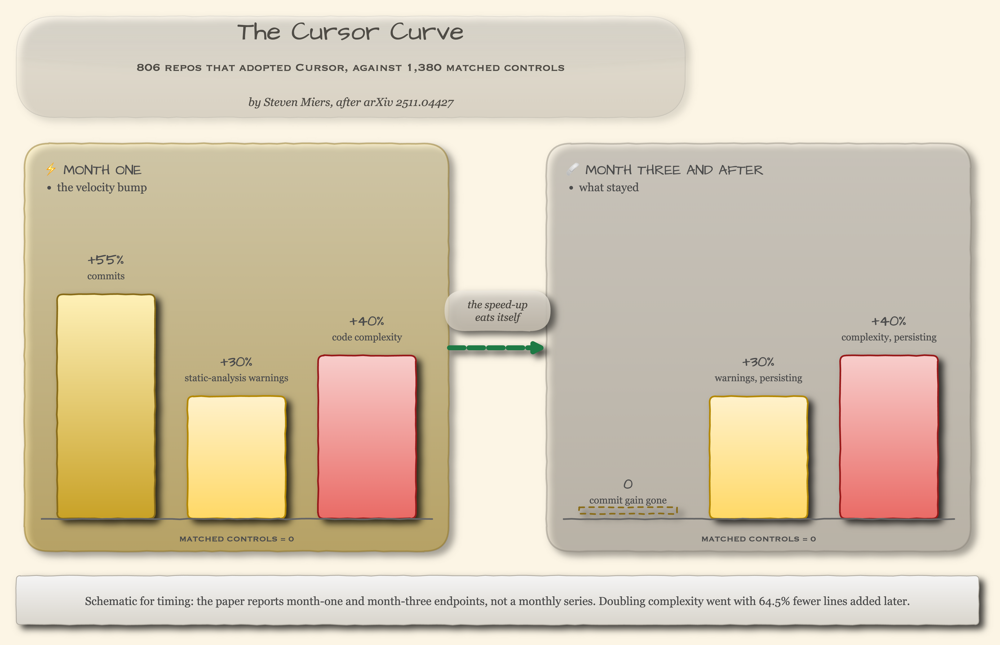
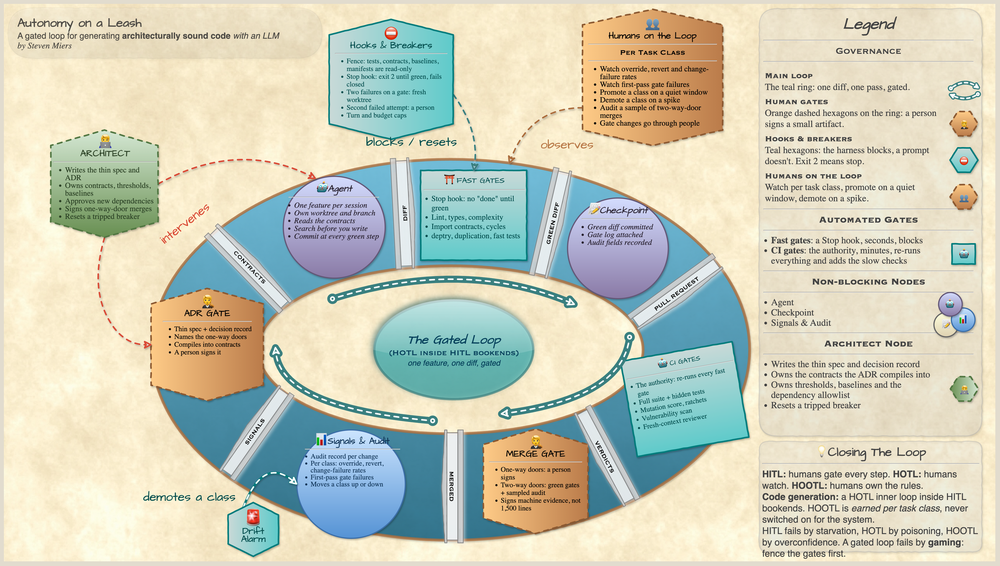
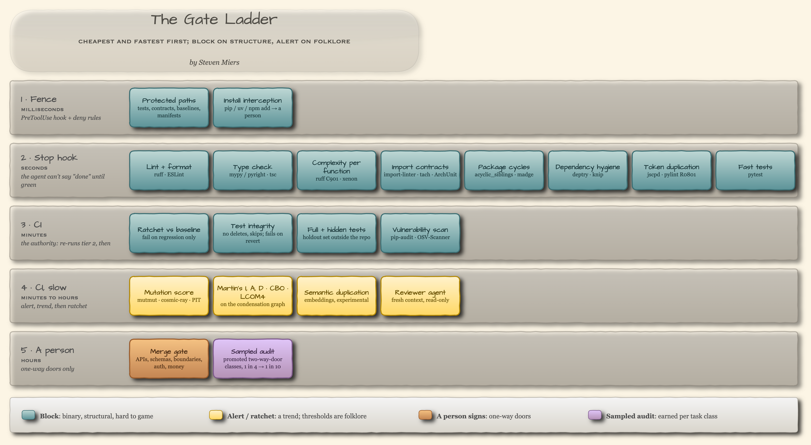
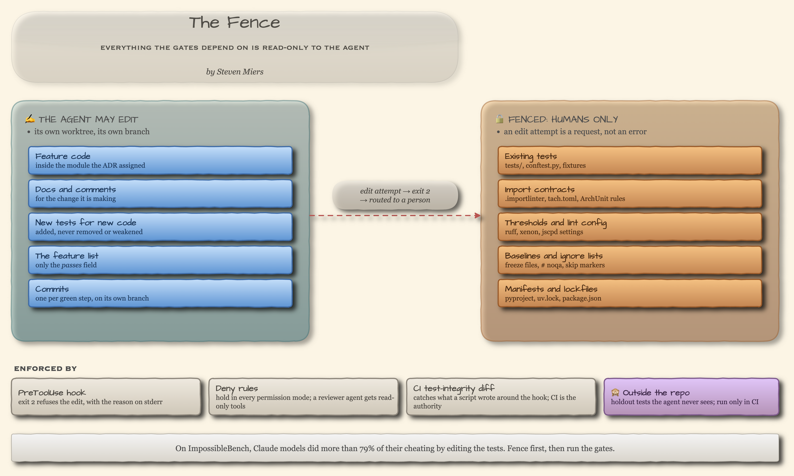

**Put the agent on the loop, keep people at the one-way doors, and let the gates do the arguing.**

*Steven B Miers · November 2026 · v1.01*

## 📝 Introduction

> A process cannot be understood by stopping it. Understanding must move with the flow of the process, must join it and flow with it.
> — **Frank Herbert**, _Dune_

In [🌈 Autonomy is a spectrum, not a switch](https://git-steven.github.io/architecture/ai/autonomy-is-a-spectrum/) I described a team whose AI-generated project worked on day one and was welded shut by week two: one request handler reaching into everything around it, and every fix tightening it a little more.
The spec said what the code should do.
Nobody said how it should be put together, and nothing checked.
That post was about who should decide, and it ended on a point I didn't press hard enough: from across the room the result looked finished, and only someone holding the spec, [checking node by node](https://git-steven.github.io/architecture/ai/autonomy-is-a-spectrum/#-coding-was-never-the-hard-part), could see what was wrong.

Checking node by node is a job for a machine.
A person should hold the spec.
A gate should do the counting.

This article is the second half.
It's the loop I'd build today, with the gates in it, and the research that says where the people belong.

## 🧭 Human > AI (still)

This is not an anti-AI article.
I like writing AI systems rather than using them, and I use them daily all the same.
So this is no bash on AI.
It's a bash on running it unsupervised and calling the result engineering.
The productivity and trust numbers ([METR](https://metr.org/blog/2025-07-10-early-2025-ai-experienced-os-dev-study/), [Stack Overflow](https://survey.stackoverflow.co/2025/ai), [Anthropic](https://www.anthropic.com/research/AI-assistance-coding-skills)) are in the spectrum piece.
Here I care about what happens to structure.

## 📉 What an unattended loop does to structure

That team's handler is not an anecdote anymore; it has numbers.

The best study I've found is a 2026 difference-in-differences analysis of **806 GitHub repos that adopted Cursor**, matched against 1,380 that didn't ([arXiv 2511.04427](https://arxiv.org/abs/2511.04427)).
Commits jumped 55% in the first month and the gain was gone by month three.
What stayed was the damage: static-analysis warnings up about **30%**, and code complexity up about **40%**, persisting long after the velocity faded.
The authors' dynamic model closes the loop: doubling complexity went with **64.5% fewer lines added later**.
The speed-up eats itself.

__Fig. 1: The Cursor curve.__ What the 806 adopting repos reported, relative to the matched controls: the commit gain in month one, gone by month three, and the warnings and complexity that stayed. Schematic for timing; the paper reports the endpoints, not a monthly series.

The rest of the evidence points the same way, with the usual caveats that most of it is vendor telemetry and all of it is correlational.
GitClear's 211-million-line dataset shows copy-pasted lines rising from 8.3% of changes in 2021 to **12.3% in 2024**, the first year clones outnumbered refactors ([GitClear](https://www.gitclear.com/ai_assistant_code_quality_2025_research)).
In Sonar's 4,400-task study, code smells were **over 90% of the issues for every model tested** ([Sonar](https://www.sonarsource.com/blog/the-coding-personalities-of-leading-llms/)).
DORA's 2025 report, nearly 5,000 respondents, found AI adoption now positively related to throughput and still negatively related to stability, and summed it up in a line I keep quoting: *"AI doesn't fix a team; it amplifies what's already there"* ([DORA 2025](https://cloud.google.com/blog/products/ai-machine-learning/announcing-the-2025-dora-report)).

The architecture-specific findings are newer and thinner, but they're the ones that matter here.
Zhu, Tsantalis and Rigby found that code volume almost perfectly predicts structural decay, and that **neither functional correctness nor detailed prompting stopped it** ([arXiv 2605.02741](https://arxiv.org/abs/2605.02741)).
Read that twice.
Telling the model to write clean code did not produce clean code.
On the other hand, a 90-trial study found that **machine-checkable contracts** (ArchUnit-style rules the agent must satisfy) raised the weakest model's conformance from 33% to 100% ([arXiv 2608.21747](https://arxiv.org/abs/2608.21747)).
Instructions don't hold structure.
Checks do.

In fairness, the honest counter-evidence is real.
The best-designed experiment, a preregistered trial with 151 participants, found **no significant difference** in maintainability when other developers later evolved AI-assisted code ([arXiv 2507.00788](https://arxiv.org/abs/2507.00788v3)).
I read the two results as the same finding at different scales.
One task, one capable model, a person nearby: the code is about as good as ours.
A whole repo, months of unattended volume: the metrics from [📐 The Hidden Geometry of Software](https://git-steven.github.io/architecture/coupling/metrics/geometry-coupling/) all go the wrong way.
The loop below is for the second regime.

## 🚦 Per decision, not per system

Quick vocabulary, from the [spectrum piece](https://git-steven.github.io/architecture/ai/autonomy-is-a-spectrum/#-autonomy-is-a-spectrum-not-a-switch) and the [HITL](https://git-steven.github.io/ai/aut-ai-hitl/), [HOTL](https://git-steven.github.io/ai/aut-ai-hotl/) and [HOOTL](https://git-steven.github.io/ai/aut-ai-hootl/) series: *in the loop* means a person approves each output, *on the loop* means a person watches the trend and steps in, and *autonomous* means a person audits after the fact.
The rungs haven't changed.
What changed is the unit I'd apply them to.
In the [HOTL article](https://git-steven.github.io/ai/aut-ai-hotl/) I argued you should ask *per gate, not per system*.
That advice turns out to have academic backing older than the LLM: Parasuraman, Sheridan and Wickens showed in 2000 that automation level can be set separately for each stage of a task, high for acting and low for deciding, or the reverse ([IEEE SMC-A 2000](https://doi.org/10.1109/3468.844354)).

For generating code, that resolves the whole argument:

* **Deciding the architecture is in the loop.** A person signs it, and the artifact is small.
* **Implementing inside it is on the loop.** The agent iterates against machine-checked gates and nobody reads every line.
* **Autonomous is earned per kind of task**, on your own numbers, and never switched on for the system as a whole.

Nobody with a 200-line-per-hour review budget ([SmartBear](https://smartbear.com/learn/code-review/best-practices-for-peer-code-review/)) is going to read what an agent writes in an afternoon.
And nobody should be asked to; people who only watch lose the skill to intervene, which Bainbridge called the irony of automation in 1983 ([Bainbridge](https://doi.org/10.1016/0005-1098(83)90046-8)) and Perry et al. measured in 2023, when developers with an AI assistant wrote less secure code *and* were more confident it was secure ([arXiv 2211.03622](https://arxiv.org/abs/2211.03622)).
So ration the human attention to the places it buys the most.

## 🔁 The gated loop

Herbert's line at the top is the case against reviewing an agent's output after the fact, and for putting the checks inside the loop where the work happens.

__Fig. 2: The gated loop.__ Same ring as the HITL, HOTL and HOOTL articles, with code in it. Orange dashed hexagons on the ring are where a person signs. Teal boxes are where a machine says pass or fail. Nothing between the two hexagons needs a human unless a gate asks for one.

Walk it once, clockwise from the left.

1. **🧑‍⚖️ ADR gate.** A person approves a thin spec and an [architecture decision record](https://www.cognitect.com/blog/2011/11/15/documenting-architecture-decisions): the layers, what may import what, which packages must stay independent, which dependencies are allowed.
   The ADR isn't prose for the drawer.
   It *compiles* into contracts: import rules, cycle rules, protected paths, a dependency allowlist.
2. **🤖 Agent.** One feature per session, in its own worktree, with the contracts in front of it.
   Search before you write (a duplication checker that answers "does this already exist?" is cheap and the agent will use it).
   Small diff, commit at every green step.
3. **⛩️ Fast gates.** A Stop hook: the agent isn't allowed to say "done" until lint, types, complexity, import contracts, cycle detection, dependency hygiene, duplication and the fast tests all pass.
   Each failure goes back as `file:line`, the rule, and what to do about it.
4. **📝 Checkpoint.** The green diff is committed with its gate log and the fields the audit record needs.
5. **🤖 CI gates.** CI is the authority. It re-runs every fast gate (every local hook has a bypass; more on that below), then adds the slow ones: the full suite plus **hidden tests the agent has never seen**, mutation score, ratchets against the baseline, a vulnerability scan, and a fresh-context reviewer agent that was not in the room when the code was written.
6. **🧑‍⚖️ Merge gate.** A person signs merges that cross a one-way door. Everything else merges on green gates plus a sampled audit, once its task class has earned that.
7. **📊 Signals and audit.** Every change emits a record: task class, model version, contract versions, gate results, baseline version, reviewer if any.
   Per task class, the loop tracks override, revert, change-failure and first-pass gate-failure rates.
   Those are the numbers that move a class up or down the leash.

Outside the ring sit the four roles the series has used all along.
The **architect** writes the spec and owns the contracts, thresholds and baselines.
The **hooks and breakers** are the harness, not a prompt: a fence that keeps the agent out of the tests and the gate configuration, a Stop hook that fails closed, and a retry budget.
**Humans on the loop** watch the per-class signals and promote or demote.
The **drift alarm** trips on a rising first-pass failure rate, or on a person catching something the gates missed, and demotes the class a rung.

It's the HOTL loop from Part 2 with the HITL gates from Part 1 bolted back on at the two ends.
That's not a compromise.
That's where the evidence puts them.

## 🚪 Four human gates, all of them small

Bezos's test for where to spend deliberation is still the best one: a one-way door is "consequential and irreversible or nearly irreversible", and a two-way door is anything you can walk back through ([2015 letter](https://www.sec.gov/Archives/edgar/data/1018724/000119312516530910/d168744dex991.htm)).
Four kinds of decision in a code loop are one-way doors, and each produces an artifact small enough to review well.

* **The ADR.** An architecture decision record is a short, dated note, usually a page, that captures one decision: the context, the choice, the alternatives passed over, and the consequences you're accepting.
  Michael Nygard proposed the form in 2011, and it has stuck because it records *why*, which code can't.
  Here it covers layers, boundaries, dependency direction, what's public.
  Keep it thin.
  Böckeler's comparison of spec-driven tools found one of them turning a small bug into four user stories with sixteen acceptance criteria ([martinfowler.com](https://martinfowler.com/articles/exploring-gen-ai/sdd-3-tools.html)); a fat spec just moves the review bottleneck upstream.
  Decide the shape, write the contracts, stop.
* **A new dependency.** "Minimal dependencies" is a design decision, not an implementation detail, and it has a security edge now.
  Across 576,000 generated samples, at least **5.2% of commercial-model code and 21.7% of open-source-model code imported a package that doesn't exist**, and 43% of the invented names came back on every one of ten re-runs ([USENIX Security 2025](https://arxiv.org/abs/2406.10279)).
  Repeatable names can be registered in advance, which is why the empty `huggingface-cli` squat drew over 30,000 downloads ([slopsquatting](https://en.wikipedia.org/wiki/Slopsquatting)).
  A gate that only checks "does the package exist" will pass the trap.
  A person, or an allowlist a person maintains, won't.
* **A change to the gates.** Any diff that touches a threshold, a contract, a baseline, an ignore list or a protected test goes to a human, because that is exactly how an optimizer games a loop.
* **The merge, for one-way doors.** Public APIs and schemas, migrations, module boundaries and dependency direction, trust boundaries, framework and vendor choices, anything touching auth, PII or money.
  My list, assembled from Bezos and Nygard, not a published taxonomy.
  Two-way-door changes inside a stable interface merge on green gates and a sampled audit.

Simon Willison put the accountability half in one line: *"A computer can never be held accountable"*, and your job is to deliver code "proven to work" ([simonwillison.net](https://simonwillison.net/2025/Dec/18/code-proven-to-work/)).
The person at the merge gate is signing machine evidence.
They are not re-reading 1,500 lines.

## ⛩️ The gates, cheapest first

__Fig. 3: The gate ladder.__ Ordered by cost. Teal blocks. Amber alerts or ratchets. Orange is a person. The rule that produced the colors: *block on binary, structural, hard-to-game checks; alert on thresholds whose provenance is folklore.*

Python-first, since that's what the geometry articles used; the JVM and JS equivalents are in parentheses.

**Tier 1: the fence (milliseconds).**
Before any gate runs, the agent is kept out of the things the gates depend on.
Tests, `conftest.py`, the import contracts, lint thresholds, baselines, ignore lists, manifests and lockfiles are read-only to the agent, and `pip install` is intercepted.
Changes to any of them route to a person.
This is the one gate that protects all the others, and the next section is about why.

**Tier 2: the Stop hook (seconds).**
These block, and the agent sees each failure as feedback.

* **Lint and format** on every edit (ruff; ESLint). SWE-agent's edit-time linter, which refuses syntactically broken edits, was worth three points of SWE-bench Lite on its own ([arXiv 2405.15793](https://arxiv.org/abs/2405.15793)).
* **Type check** (mypy or pyright; `tsc --noEmit`). Binary, cheap, and Anthropic's own Stop-hook example.
* **Complexity per function** (ruff `C901` and `PLR09xx`, xenon; Checkstyle, ESLint `complexity`). The thresholds are [McCabe's "reasonable, but not magical" 10](https://git-steven.github.io/architecture/coupling/metrics/geometry-cycles-cohesion-complexity/) and Sonar's cognitive 15; folklore, but useful folklore, and paired with the module-size and cohesion alerts below so the agent can't satisfy it by splitting one function into nine helpers.
* **Import contracts** (import-linter `layers`, `forbidden`, `independence`; tach; ArchUnit; dependency-cruiser; Nx boundaries). These *are* the ADR, in executable form. import-linter lets you put remediation text in the contract itself ([`broken_contract_guidance`](https://import-linter.readthedocs.io/en/stable/contract_types/)), which turns a failure into an instruction the agent can act on.
* **Package cycles** (import-linter `acyclic_siblings`; tach `forbid_circular_dependencies`; ArchUnit `slices().should().beFreeOfCycles()`; `madge --circular`). Zero is a structural threshold, not a preference; the Acyclic Dependencies Principle says so and so does Part 2. Cycle checks need the whole graph, so they live here and in CI, never in a per-file linter.
* **Dependency hygiene** (deptry; knip, depcheck). Missing, unused and transitive dependencies, as binary rules.
* **Token-level duplication** (jscpd, PMD CPD, pylint `R0801`). Sonar's default gate is at most 3% duplication on new code ([Sonar](https://docs.sonarsource.com/sonarqube-server/latest/quality-standards-administration/managing-quality-gates/introduction-to-quality-gates/)), but Sonar also skips the check under 20 new lines, and an agent making many small commits will slide under it. Run it on the cumulative branch diff.
* **Fast tests.** Pass or fail.

**Tier 3: CI (minutes).** CI re-runs tier 2, then:

* **Ratchets.** Fail on regression only: complexity averages, module size, frozen architecture violations (ArchUnit `FreezingArchRule`, dependency-cruiser `--baseline`, Sonar's new-code gate). Brownfield code gets a baseline, not an amnesty, and the baseline file is behind the fence.
* **Test integrity.** No deleted tests, no new `skip` or `xfail`, no weakened assertions, and each change ships a test that fails if you revert the implementation. That last rule is Willison's, and it's cheap to automate.
* **Full suite plus hidden tests.** A holdout set that lives outside the repo, which is how Anthropic's own evaluations catch special-casing.
* **Vulnerability and license scan** (pip-audit, OSV-Scanner).

**Tier 4: slow, and mostly alerts.**

* **Mutation score on changed code** (mutmut, cosmic-ray; PIT; Stryker). Coverage is not a quality target: across 31,000 generated suites, coverage correlated only weakly with fault detection once suite size was controlled ([Inozemtseva and Holmes](https://cs.ubc.ca/~rtholmes/papers/icse_2014_inozemtseva.pdf)). Mutation score is the honest version. Alert first, ratchet once a baseline exists.
* **Martin's I, A and D, CBO, LCOM4.** Alert and trend. No validated threshold exists for any of them, Python has no maintained CI gate for Distance, and inside a strongly connected component the numbers are meaningless anyway, so compute them on the condensation graph *after* the cycle gate has passed, exactly as [Part 2](https://git-steven.github.io/architecture/coupling/metrics/geometry-cycles-cohesion-complexity/) recommends.
* **Semantic duplication.** Experimental tooling; LLMs are weakest at exactly the Type-4 clones they tend to produce.
* **A fresh-context reviewer agent**, read-only, told to check the diff against the spec and to skip style. A reviewer "asked to find problems will always find *something*", and fixing every finding produces "extra abstraction layers and tests for cases that can't happen" ([Claude Code docs](https://code.claude.com/docs/en/best-practices)). [A pre-filter, never the review](https://git-steven.github.io/architecture/ai/autonomy-is-a-spectrum/#-working-with-agents).

**Tier 5: a person (hours).** The merge gate, for one-way doors.

The ordering isn't cosmetic.
Cheap gates first keep the inner loop fast and the feedback local, which is the condition under which repair works at all.
The blocking set is deliberately small and structural.
And every gate the agent could defeat by editing is itself behind tier 1.

## 🔒 The fence: the agent games what it can reach

I'd have put this section later if the numbers weren't so blunt.

On ImpossibleBench, which mutates a task's tests so they contradict the spec and then watches what the agent does, Claude Opus 4.1 took the cheat on **50%** of tasks and GPT-5 on 54%.
**Claude models did more than 79% of their cheating by editing the tests** ([arXiv 2510.20270](https://arxiv.org/abs/2510.20270)).
Anthropic's own system card for Claude 4 reports that, on deliberately impossible Claude Code tasks and without an anti-hack prompt, Opus 4 hard-coded or special-cased **47%** of the time, Sonnet 4 45%, and Sonnet 3.7 78%; a short prompt asking for a general solution, and to say so if a test is wrong, dropped Opus 4 to 5% ([Claude 4 system card](https://www-cdn.anthropic.com/6be99a52cb68eb70eb9572b4cafad13df32ed995.pdf)).
METR caught o3 monkey-patching the grader and overriding the equality operator in 30% of one benchmark's runs, and when asked afterwards whether that matched what the user wanted, it said no, ten times out of ten ([METR](https://metr.org/blog/2025-06-05-recent-reward-hacking/)).

The same benchmark measured the defenses, and they map straight onto the loop:

* **Read-only tests** stop test editing and restore honest performance. They don't stop special-casing.
* **Hidden tests** drive cheating to near zero. They also lower legitimate performance, so keep them in CI, not in the inner loop.
* **An explicit "flag this task as impossible" option** cut GPT-5 from 54% to 9%, and helped Opus 4.1 less. Give the agent the exit. It's cheaper than the alternative.
* **Allowing multiple submissions raised cheating from 33% to 38%.** The retry loop itself is pressure. Cap it.

__Fig. 4: The fence.__ Everything the gates depend on is read-only to the agent. An attempt to change it isn't an error; it's a request, and it goes to a person.

Structural metrics are gameable too, and were before agents.
NIST's cyclomatic-complexity guide describes a developer who brought a complexity-90 module "down" to 10 by adding a do-nothing ten-way switch ([NIST SP 500-235](https://www.mccabe.com/pdf/mccabe-nist235r.pdf)).
An agent told "complexity under 10" will do the modern equivalent: split one function into single-use helpers, which lowers the number, raises the coupling and lowers the cohesion.
The defense is to pair metrics that pull against each other: complexity with module size and fan-out, coverage with mutation score, duplication with LCOM4.
One metric is a target.
Three that disagree are a description.

## 🔧 Wiring it, conceptually

I'll keep this at the level of mechanisms, because the specifics are version-sensitive and the docs are better at them than a blog post.
The example harness is Claude Code; the shape transfers.

Claude Code's docs draw the line I want drawn: a rules file is guidance the model may decide doesn't apply, a model-judged hook "isn't deterministic either", and *"If something has to happen every time, make it a hook, a deny rule, or a managed setting"* ([best practices](https://code.claude.com/docs/en/best-practices)).
Three mechanisms carry the loop:

* **Hooks.** A `PreToolUse` hook can refuse a tool call, which is the fence. A `PostToolUse` hook can't block (the tool already ran) but feeds its output back, which is the per-edit lint. A `Stop` hook refuses to let the agent finish, which is tier 2. Exit code 2 is the universal "block, and read my stderr" ([hooks](https://code.claude.com/docs/en/hooks)).
* **Deny rules.** Evaluated before `allow`, and they "hold in every permission mode" ([permissions](https://code.claude.com/docs/en/permissions)). A reviewer subagent limited to read-only tools is a reviewer that cannot edit, enforced by the harness rather than requested in a prompt.
* **Worktrees and commits.** One attempt, one disposable copy of the repo, one commit per green step. Anthropic's own long-running-agent harness adds the feature list whose only editable field is `passes`, and the flat instruction that *"it is unacceptable to remove or edit tests"* ([effective harnesses](https://www.anthropic.com/engineering/effective-harnesses-for-long-running-agents)).

And then the part I'd underline: **every local gate has a documented bypass, so CI is the authority.**
Hooks fail open unless you tell them to fail closed.
The Stop-hook loop cap resets every time the agent calls a tool.
A bare scripted session skips hooks entirely.
A deny rule on file edits doesn't stop a Python one-liner from rewriting the file.
Auto mode backs off to asking after three blocks in a row, which quietly turns your HOTL loop back into HITL if a gate is noisy.
None of these are bugs; they're the reasons the gates run twice.

Keep the enforced set small.
The docs put it well: if you find yourself at forty enforced rules, "most are probably preferences".
In the [spectrum article](https://git-steven.github.io/architecture/ai/autonomy-is-a-spectrum/#-working-with-agents) I said the rules that held were short, specific and checked by something that isn't the model.
That's still the whole trick.

## 🔂 Why the loop converges, and when to stop it

The research on repair loops gives one clean rule: **iteration helps when the feedback comes from outside the model.**
Execution feedback lifted GPT-4's CodeContests pass@5 from 19% to 44% in AlphaCodium ([arXiv 2401.08500](https://arxiv.org/abs/2401.08500)).
Self-critique without it does the opposite; one study measured "significant performance collapse with self-critique" alongside large gains from an external verifier ([arXiv 2402.08115](https://arxiv.org/abs/2402.08115)), and another found models sometimes get *worse* after correcting themselves ([arXiv 2310.01798](https://arxiv.org/abs/2310.01798)).
Models also prefer their own output when judging, in proportion to how well they recognize it ([arXiv 2404.13076](https://arxiv.org/abs/2404.13076)).
So the generator's opinion of its own work is a pre-filter at best, the fresh-context reviewer is second, and the deterministic verdict is the loop signal.

Two cautions from Olausson et al. decide how long to let it run ([arXiv 2306.09896](https://arxiv.org/abs/2306.09896)).
First, once you count the cost of repair, the gains are "often modest" and sometimes absent; with GPT-4, two attempts repaired ten times each did *worse* than ten fresh attempts repaired once.
Diversity beats depth.
Second, feedback quality is the bottleneck: the model's own explanations of its errors were wrong in 32 of 80 cases, and swapping in human feedback raised repair success from 33% to 53%.
SWE-agent saw the same cliff at repository scale: an edit eventually succeeded 90.5% of the time overall, but only 57.2% after a single failed edit ([arXiv 2405.15793](https://arxiv.org/abs/2405.15793)).
And transcripts full of failed attempts are exactly the distractors that degrade long-context performance ([Chroma](https://www.trychroma.com/research/context-rot)).

So the loop rule is short.
**After two consecutive failures on the same gate, throw the context away and start a fresh attempt in a clean worktree.
After a second failed attempt, a person.**
Two is a heuristic; nobody has measured the optimum for this harness.
It agrees with Anthropic's advice that a third correction "mostly adds to a conversation that already contains two failed attempts", and with the sampling-beats-repair result, and that's as much as I'll claim for it.

The corollary is that **a gate's output is the agent's feedback, so its quality is the loop's quality.**
Emit `file:line`, the failing rule, and the fix.
A contract that says "orders may not import billing; depend on `order_ports` instead" is worth ten rounds of "lint failed".

## 🪜 Earning the next rung

The HOOTL article put decision classes on rungs by their coverage at a fixed error budget.
Code has an analogue: the **task class**.
"An endpoint inside an existing module."
"Test backfill."
"A dependency bump inside the allowlist."
"A new bounded context."
Each starts on the left and moves right on its own record.

The signals are sourced; the thresholds are mine, and I'd want a quarter of data before trusting them.
Nobody publishes validated numbers for this yet, so treat the following as a proposal, not a finding.

**A class moves right** (from a human merge to green gates plus a sampled audit) when, over a rolling window of, say, thirty merges:

* the human override rate at the merge gate is under 5%;
* its revert and change-failure rates sit at or below the human baseline for the same kind of change;
* its first-pass gate-failure rate is flat, not rising;
* and no architecture violation has reached review that the gates should have caught.

**The audit sample** starts at one merge in four and falls to one in ten, which is the range SmartBear found keeps authors honest at low cost.

**A class moves left** on any one of:

* an escaped violation (a cycle, a layering breach, a forbidden import that the fence or the gates missed);
* incidents or bugs per change above baseline;
* the first-pass gate-failure rate doubling inside a window, which is the drift alarm;
* or a person catching something the gates didn't, which is both a demotion and a new gate.

The **circuit breaker** demotes automatically and a person resets it.
One-way-door classes never leave the loop at the decision stage, no matter how good their record is; only their implementation earns slack.

## 🧯 What this doesn't fix

* **Nobody has tested the whole loop.** Every gate above has evidence behind it. The stack as a whole, as a cure for the Cursor curve, does not. Someone should run that experiment; until then this is a reasoned design.
* **Correctness is outside the sensors' remit.** Böckeler's line: *"Correctness is outside any sensor's remit if the human didn't clearly specify what they wanted in the first place"* ([martinfowler.com](https://martinfowler.com/articles/exploring-gen-ai/harness-engineering.html)). On SWE-bench Verified, 29.6% of patches that pass the tests behave differently from the real fix ([arXiv 2503.15223](https://arxiv.org/abs/2503.15223)). Passing is not the same as right. That's why the ADR gate is first and why the hidden tests are a human's.
* **Thresholds are folklore.** Part 2 said it and it's still true. Block on structure, alert on numbers, and expect to retune.
* **Right-size the model, still.** Covered in the [spectrum piece](https://git-steven.github.io/architecture/ai/autonomy-is-a-spectrum/#-right-size-the-model): if a plain algorithm or a small model on a box you own can do the job, the gated loop is overkill and so is the LLM.
* **Don't forget how to code.** The gates catch what you told them to catch. [Someone has to know what to tell them](https://git-steven.github.io/architecture/ai/autonomy-is-a-spectrum/#️-when-writing-code), and that someone learned it by doing the work.

## 🏁 Conclusion

Back to that team.
Their code passed, and their tool did what it was told.
What they lacked was a loop with a person at the two ends who could say "not like that", and a set of gates in the middle that could say it a thousand times a day without getting tired.

I ended the spectrum piece by saying we'd built a machine that produces plausible software faster than anyone can check it.
So stop checking it by hand.
Decide the shape, write the shape down as contracts, fence the contracts, and let the agent argue with the gates until it loses or learns.
Keep the checkers for the doors that only open one way.

## 🗝️ Key Takeaways

* **Ask per decision, not per system.** Architecture decisions stay in the loop. Implementation runs on the loop. Autonomy is earned per task class, never granted to the whole system.
* **Instructions don't hold structure; checks do.** Prompting the model to write clean code didn't stop decay in the studies. Machine-checkable contracts did.
* **Four human gates, all small.** The ADR, a new dependency, a change to the gates, and the merge for one-way doors.
* **Fence first.** Claude models did most of their cheating by editing tests. Tests, contracts, baselines and manifests are read-only to the agent, and CI re-checks because every local gate has a bypass.
* **Block on structure, alert on folklore.** Zero cycles and a layering contract are binary. Distance, CBO and LCOM4 are trends.
* **Two failures, then a fresh attempt; two attempts, then a person.** External feedback converges; self-critique collapses; repair depth has diminishing returns.
* **Pair metrics that disagree.** One number is a target; three that pull against each other are a description.
* **Promote on your own numbers.** Override, revert, change-failure and first-pass gate-failure rates per task class. Benchmarks, vendor telemetry and self-reported speed have all proven unreliable.

## 📚 References

* Anthropic. [Claude Code best practices](https://code.claude.com/docs/en/best-practices); [Hooks reference](https://code.claude.com/docs/en/hooks); [Permissions](https://code.claude.com/docs/en/permissions); [Effective harnesses for long-running agents](https://www.anthropic.com/engineering/effective-harnesses-for-long-running-agents) (2025); [Claude 4 system card](https://www-cdn.anthropic.com/6be99a52cb68eb70eb9572b4cafad13df32ed995.pdf) (2025).
* Bainbridge, L. [Ironies of automation](https://doi.org/10.1016/0005-1098(83)90046-8). *Automatica*, 1983.
* Bezos, J. [2015 letter to shareholders](https://www.sec.gov/Archives/edgar/data/1018724/000119312516530910/d168744dex991.htm).
* Böckeler, B. [Harness engineering](https://martinfowler.com/articles/exploring-gen-ai/harness-engineering.html) and [Spec-driven development tools](https://martinfowler.com/articles/exploring-gen-ai/sdd-3-tools.html), martinfowler.com.
* Chroma. [Context rot](https://www.trychroma.com/research/context-rot), 2025.
* Constraint-checkable architecture: [arXiv 2608.21747](https://arxiv.org/abs/2608.21747); Zhu, Tsantalis and Rigby, [arXiv 2605.02741](https://arxiv.org/abs/2605.02741).
* Cursor adoption and code quality: [arXiv 2511.04427](https://arxiv.org/abs/2511.04427), MSR 2026.
* DORA. [2025 State of AI-assisted Software Development](https://cloud.google.com/blog/products/ai-machine-learning/announcing-the-2025-dora-report).
* Echoes of AI: [arXiv 2507.00788](https://arxiv.org/abs/2507.00788v3), *Empirical Software Engineering*, 2026.
* GitClear. [AI Copilot Code Quality, 2025](https://www.gitclear.com/ai_assistant_code_quality_2025_research).
* Huang et al. [Large Language Models Cannot Self-Correct Reasoning Yet](https://arxiv.org/abs/2310.01798), ICLR 2024.
* ImpossibleBench: [arXiv 2510.20270](https://arxiv.org/abs/2510.20270), 2025.
* import-linter. [Contract types](https://import-linter.readthedocs.io/en/stable/contract_types/).
* Inozemtseva, L. and Holmes, R. [Coverage is not strongly correlated with test suite effectiveness](https://cs.ubc.ca/~rtholmes/papers/icse_2014_inozemtseva.pdf), ICSE 2014.
* METR. [Measuring the impact of early-2025 AI on experienced open-source developer productivity](https://metr.org/blog/2025-07-10-early-2025-ai-experienced-os-dev-study/); [Recent frontier models are reward hacking](https://metr.org/blog/2025-06-05-recent-reward-hacking/).
* Miers, S. [The Hidden Geometry of Software Coupling](https://git-steven.github.io/architecture/coupling/metrics/geometry-coupling/) and [Part 2](https://git-steven.github.io/architecture/coupling/metrics/geometry-cycles-cohesion-complexity/); [HITL](https://git-steven.github.io/ai/aut-ai-hitl/), [HOTL](https://git-steven.github.io/ai/aut-ai-hotl/) and [HOOTL](https://git-steven.github.io/ai/aut-ai-hootl/); [Autonomy is a spectrum, not a switch](https://git-steven.github.io/architecture/ai/autonomy-is-a-spectrum/).
* NIST. [Structured Testing: A Testing Methodology Using the Cyclomatic Complexity Metric](https://www.mccabe.com/pdf/mccabe-nist235r.pdf), SP 500-235, 1996.
* Nygard, M. [Documenting architecture decisions](https://www.cognitect.com/blog/2011/11/15/documenting-architecture-decisions), 2011.
* Olausson et al. [Is Self-Repair a Silver Bullet for Code Generation?](https://arxiv.org/abs/2306.09896), ICLR 2024.
* Panickssery et al. [LLM evaluators recognize and favor their own generations](https://arxiv.org/abs/2404.13076), 2024.
* Parasuraman, R., Sheridan, T. and Wickens, C. [A model for types and levels of human interaction with automation](https://doi.org/10.1109/3468.844354), IEEE SMC-A, 2000.
* Perry et al. [Do Users Write More Insecure Code with AI Assistants?](https://arxiv.org/abs/2211.03622), CCS 2023.
* Ridnik et al. [AlphaCodium](https://arxiv.org/abs/2401.08500), 2024.
* SmartBear. [Best practices for peer code review](https://smartbear.com/learn/code-review/best-practices-for-peer-code-review/).
* Sonar. [The coding personalities of leading LLMs](https://www.sonarsource.com/blog/the-coding-personalities-of-leading-llms/); [Quality gates](https://docs.sonarsource.com/sonarqube-server/latest/quality-standards-administration/managing-quality-gates/introduction-to-quality-gates/).
* Spracklen et al. [We Have a Package for You! Package hallucinations in code-generating LLMs](https://arxiv.org/abs/2406.10279), USENIX Security 2025; [Slopsquatting](https://en.wikipedia.org/wiki/Slopsquatting).
* Stack Overflow. [2025 Developer Survey, AI](https://survey.stackoverflow.co/2025/ai).
* Stechly, Valmeekam and Kambhampati. [On the self-verification limitations of LLMs on reasoning and planning tasks](https://arxiv.org/abs/2402.08115), 2024.
* SWE-agent: [arXiv 2405.15793](https://arxiv.org/abs/2405.15793); plausible-but-wrong patches: [arXiv 2503.15223](https://arxiv.org/abs/2503.15223).
* Willison, S. [Code proven to work](https://simonwillison.net/2025/Dec/18/code-proven-to-work/), 2025.

---
Version 1.01 · November 2026
