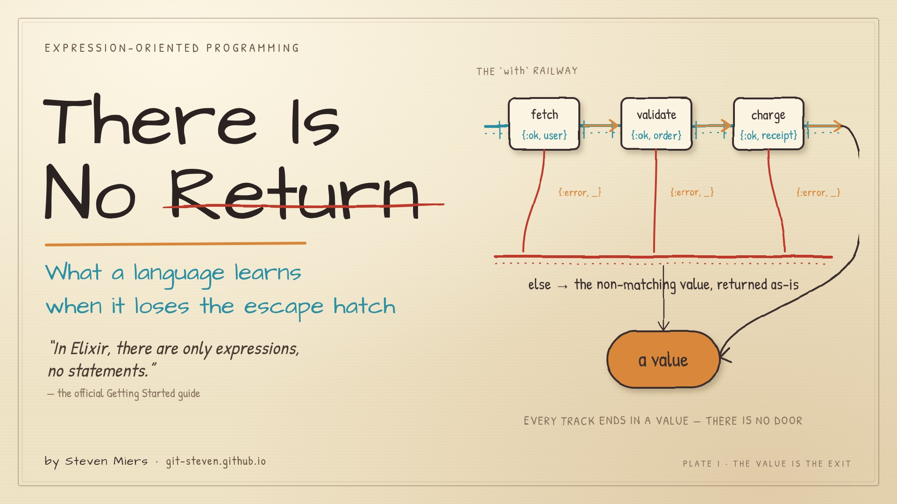
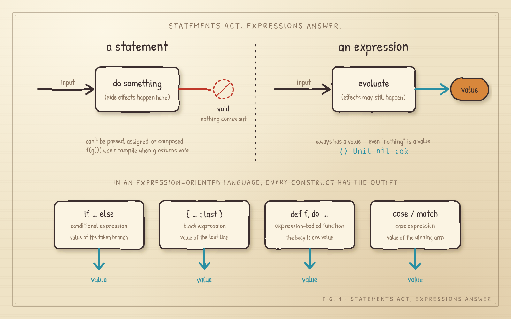
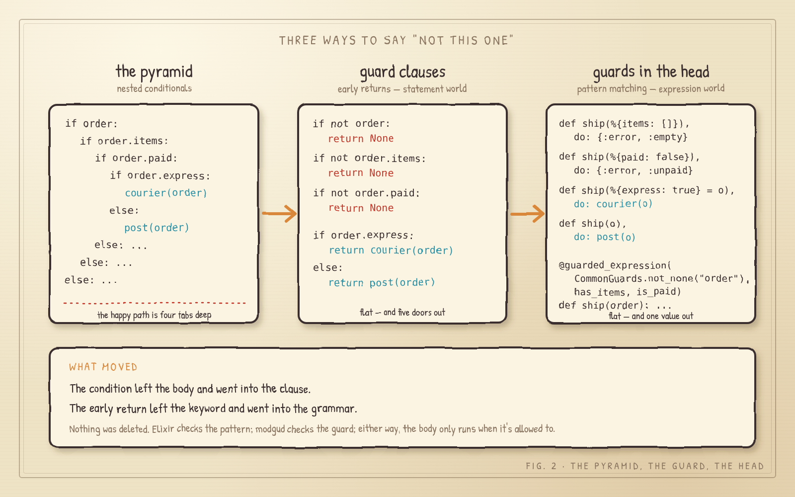
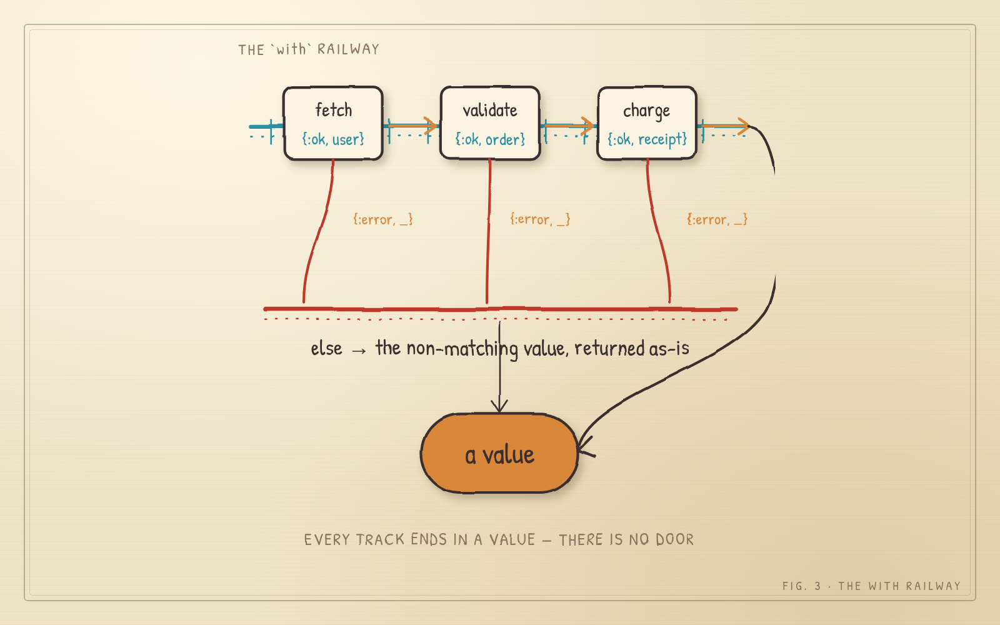
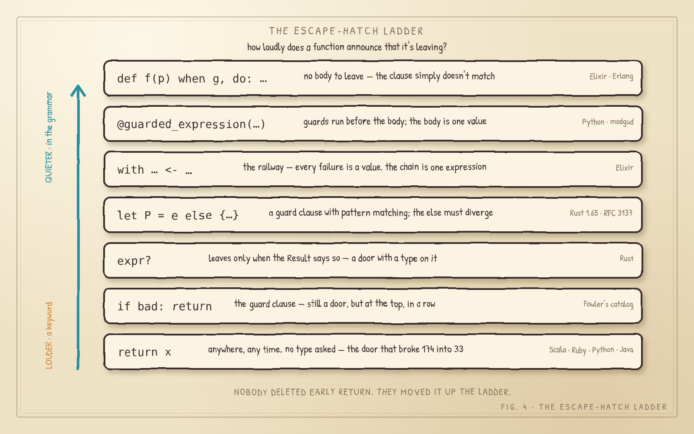

    


**What a language learns when it loses the escape hatch.**

*Steven B Miers · November 2026 · v1.06*

## 📝 Introduction

> Doors and corners, kid. That's where they get you.
> — **Detective Miller**, in James S. A. Corey's _Leviathan Wakes_ (2011)

Elixir has no `return` keyword. Not deprecated, not frowned on in a style guide — absent. Type one anyway and the compiler, having no idea what you mean, goes looking for a function named `return` and reports, a little sadly, that there isn't one. Erlang never had one either. Rust, Scala and Ruby technically do, and the advice in each is some flavor of "don't" — many Ruby shops, including all of the ones the author has led, ban it in the style guide, so Ruby keeps `return` mainly to give the linter a hobby. Java, meanwhile, spent 2017 to 2020 and three JEPs teaching `switch` to hand back a value at all [1].

**In an expression-oriented language, the value is the exit.** There is no door marked `return` because every hallway already ends in a room.

_This is not a functional-programming sermon. ALGOL 68 was expression-oriented in 1968 and thoroughly imperative [2]. The claim is narrower and stranger: when every construct must produce a value, the early return doesn't die. It gets absorbed — and comes back with a type signature._

---

## 🧱 Everything is a value, including nothing

*Concepts: conditional expressions · block expressions · expression-bodied functions · case (match) expressions · the unit value*

Elixir's Getting Started guide states the rule in one breath: "In Elixir, there are only expressions, no statements. Everything you write in Elixir language returns some value" [3].



__Fig. 1: Statements act, expressions answer.__ A statement does something and hands back nothing; `void` isn't a value, so it can't be passed or assigned. An expression always hands back a value — and in an expression-oriented language, every construct has the outlet.

A **conditional expression** has a value, even when it has nothing to say:

```elixir
# Elixir
iex> if 7 > 5, do: "yes"
"yes"
iex> if 3 > 5, do: "yes"
nil
```

That `nil` isn't Elixir being polite. The `if` macro quietly bolts on an `else: nil` and expands to a `case`, and a `case` is not allowed to shrug [4].

A **block expression** is worth its last line. Rust spells it out [5]:

```rust
// Rust
let x = { (); 0u8 };   // 0
let y = { 0u8; };      // ()  — the semicolon threw the value away
let z = { 0u8 };       // 0   — no semicolon, so the value walks out
```

Ruby, Elixir and Scala agree, which is why none of them need `return` to say what a function produces.

An **expression-bodied function** is a function that is nothing but that value. In Rust the body is a block, so the tail expression *is* the return [5]; C# calls the same thing an expression-bodied member; Elixir does it with a keyword list. This can be accomplished in Python via a decorator (more below):

```rust
// Rust
fn two() -> u8 { 2 }           // the block's last expression is the value
```

```elixir
# Elixir
def two, do: 2
```

```python
# Python 3.11+ · modgud 2.0
from modgud import implicit_return

@implicit_return()
def two():
    2
```

And a **case expression** is worth whatever the winning arm is worth:

```elixir
# If no arm wins, Elixir raises `CaseClauseError` rather than quietly handing back `nil` [4].

# Elixir
label = case fetch(id) do
  {:ok, user}      -> user.name
  {:error, reason} -> "unknown (#{reason})"
end
```

Python's `match` is a statement, so it can't stand on the right of an `=`. Inside a modgud-decorated function, `eop_case` can; the only concession is that `default=` is mandatory, because Python has no `CaseClauseError` to fall back on:

```python
# Python 3.11+ · modgud 2.0
from modgud import eop_case, eop_clause, eop_var, implicit_return

@implicit_return()
def fetch_username(id):
    eop_case(
        fetch(id),
        eop_clause(("ok", eop_var.user), eop_var.user.name),
        eop_clause(("error", eop_var.reason), f"unknown ({eop_var.reason})"), default="unknown"
    )   
```
---

## 🧱 Guard clauses: the orthodoxy with no receipts

*Concepts: guard clauses · early return · the nesting-depth rule*

Here is the obvious objection. A language with no `return` can't do this:

```python
# Python
def ship(order):
    if order is None: return None
    if not order.items: return None
    if not order.paid: return None
    # the actual work, flat and unindented
```

Guard clauses. Early returns. Martin Fowler's catalog calls the move "Replace Nested Conditional with Guard Clauses," and the entry lists the prerequisites, the mechanics, and not a single drawback [6] — the one refactoring in the catalog with no downside, which ought to make a person suspicious. The author has shipped that `return None` on line three more times than he would admit under oath.

So where are the receipts? Thin. The famous rule — never nest past three levels, few humans can follow more — traces to a software-quality indicator page that cites style guides from 1976 to 1987 and no studies at all [7].  The nesting objection to expression-oriented code and the case for guard clauses stand on the same unmeasured ground. Neither side gets to bring data to this fight, so both sides bring volume.



__Fig. 2: The pyramid, the guard, the head.__ Guard clauses flatten the pyramid by adding doors. The third panel flattens it by removing the body the doors were in — that's the next section.

**🐍 Python with a twist: a bonus fourth way.** Python can't put the guards in the function head, but a decorator can put them just above it. [`modgud`](https://pypi.org/project/modgud/) runs each guard before the body — a guard is any callable that answers `True` or a message — and makes the last expression of each branch the function's value, so the body has no `return` at all. The same `ship`, doors up top, one value out the back:

```python
# Python 3.11+ · modgud 2.0
from modgud import Guards, guarded_expression

@guarded_expression(
    Guards.not_none("order"),
    lambda order, *_, **__: bool(order.items) or "no items",
    lambda order, *_, **__: order.paid or "unpaid",
    implicit_return=True # This is the default
)
def ship(order):
    if order.express:
        courier(order)
    else:
        post(order)
```

By default a failed guard raises `GuardClauseError` with its message, and the body never starts. That's only the default, though. Pass the decorator a `strategy` and an `on_failure` and a failure can raise an exception class you choose, hand that exception back instead of raising it, return a fallback value such as `None` or `False`, or call a handler that gets the error messages plus the original arguments and returns whatever it builds, a 400 response for instance. Add `continuance=N` and it keeps checking past the first failure, so the caller hears every complaint at once instead of one per round trip (bundled into an `ExceptionGroup` when it raises). Between the built-in `Guards` and plain lambdas, the checks can test just about anything, and a failure can do or return just about anything you can dream up. More on how it does this, and what it borrows from Elixir, in [What replaced the door](#️-what-replaced-the-door).

---

## 💣 The 174 → 33 problem

*Concepts: non-local return · return inside a block expression*

What there *is* evidence for is what an early return does inside a language where blocks are values. Rob Norris's Scala demonstration: take a helper that returns early, inline it into a fold's lambda, and the sum changes from 174 to 33 — because the keyword exits the enclosing *method*, not the lambda, and does it by throwing an exception that carries no stack trace [8]. An early return inside a block that is a value is a time bomb with the countdown display unplugged — it still goes off; you just don't get to watch. Scala 2.13 added a lint for it. Elixir skipped the lint by skipping the keyword.

---

## 🛤️ What replaced the door

*Concepts: guards in function heads · multi-clause functions · railway chaining (`with`) · the `?` operator · `let-else` · decorator guards with implicit return*

Nobody deleted early return. They moved it into the grammar, and every language picked a different spot.

> "Composing simple components, simple in that same respect, is the way we write robust software." — Rich Hickey, *Simple Made Easy* (2011)

**Guards in the function head.** Elixir puts the condition on the clause, not in the body:

```elixir
# Elixir
def area({:circle, r}) when r > 0, do: 3.14159 * r * r
def area({:rect, w, h}) when w > 0 and h > 0, do: w * h
def area(_), do: {:error, :bad_shape}
```

Three guard clauses, written as pattern matching, and nothing to flatten because there is no body to flatten it out of. The docs say it outright: developers "prefer to use pattern matching and guards in function definitions" over nested conditionals [3].

**The railway.** For a chain of steps that can each fail, Elixir's `with` is a sequence of guarded early returns expressed as one value. Every `<-` either matches and continues, or the chain stops and hands back the thing that didn't match [4].

```elixir
# Elixir
with {:ok, user}    <- fetch(id),
     {:ok, order}   <- validate(user, params),
     {:ok, receipt} <- charge(order) do
  {:ok, receipt}
end
```



__Fig. 3: The `with` railway.__ Three stations on the main line, each with a siding to the `else` platform, and every track ends in a value. There is no door.

**The typed escape hatch.** Rust kept `return` and then built two better ones. The `?` operator is an early return with a type-directed trigger — it leaves the function only when the `Result` says so. And `let … else`, stable since Rust 1.65, is a guard clause with pattern matching. The RFC that introduced it concedes, in its own motivation, that `if let` "can force rightward drift," and cites a refactor "showing the value of early-returns" [9]. The people who built the expression language bolted a statement-shaped hatch back onto it — on purpose, in writing.

**The decorator.** Python is a statement language and intends to stay one. PEP 635 rejected an expression form of `match` because the result would be "unusually long and complex" [10] — and the Zen of Python was there first: "Readability counts" [11]. 
The author, lacking the standing to argue with Guido, wrote a package instead, which is how engineers converse. `modgud` wraps a function in guard clauses that run first — a failed guard raises `GuardClauseError` and the body never starts — plus an implicit return that makes the last expression of each branch the value [12]. A guard is any callable that answers `True` or a message. Here is the `ship` function from the pyramid, with its three doors moved above the body:

```python
# Python 3.11+ · modgud 2.0
from modgud import Guards, guarded_expression

def has_items(order, *_, **__):
    return bool(order.items) or "no items"

def is_paid(order, *_, **__):
    return order.paid or "unpaid"

# @implicit_return is implicit with use of @guarded_expression, and can be disabled
@guarded_expression(Guards.not_none("order"), has_items, is_paid)
def ship(order):
    if order.express:
        courier(order)
    else:
        post(order)
```

Version 2.0 goes one step further and lends Python a conditional *expression* with Elixir's vocabulary:

```python
# Python 3.11+ · modgud 2.0
from modgud import eop_clause, eop_cond, implicit_return

@implicit_return()
def sign(x):
    eop_cond(eop_clause(x < 0, "negative"), eop_clause(x == 0, "zero"), default="positive")
```

It's named for Móðguðr, who guards the bridge to Hel in the Norse stories. The resemblance to "mod-good" is not an accident, and neither is the fact that it works by rewriting the AST, which is the polite term for a trick. Python will keep being Python. But the shape — guards up front, one value out the back — is the shape Elixir enforces and Rust types.


---

## ⚠️ Beware!

*Concepts: flattened error handling · error normalization · function granularity*

The best critique comes from the most honest place: Elixir's own documentation, under a heading literally titled **Beware!** Every failure in a `with` lands in the same `else` block, so "it's difficult to know from which clause the error value came," and the official anti-patterns guide names "complex else clauses in `with`" as a smell [4][13]. The fix the docs offer — normalize each step's errors in its own private function — points where every remedy in this style points: more, smaller functions. People who live in it report that *that* is the real cost. Not nesting. Navigation.

Here is the railway from Fig. 3 with the smell on it. Three stations, three different failure shapes, one `else` to sort them out:

```elixir
# Elixir — the smell: one else for three stations
with {:ok, user}    <- fetch(id),
     {:ok, order}   <- validate(user, params),
     {:ok, receipt} <- charge(order) do
  {:ok, receipt}
else
  nil                 -> {:error, :no_such_user}     # fetch/1 returns nil…
  {:error, changeset} -> {:error, :invalid_order}    # …validate/2 a changeset…
  {:error, :declined} -> {:error, :payment_declined} # …charge/1 an atom…
  :timeout            -> {:error, :gateway_timeout}  # …and this one? Go read charge/1.
end
```

Reading the `else` means reconstructing what each step can return — exactly the complaint in the docs. The fix they prescribe, applied here, normalizes every station to `{:ok, _} | {:error, reason}` in a private function of its own, and the `else` disappears [13]:

```elixir
# Elixir — the fix: every station speaks the same shape
with {:ok, user}    <- fetch_user(id),
     {:ok, order}   <- validate_order(user, params),
     {:ok, receipt} <- charge_order(order) do
  {:ok, receipt}
end

defp fetch_user(id) do
  case fetch(id) do
    nil  -> {:error, :no_such_user}
    user -> {:ok, user}
  end
end

defp validate_order(user, params) do
  case validate(user, params) do
    {:ok, order}  -> {:ok, order}
    {:error, _cs} -> {:error, :invalid_order}
  end
end

defp charge_order(order) do
  case charge(order) do
    {:ok, receipt}      -> {:ok, receipt}
    {:error, :declined} -> {:error, :payment_declined}
    :timeout            -> {:error, :gateway_timeout}
  end
end
```

Every failure now names its station, and the `with` reads as the happy path it was meant to be. The bill is on the page too: five lines became twenty-five, and the reason a declined card comes back as `:payment_declined` now lives in a function two screens below the chain that produced it. That's the navigation cost, itemized.


---

## 🗝️ The door was never the point

Expression-oriented languages didn't win the argument against early return. They absorbed it.



__Fig. 4: The escape-hatch ladder.__ Every rung is an early return. What changes is how loudly the function says so — and whether the compiler gets to check the exit.

The question left in 2026 isn't *expressions or statements*. It's *which escape hatches, and how loudly a function has to announce that it's leaving*.

Underneath every one of those hatches sit the same four preferences:

* **Expressions over statements.** Computations produce values rather than merely perform actions.
* **Composition over sequence.** Complex behavior emerges from combining smaller expressions.
* **Abstraction over ceremony.** Code should communicate meaning without unnecessary machinery.
* **Clarity over mechanics.** A program should describe a computation, not merely enumerate instructions.

**Try this Monday:** find one function with a mutable result variable assigned in every branch. Make it an expression. If the compiler finds a branch you didn't — that was the bug.

_The author has never designed a language, only lived in several. The research behind this piece, every quote with its source, runs to fifteen thousand words; this is the short version._

---

## 📖 References

1. JEP 361: Switch Expressions. OpenJDK, final in Java 14 (2020). https://openjdk.org/jeps/361
2. van Wijngaarden, A., et al. *Report on the Algorithmic Language ALGOL 68*, §0.1.2 "Orthogonal design," 1968.
3. Elixir Getting Started, "case, cond, and if." https://elixir.hexdocs.pm/case-cond-and-if.html
4. Elixir v1.20.0, `Kernel` and `Kernel.SpecialForms` documentation (`if/2`, `case/2`, `with/1`, `defmodule/2`).
5. *The Rust Reference*, "Statements" and "Block expressions."
6. Fowler, M. "Replace Nested Conditional with Guard Clauses." *Refactoring*, 2nd ed., 2018.
7. IFSQ indicator SP-2, "Nesting." https://www.ifsq.org/indicator-SP-2.html
8. Norris, R. "Don't Use Return in Scala," 9 May 2014. https://tpolecat.github.io/2014/05/09/return.html
9. Rust RFC 3137, `let-else` statements, 2021. https://rust-lang.github.io/rfcs/3137-let-else.html
10. PEP 635, Structural Pattern Matching: Motivation and Rationale, "Statement vs. Expression." https://peps.python.org/pep-0635/
11. Peters, T. "The Zen of Python," PEP 20, 2004. https://peps.python.org/pep-0020/
12. `modgud` 2.0.0 on PyPI, November 2026. https://pypi.org/project/modgud/
13. Elixir, "Code-related anti-patterns." https://elixir.hexdocs.pm/code-anti-patterns.html
14. Error Prone, `StatementSwitchToExpressionSwitch`. https://errorprone.info/bugpattern/StatementSwitchToExpressionSwitch
15. Clippy, `needless_late_init`.

---

Version 1.06 · November 2026
