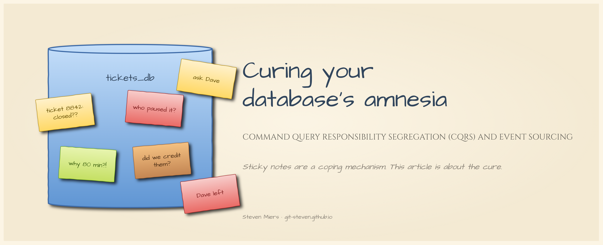
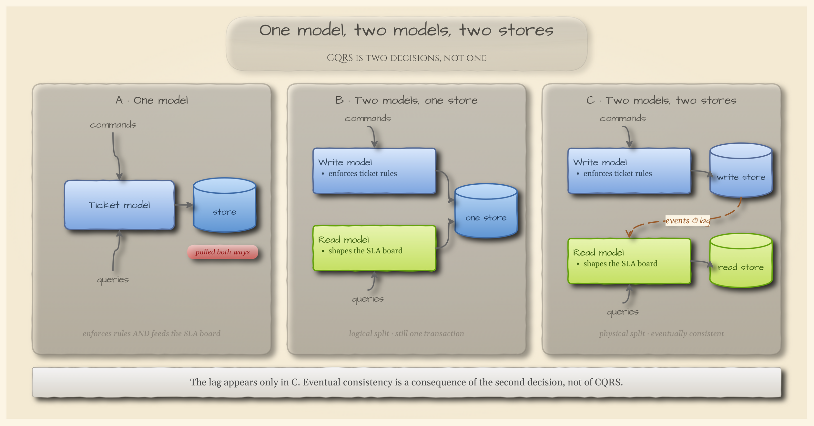
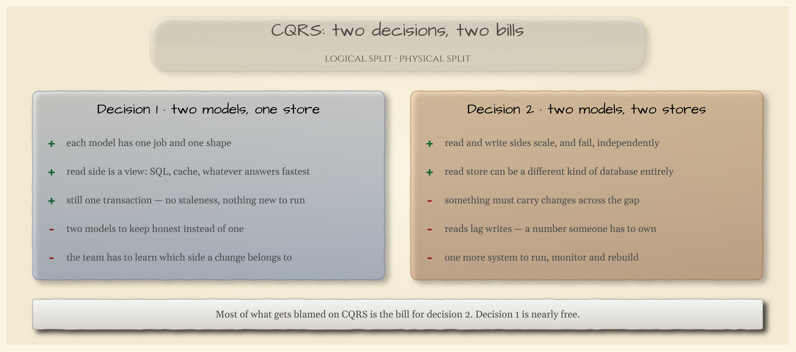
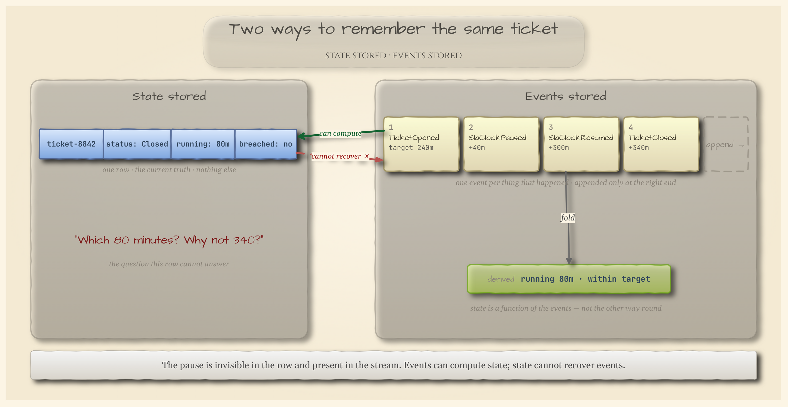
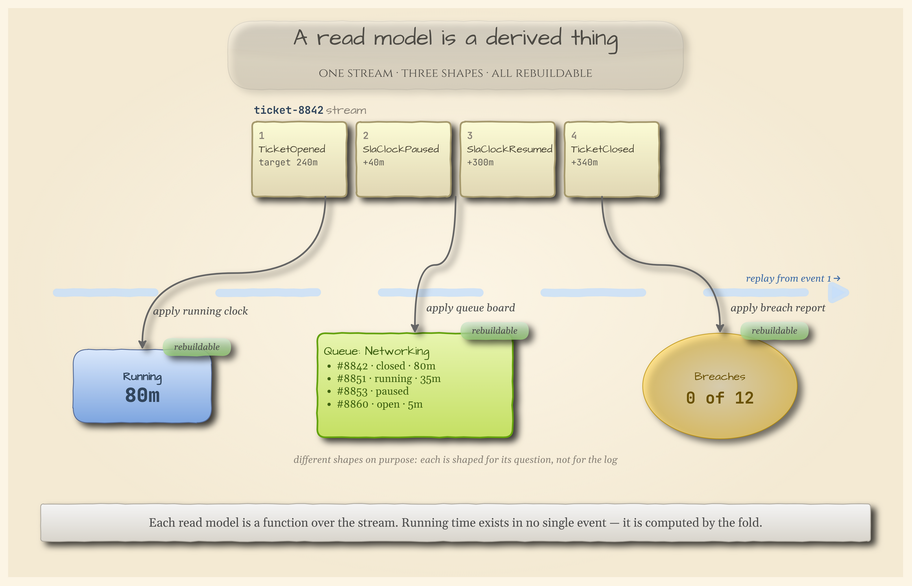
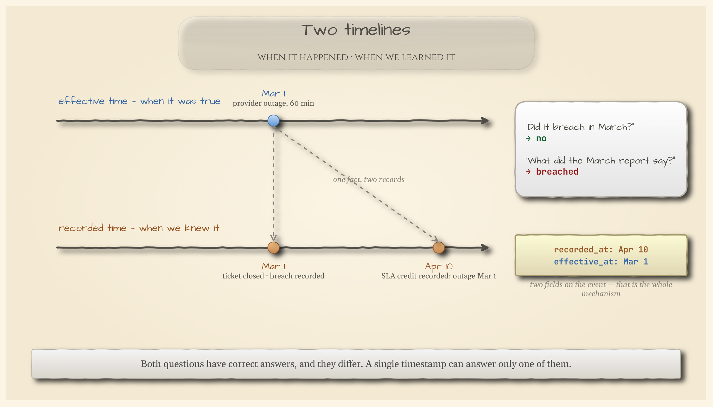
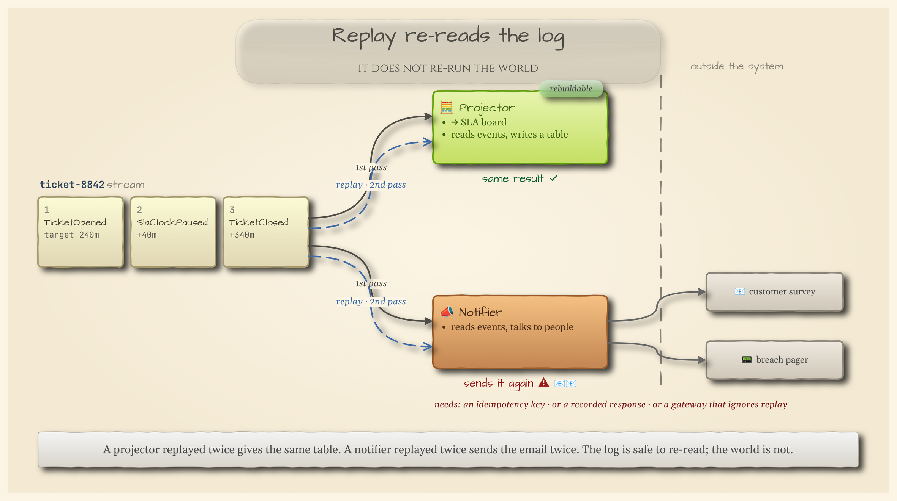
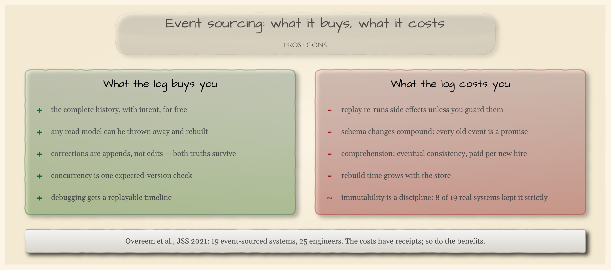
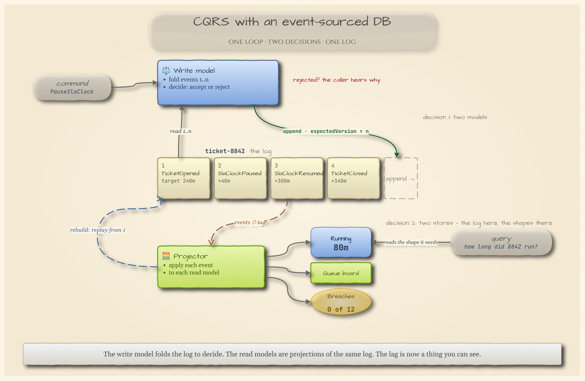

**Command Query Responsibility Segregation (CQRS) and Event Sourcing.**

*Steven B Miers · November 2026 · v1.02*

## 📝 Introduction

Every `UPDATE` is a small act of forgetting. Your database knows what's true right now and has no idea how it got that way — and when the customer, the auditor, or the regulator asks *how*, "now" is the one answer that doesn't help. Two ideas fix this, and they're usually introduced as one. CQRS stops asking a single model to both enforce the rules and answer the questions. Event sourcing stops throwing away the events that produced the state. This article takes them in that order, on a helpdesk ticket, with the costs stated out loud and no framework in sight.

**CQRS is a decision about models. Event sourcing is a decision about memory.**

_This is an introduction. It is not a database shoot-out, not a Kafka tutorial, and not a sermon. The author has built both of these, regretted one of them, and would like to save you the version of the regret that comes with a pager._

---

## ⚖️ Command Query Responsibility Segregation (CQRS)

> "Asking a question should not change the answer."
> — Bertrand Meyer, *Object-Oriented Software Construction*

### Commands and queries

Meyer's rule was about methods. A **command** changes state and returns nothing worth reading; a **query** returns something and changes nothing. Keep them apart and you can call a query as often as you like, in any order, from any thread, and the answer is the answer.

Greg Young applied the same rule to the model, which is where CQRS starts. Take a helpdesk ticket system. The code that enforces a ticket's rules — you can't resume a clock that isn't paused; you can't close what was never opened — wants a small, strict object with invariants. The screen that shows the support lead a queue sorted by SLA risk wants a wide, flat, denormalized row with no rules at all. One class serving both is pulled in two directions at once, and the usual result is an object with 40 fields, half of which are null depending on who's asking.

So: a **write model** that makes decisions, and a **read model** that answers questions. That's CQRS.

Full stop. It says nothing about databases, queues, or asynchrony, which comes as a surprise to most people who met it at a conference.

### One model, two models, two stores



__Fig. 1: One model, two models, two stores.__ Panel B is CQRS. Panel C is CQRS plus a second decision. The clock appears only in C.

Panel B — two models, one store — is complete, boring, correct CQRS. The read model can be a SQL view over the same tables. Writes and reads sit in one transaction; nothing is stale, nothing new runs at 3 a.m.

Panel C is a *second* decision: give the read side its own store. Now reads scale independently, the read store can be a different kind of database entirely, and the two are no longer in one transaction. Something must carry changes across the gap, and reads lag writes by however long that takes. **Eventual consistency is the bill for decision 2. It is not a property of CQRS**, and conflating the two is how "CQRS is complicated" became folklore. Oskar Dudycz calls it a myth and Microsoft's own pattern page describes the asynchronous deployment as if it were the pattern; both are right about the thing they're describing, and the thing is two different things.



__Fig. 2: Two decisions, two bills.__ Fowler's 2011 verdict was that for most systems CQRS "adds risky complexity." Read the right-hand column and you'll find he was mostly describing decision 2.

Two misconceptions follow people around. CQRS does not mean two databases — that's panel C, and it's optional. And CQRS does not need messaging; a write model and a view is CQRS with nothing in the middle. If a colleague says you can't do CQRS without Kafka, the kind thing is to hand them Fig. 1 and change the subject.

One last thing about panel C, because it's the hinge of the article. Whatever carries the changes across that gap has to say *what changed*. The most useful thing it can say is what *happened* — not "row 8842 now reads `Paused`" but "the SLA clock on ticket 8842 was paused at 09:12 because the customer went to lunch." Give that a name and you've invented the event. Keep every one of them and you've invented the next section.

---

## 📜 Event Sourcing

> "Capture all changes to an application state as a sequence of events."
> — Martin Fowler, *Event Sourcing*, 2005

### Stop overwriting the evidence

A customer escalates. Ticket 8842 closed in 80 minutes against a four-hour target, says the SLA board, and the customer says it took all day. You open the row: `status: Closed`, `running: 80m`, `breached: no`. All true. None of it explains anything. Somewhere between 09:12 and 14:52 that ticket was paused, resumed, and paused again, and the database remembers exactly one thing about all of that: the number 80.

Most systems remember the present. A row per ticket, updated in place, and the update *is* the forgetting. Event sourcing remembers the past instead: every change is written down as an **event** — a thing that happened, in the past tense, in words the support lead would use — appended to the ticket's **stream** in order and never edited. The row still exists. It's computed from the list.



__Fig. 3: Two ways to remember the same ticket.__ Same ticket, same moment. The left panel can't answer its own question. The right panel can, and the left panel is one `fold` away.

The arrows across the middle are the whole argument. **Events can compute state; state cannot recover events.** That isn't a vendor limitation. It's arithmetic, and it makes keeping events the one decision you can't take retroactively. The pause in ticket 8842 is invisible on the left and sitting in plain sight on the right. With a version number.

### The read model is a function, not a copy

Once state is a **fold** over events, nothing says there's only one fold. The SLA board wants running minutes; the queue view wants a list by team; the compliance report wants breaches this quarter. Each is a different function over the same stream — a **projection** — shaped for its question rather than for the log, and each can be thrown away and rebuilt by replaying from event 1.



__Fig. 4: A read model is a derived thing.__ Three deliberately different shapes from one stream. The band behind the arrows is the property that matters.

Martin Kleppmann's framing is the one that sticks: a read model is "just a cached view of the event log." Engineers already reason correctly about caches — stale, droppable, rebuildable, never the place you do a transactional read. Call it a second database and every one of those intuitions files a bug. And the 80 minutes are the honest example of why a read model isn't a mirror: they exist in no single event. They're the fold's arithmetic over `Paused` and `Resumed`.

### One fact, two records

On March 1 a provider outage stalled ticket 8842 for an hour. The breach was recorded, the report shipped. On April 10 the postmortem landed: the outage wasn't ours. With a row, you edit `breached` to `no` and the March report becomes a lie nobody can reproduce. With a log, you append `SlaCreditGranted` carrying two timestamps — when it was true and when you learned it — and rebuild.



__Fig. 5: Two timelines.__ "Did it breach in March?" No. "What did the March report say?" Breached. Both answers are correct, and a single timestamp could hold only one of them.

Audit is the case people make for the log. Corrections are the case that pays. A system that can say what it said then, what it says now, and why they differ has earned its keep — in the places where that question gets asked, which are fewer than the conference talks suggest.

### What it costs



__Fig. 6: Replay re-reads the log; it does not re-run the world.__ A projector replayed twice gives the same table. A notifier replayed twice sends the survey twice. Anything that crosses the dashed line needs an idempotency key, a recorded response, or a gateway that knows it's a replay.

Replay is the cost everyone discovers on a Friday. The others compound more quietly. A column rename is a migration; an event rename is a promise you made to every event already on disk. The one systematic study of real systems — Overeem and colleagues, 19 event-sourced systems, 25 engineers, 2021 — found upcasters the most common fix and slower loading the price, and it also found the number that should temper every conference talk: of 19 systems, 8 kept their events strictly immutable [11]. Fewer than half. The append-only log is a discipline, and most teams bend it.



__Fig. 7: What the log buys, what it costs.__ The costs have receipts. So do the benefits.

---

## 🤝 Conclusion: tying it together

> "A well-done CRUD is much better than a poorly done Event Sourcing."
> — Oskar Dudycz, *When not to use Event Sourcing?*

### CQRS with an event-sourced DB

Put the two decisions together and the shape is a loop, not a pipeline. A command arrives; the write model folds the ticket's stream to find out what's currently true, decides, and appends — with an **expected version**, so that if another writer got there first the append fails and the decision is redone against the newer truth. That's optimistic concurrency, and it's the entire write-side consistency story:

```
events  = store.read("ticket-8842")            // versions 1..n
state   = fold(events)                          // what's true now
newEvts = decide(command, state)                // may reject, for a business reason
store.append("ticket-8842", newEvts, expectedVersion = n)
```

On the other side, a projector applies each new event to each read model, and queries read whichever shape they need. The read models *are* the projections; decision 2's lag is now a thing you can point at instead of a thing you discover.



__Fig. 8: CQRS with an event-sourced DB.__ The write model folds the log to decide. The read models are projections of the same log. The dashed arrow is why you can sleep.

### Four gates

Greg Young, who named CQRS, has spent a decade telling rooms not to event-source everything; Fowler's failed cases are whole-system adoptions. The pattern belongs inside one **bounded context**, chosen on purpose. Four gates, each with at least two independent sources behind it:

1. **The write side makes decisions that can be rejected for a business reason.** Not a timeout — a rule.
2. **History is a requirement someone will pay for**, not a feature you'd like to have had.
3. **The stream ends.** A ticket opens, pauses, resumes, closes. Dudycz's test: if every event you can name is a field update, that's a change log wearing a trench coat — and the author has shipped one.
4. **The team has event-driven scar tissue**, or is deliberately building it on something small.

**Try this Monday:** pick one module your team owns and run it through the four gates. If it clears them, run Dudycz's five questions against whatever store you already operate — do concurrent appends get one rejected, what comes back after a crash mid-projection, can a projection be rebuilt from scratch, can an event type gain a field with data already present, how much setup does one decision's test need. If it doesn't clear them, that's your finding, and the finding is CRUD.

**Keep the events where the questions are. Keep the rows everywhere else.**

_The author is not a database vendor, only someone who has had to explain the number 80 to a customer. The research behind this piece runs to several hundred pages of notes; this is the short version, with the receipts below._

---

## 🗝️ Lexicon

* **Command** — a request to change state, which the write model may reject.
* **Query** — a request for information, which changes nothing.
* **Write model** — the model that enforces the rules and makes decisions.
* **Read model** — a model shaped to answer one kind of question; in event sourcing, a projection.
* **Eventual consistency** — reads lagging writes; the bill for two stores, not for CQRS.
* **Event** — a fact that happened, past tense, in the domain's words, never edited.
* **Stream** — one entity's events in order; `ticket-8842`.
* **Append** — the only write an event store allows.
* **Fold / replay** — computing state by applying events from the first to the last.
* **Projection** — a fold shaped for a question; rebuildable from event 1.
* **Snapshot** — a cached fold, kept for speed, never the source of truth.
* **Expected version** — the optimistic-concurrency check on append.
* **Effective vs recorded time** — when a fact was true vs when the system learned it.
* **Bounded context** — the one part of the system where you chose to do any of this.

---

## 📖 References

1. Meyer, Bertrand. *Object-Oriented Software Construction*, 2nd ed. Prentice Hall, 1997. (Command–query separation.)
2. Fowler, Martin. *CQRS*. martinfowler.com, 14 July 2011. https://martinfowler.com/bliki/CQRS.html
3. Microsoft Learn. *CQRS pattern*. Azure Architecture Center. https://learn.microsoft.com/en-us/azure/architecture/patterns/cqrs
4. Dudycz, Oskar. *CQRS facts and myths explained*. event-driven.io. https://event-driven.io/en/cqrs_facts_and_myths_explained/
5. Fowler, Martin. *Event Sourcing*. martinfowler.com, 2005. https://martinfowler.com/eaaDev/EventSourcing.html
6. Fowler, Martin. *Domain Event*. martinfowler.com, 2005. https://martinfowler.com/eaaDev/DomainEvent.html
7. Microsoft Learn. *Event Sourcing pattern*. Azure Architecture Center. https://learn.microsoft.com/en-us/azure/architecture/patterns/event-sourcing
8. Kleppmann, Martin. *Stream processing, Event sourcing, Reactive, CEP… and making sense of it all*. 29 January 2015. https://martin.kleppmann.com/2015/01/29/stream-processing-event-sourcing-reactive-cep.html
9. Dudycz, Oskar. *Property Sourcing*. event-driven.io. https://event-driven.io/en/property-sourcing/
10. Dudycz, Oskar. *Event Streaming is not Event Sourcing!* event-driven.io. https://event-driven.io/en/event_streaming_is_not_event_sourcing/
11. Overeem, Michiel; Spoor, Marten; Jansen, Slinger; Brinkkemper, Sjaak. *An empirical characterization of event sourced systems and their schema evolution — Lessons from industry*. Journal of Systems and Software 178, 2021. https://arxiv.org/abs/2104.01146
12. Dudycz, Oskar. *When not to use Event Sourcing?* event-driven.io. https://event-driven.io/en/when_not_to_use_event_sourcing/
13. Dudycz, Oskar. *Start Small, Grow Big: how to pick the first module*. Architecture Weekly. https://www.architecture-weekly.com/p/start-small-grow-big-how-to-pick
14. Dahan, Udi. *Race Conditions Don't Exist*. 31 August 2010. https://udidahan.com/2010/08/31/race-conditions-dont-exist/
15. Vernon, Vaughn. *Effective Aggregate Design, Part I*. dddcommunity.org, 2011. https://www.dddcommunity.org/wp-content/uploads/files/pdf_articles/Vernon_2011_1.pdf
16. Young, Greg. *A Decade of DDD, CQRS, Event Sourcing*. DDD Europe 2016, as noted by Miguel Alho. https://www.miguelalho.pt/a-decade-of-ddd-cqrs-event-sourcing-greg-young/
17. Libutzki, Oliver. *Why Event Sourcing is a microservice (communication) anti-pattern*. dev.to, 2019. https://dev.to/olibutzki/why-event-sourcing-is-a-microservice-anti-pattern-3mcj
18. Dudycz, Oskar. *Why a bank account is not the best example of Event Sourcing?* event-driven.io. https://event-driven.io/en/bank_account_event_sourcing/

---

Version 1.02 · November 2026
