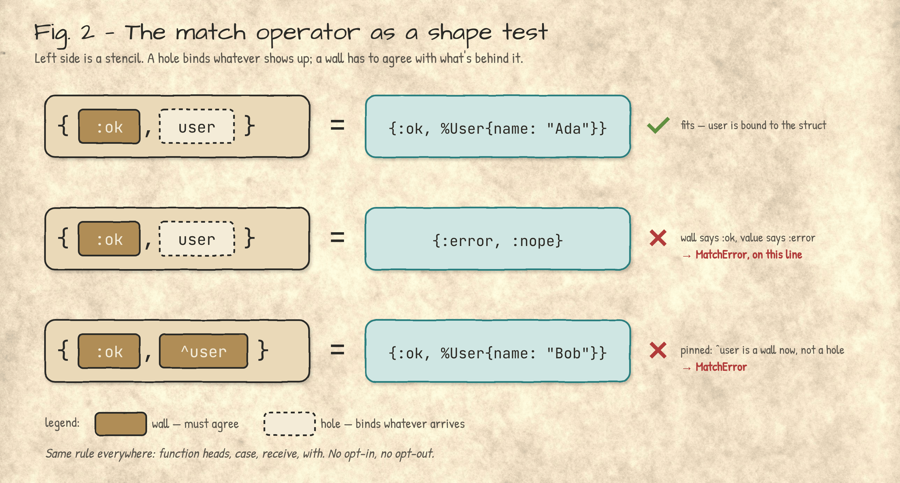
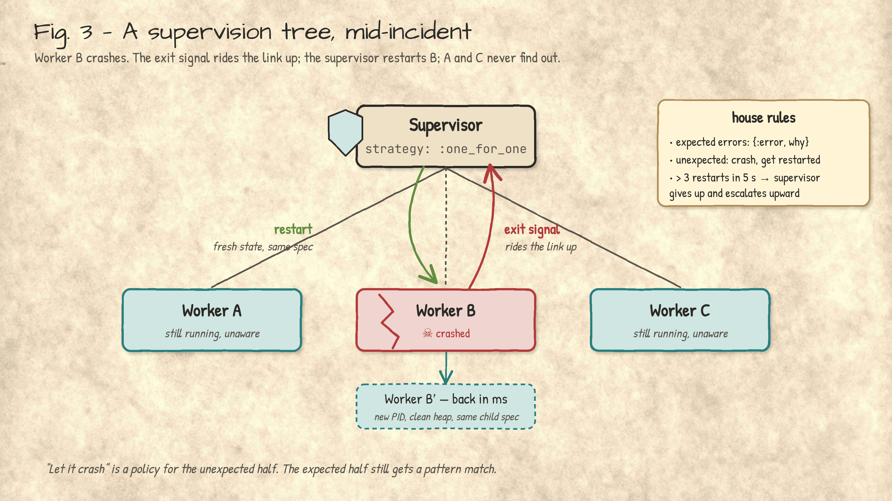
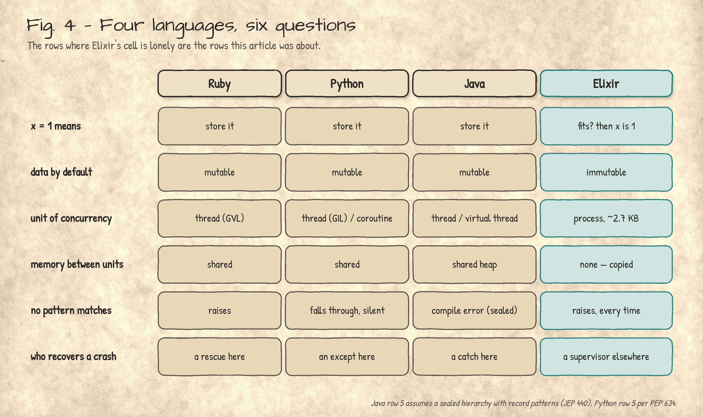

**Elixir looks like three languages you already know. Then it bites.**

*Steven B Miers · November 5, 2026 · v1.14*

## 📝 Introduction

You open an Elixir file and relax a little.

* [`do … end` blocks](https://hexdocs.pm/elixir/modules-and-functions.html), so this is Ruby.
* [Keyword arguments](https://hexdocs.pm/elixir/keywords-and-maps.html) and a [`for` comprehension](https://hexdocs.pm/elixir/comprehensions.html), so maybe Python with better manners.
* Everything lives in a module with a capitalized name, so Java's in here somewhere too.
* There's a web framework called [Phoenix](https://hexdocs.pm/phoenix/overview.html), with a [router](https://hexdocs.pm/phoenix/routing.html), [controllers](https://hexdocs.pm/phoenix/controllers.html) and a [generator](https://hexdocs.pm/phoenix/Mix.Tasks.Phx.Gen.Live.html) that scaffolds a CRUD screen, so Rails is *definitely* in here.
* The creator came from the Rails core team in 2011 [1], and it shows.

Then you write `x = 1` and it works, but not for the reason you think. Three things you were sure of are now false:

* **[`=` is a question](https://hexdocs.pm/elixir/Kernel.SpecialForms.html#=/2), not a command.** It asks whether the value on the right fits the shape on the left. A bare `x` fits anything, so `x` is bound to `1`. Put a literal, a pattern, or a pinned `^x` on the left instead, and if the answer is no, it says so, loudly.
* **There are no objects.** [Modules](https://hexdocs.pm/elixir/modules-and-functions.html) hold functions. Data is data, and it never learns any methods.
* **Nothing is mutable.** You can give a name a new value. You cannot change the old one.

The thing you took for a log has teeth. [Elixir-isms](#elixir-isms) has the bite marks.

**Elixir borrowed its clothes from languages you know and its body from one you probably don't.**

_This is an introduction, not a sermon. It covers where the body came from, the everyday syntax and where it differs, the constructs with no cousin in Ruby, Python or Java, and where the crocodile loses. Part 2 covers what the ecosystem builds out of them; a one-page cheat sheet rides along separately, for interviews._

---

<a id="under-the-clothes"></a>

## 🏛️ What's under the clothes

Eight names, and people use the first four interchangeably, which is how you can tell who's read the docs. From the bottom up:

* **[Erlang](https://www.erlang.org/doc/)** is the language. Ericsson built it in the late 1980s to run telephone switches, which is why it cares about uptime the way a bank cares about decimals. Open-sourced in 1998 [2]
* **BEAM** is the virtual machine Erlang runs on, "Bogdan's Erlang Abstract Machine," after its original author. A register machine, not a stack machine like the JVM [3]
* **ERTS** is the runtime system the BEAM lives inside: schedulers, memory, I/O. It has its own version number that does *not* match the OTP release. OTP 29 ships erts-17, and writing "ERTS 29" is a tell [4]
* **OTP** is the standard library of behaviours for building things that stay up: [supervisors](https://hexdocs.pm/elixir/Supervisor.html), [generic servers](https://hexdocs.pm/elixir/GenServer.html), [applications](https://hexdocs.pm/elixir/Application.html). A library shelf, not a layer
* **Phoenix** is the web framework, two floors up. Rails-shaped on the outside, process-shaped inside, and [the reason most people are reading this](https://git-steven.github.io/architecture/languages/elixir-four-hats/#phoenix)
* **LiveView** is Phoenix's party trick: the page's state lives in a server process and the browser gets diffs. See more in: [Part 2](https://git-steven.github.io/architecture/languages/elixir-four-hats/#liveview)
* **Oban** is background jobs, stored in the database you already have, so enqueueing a job and saving the row it's about is one transaction. Like Rails' `Hotwire`, but better: `LiveView` is stateful, one process per visitor holding the
   page, where `Hotwire` is stateless and rebuilds from the request every time. See more in [Part 2](https://git-steven.github.io/architecture/languages/elixir-four-hats/#oban)
* **Commanded** is CQRS and event sourcing with every aggregate as its own process, which is the pattern's natural habitat. See more in [Part 2](https://git-steven.github.io/architecture/languages/elixir-four-hats/#commanded).

Elixir, which José Valim started in 2011, is none of the first four. It's a second language aimed at the same machine, and it gets there with less ceremony than you'd guess: it doesn't compile *to* Erlang source. It compiles to what Erlang source becomes *after parsing*, the [Erlang Abstract Format](https://www.erlang.org/doc/apps/erts/absform.html), and hands that to the Erlang compiler with a note that says *you take it from here* [5].


__Fig. 1: Two front doors, one building.__ Peers that meet at the Abstract Format; the Erlang compiler takes it from there to `.beam` bytecode. (The crossed-out box is real [6].)

So "Elixir is fast because the BEAM is fast" is true the way "Scala has a great garbage collector" is true. It does, and Scala didn't write a line of it; the JVM did. Elixir gets the scheduler, the memory model and the fault model the same way, for free, because it never left the building. What it adds is the part you type.

*See also:* [Getting started](https://hexdocs.pm/elixir/introduction.html) · [Erlang libraries from Elixir](https://hexdocs.pm/elixir/erlang-libraries.html) · [Mix](https://hexdocs.pm/elixir/introduction-to-mix.html)

---

<a id="elixir-isms"></a>

## 🧱 Elixir-isms

The constructs you'll type before lunch on day one, all in one place. Every one has a cousin in Ruby, Python or Java, and every cousin will mislead you in some small, specific way. The first one misleads the most.

<a id="match"></a>

### `=` is a question, not a statement

In Ruby, Python and Java, `=` means *put this there*. In Elixir [it means *does this fit?*](https://hexdocs.pm/elixir/pattern-matching.html) Most of the time the answer is yes, and it looks exactly like assignment, because it is:

```elixir
x = 1    # a bare name fits anything, so x is now 1. Assignment, as advertised
1 = x    # also legal: does x fit 1? It does, so nothing happens
2 = x    # MatchError: x is 1, and the answer is no
x = 2    # a bare name always fits, so this rebinds x. The 1 itself never changed
^x = 3   # the pin makes x a wall: compare with the current x. MatchError
```

The question gets interesting when the left side has a shape. Here's a `fetch/1` that answers the way most Elixir functions do, with `{:ok, value}` or `{:error, reason}`:

```elixir
defmodule Users do
  @users %{1 => "Ada", 2 => "Grace"}

  def fetch(id) do
    case @users[id] do
      nil -> {:error, :not_found}
      user -> {:ok, user}
    end
  end
end

{:ok, user} = Users.fetch(1)    # fits, so user binds to "Ada"
{:ok, user} = Users.fetch(99)   # {:error, :not_found} won't fit: MatchError
```

The left side is a stencil. A hole (`user`) binds whatever arrives; a wall (`:ok`) has to agree, or the line raises. A bare `x` is nothing but hole, which is why `x = 1` passes for assignment, and [the pin `^`](https://hexdocs.pm/elixir/patterns-and-guards.html#variables) turns a hole into a wall: "compare against what `x` already is; don't rebind it." On a miss you get no `nil` and no warning: [an exception](https://hexdocs.pm/elixir/MatchError.html), on the line where the shape was wrong. Function heads, `case` and `with` below are the same question, asked in different places.



__Fig. 2: The match operator as a shape test.__ Hole binds, wall must agree.

The other three have all picked up pattern matching lately, and the gap is narrower than Elixir's fans let on:

* **Python 3.10** has `match`, as a *statement*. When no case fits it does nothing. Silently [7].
* **Java 21** has record patterns, final, with nesting and exhaustiveness over sealed types. "Java can't do this" expired in 2023 [8].
* **Ruby 3**'s `case … in` raises `NoMatchingPatternError` on a miss, same as Elixir, and Ruby's pin can do more than Elixir's [9].
* **Scala's** extractors are more extensible than any of the above.

So Elixir's claim isn't expressiveness. It's that matching is the *default* and failure is *loud*. You don't opt in. You can't opt out.

### Modules: where the classes went

Elixir has no classes, and everyone spends the first week looking for them anyway. What it has instead is three smaller things: modules for code, structs for data, behaviours for contracts. A [module](https://hexdocs.pm/elixir/modules-and-functions.html) is a named bag of functions:

```elixir
defmodule Pond do
  @moduledoc "Functions about ponds. No state, no instances, no self."
  @pi 3.14159   # a compile-time constant, not an instance variable

  # public: Pond.area(2) returns 12.56636
  def area(radius), do: @pi * square(radius)

  # private: Pond.square(2) raises UndefinedFunctionError
  defp square(x), do: x * x
end
```

* **No `new`, no `self`:** a module is a namespace. `Pond.area(2)` reads like a Java static method because that's all there is.
* **`def` and `defp`:** public and private. That's the whole access-modifier menu.
* **`@pi`:** a [module attribute](https://hexdocs.pm/elixir/module-attributes.html), baked in at compile time. Ruby readers, this is the one that bites: `@` isn't an instance variable, because there's no instance to have one.

### Structs: data with a name tag

A [struct](https://hexdocs.pm/elixir/structs.html) is a map with a name tag sewn in. It gets fields and defaults. It never gets methods.

```elixir
defmodule Croc do
  @enforce_keys [:name]                              # required at construction
  defstruct [:name, length_m: 4.0, hungry?: true]    # fields, with defaults
end

gus = %Croc{name: "Gus"}        # %Croc{name: "Gus", length_m: 4.0, hungry?: true}
fed = %{gus | hungry?: false}   # a new struct; gus is still hungry
%Croc{name: name} = fed         # structs match like anything else: name is "Gus"
gus.name                        # "Gus"
gus[:name]                      # UndefinedFunctionError: no [] access on structs
%Croc{length_m: 5.0}            # ArgumentError: :name must be given
```

* **[`defstruct`](https://hexdocs.pm/elixir/Kernel.html#defstruct/1):** fields and defaults, checked when the struct is built; `@enforce_keys` makes some of them mandatory.
* **Updating:** `%{gus | hungry?: false}` builds a new struct. The old one stays hungry, which is immutability doing its job.
* **Underneath:** a map with a `__struct__: Croc` key, which is why it pattern-matches like one and why `is_map(gus)` is `true`.

### Behaviours: interfaces, British spelling

A [behaviour](https://hexdocs.pm/elixir/typespecs.html#behaviours) is a contract a module promises to keep: a list of `@callback`s. It's the nearest thing to a Java interface, with one difference you'll find out the hard way.

```elixir
defmodule Notifier do
  @callback deliver(to :: String.t(), msg :: String.t()) :: :ok | {:error, term()}
end

defmodule SmsNotifier do
  @behaviour Notifier       # the British spelling; @behavior won't compile
  @impl Notifier            # "this is a callback": the compiler checks the claim
  def deliver(to, msg), do: IO.puts("SMS to #{to}: #{msg}")
end

notifier = SmsNotifier   # modules are values, so this is dependency injection
notifier.deliver("555-0100", "the crocodile is awake")
```

* **A missing callback is a warning, not an error.** Java won't compile a class that forgets a method; Elixir warns and carries on, and the call fails at runtime. Run CI with `mix compile --warnings-as-errors` and the two languages agree.
* **Modules are values:** passing `SmsNotifier` where a `Notifier` is expected is how Elixir does dependency injection, test doubles included.
* **Behaviours vs [protocols](https://hexdocs.pm/elixir/protocols.html):** a behaviour is a contract for *modules*. A protocol dispatches on the *data's* type, like Python's `functools.singledispatch` with better manners.

(`@behavior` doesn't merely fail. [The compiler](https://github.com/elixir-lang/elixir/blob/main/lib/elixir/lib/module.ex) raises "@behavior attribute is not supported, please use @behaviour instead," which is as close as a compiler gets to correcting your accent.)

### Functions: overloading by count and by shape

A function's name is really name *and* arity. `hello/0` and `hello/1` are as unrelated as `hello` and `goodbye`, which is how Elixir overloads without types:

```elixir
defmodule Greet do
  def hello, do: hello("world")           # hello/0...
  def hello(name), do: "hello, #{name}"   # ...and hello/1: two functions, one name

  # a default argument defines both bye/1 and bye/2
  def bye(name, word \\ "goodbye"), do: "#{word}, #{name}"
end
```

The other kind of overloading is by shape: same name, same arity, several clauses. The runtime takes the first one whose [pattern fits](https://hexdocs.pm/elixir/patterns-and-guards.html#where-patterns-and-guards-can-be-used), and a [`when` guard](https://hexdocs.pm/elixir/patterns-and-guards.html#guards) narrows a clause without touching the body:

```elixir
def http(200, body), do: {:ok, body}
def http(code, _) when code in 500..599, do: {:error, :server}
def http(code, _), do: {:error, code}
```

Three conditions, zero `if`s. The nesting problem never shows up because there's nothing to nest. [Anonymous functions](https://hexdocs.pm/elixir/anonymous-functions.html) are values, and they get called with a dot:

```elixir
square = fn x -> x * x end                   # an anonymous function, bound to a name
square.(4)                                   # 16: the dot marks an anonymous call
Enum.map(["Ada", "Grace"], &Greet.hello/1)   # & captures a function by name/arity
```

* **No `return`:** the last expression is the value. A sibling article, [There Is No Return](https://git-steven.github.io/architecture/languages/eop-no-return/), is about exactly that.
* **Clauses stick together:** clauses of one name/arity sit next to each other and are tried top to bottom. Split them up and the compiler warns.
* **The dot is deliberate:** `square.(4)` and `Greet.hello("Ada")` look different so you always know which kind you're holding.

### Conditionals: everything returns something

[`if`](https://hexdocs.pm/elixir/case-cond-and-if.html) exists, and it's an expression. It returns a value, so you assign its result instead of assigning inside it:

```elixir
mood = if gus.hungry?, do: "stand back", else: "probably fine"   # if returns a value

size =
  cond do                       # no else-if: cond takes the first branch that's true
    gus.length_m > 5 -> :large
    gus.length_m > 3 -> :medium
    true -> :small              # the catch-all
  end

case Users.fetch(2) do          # the same shape test as =, several shapes
  {:ok, user} -> "hello, #{user}"
  {:error, :not_found} -> "who?"
end
```

* **[Truthiness](https://hexdocs.pm/elixir/Kernel.html#module-truthy-and-falsy-values):** only `false` and `nil` are falsy. `0`, `""` and `[]` are all true, which Python readers find out exactly once.
* **Nothing leaks out:** a variable bound inside an `if` doesn't exist after it, and using it later is a compile error. Bind the `if`'s result instead, as `mood` does.
* **`case` is loud too:** no clause fits, and it raises `CaseClauseError`, the same as `=`.

### Loops: there aren't any

There's no `while`, and `for` isn't a loop. With nothing mutable there's no counter to bump, so iteration is a function call:

```elixir
Enum.map([1, 2, 3], fn n -> n * 2 end)                # [2, 4, 6]
Enum.reduce([1, 2, 3], 0, fn n, acc -> acc + n end)   # 6: sum += n, minus the +=
for n <- 1..10, rem(n, 2) == 0, do: n * n             # [4, 16, 36, 64, 100]

defmodule Countdown do
  def run(0), do: :liftoff      # the base case is its own clause
  def run(n) when n > 0 do
    IO.puts(n)
    run(n - 1)                  # a tail call: a jump, not a new stack frame
  end
end
```

And the trap every newcomer walks into once:

```elixir
total = 0
for n <- [1, 2, 3], do: total = total + n   # [1, 2, 3], plus an "unused" warning
total                                       # still 0
```

* **[`Enum`](https://hexdocs.pm/elixir/Enum.html):** `map`, `filter`, `reduce` and the rest of the family. Most of the loops you'd write elsewhere are one of these.
* **[`for`](https://hexdocs.pm/elixir/comprehensions.html):** a comprehension that *returns a list*, with generators and filters. It can't change anything outside itself, which is the trap above.
* **[Recursion](https://hexdocs.pm/elixir/recursion.html):** the base case is a function head, and a tail call doesn't grow the stack. A loop that runs forever (a server, say) is a function that calls itself last.

### `with`: the happy path, written once

`=` raises when the shape is wrong. Sometimes you'd rather get the wrong shape back and decide what to do about it. That's [`with`](https://hexdocs.pm/elixir/Kernel.SpecialForms.html#with/1): a chain of matches, written `<-` instead of `=`, that stops at the first one that doesn't fit:

```elixir
defmodule Door do
  def open(params) do
    with {:ok, id} when is_integer(id) <- Map.fetch(params, :id),
         {:ok, name} <- Users.fetch(id) do
      "come in, #{name}"
    else
      :error -> "no id given"
      {:error, :not_found} -> "never heard of them"
    end
  end
end

Door.open(%{id: 1})     # "come in, Ada"
Door.open(%{})          # "no id given": Map.fetch returned :error
Door.open(%{id: 99})    # "never heard of them"
Door.open(%{id: "1"})   # WithClauseError: failed the guard, and no else fits
```

* **No `else`:** the value that didn't fit comes straight back. Often that's the `{:error, _}` you meant to return anyway.
* **With `else`:** every possible misfit needs a clause, or you get a `WithClauseError`. The last line above is that, live.
* **What it replaces:** a ladder of early returns in Python, an `Optional` chain in Java, and `&.` plus hope in Ruby.

*See also:* [alias, require, import and use](https://hexdocs.pm/elixir/alias-require-and-import.html) · [Keyword lists and maps](https://hexdocs.pm/elixir/keywords-and-maps.html) · [Optional syntax sheet](https://hexdocs.pm/elixir/optional-syntax.html)

---

<a id="concurrency"></a>

## 🧬 Concurrency is grammar, not a library

In Java you import `java.util.concurrent`. In Python you import `asyncio`. In Elixir you import nothing, because the words are in the language:

```elixir
pid = spawn(fn -> receive do {:ping, from} -> send(from, :pong) end end)
send(pid, {:ping, self()})
receive do :pong -> "pong" end
```

That's the whole kit: [make a process](https://hexdocs.pm/elixir/Kernel.html#spawn/1), [put a message in its mailbox](https://hexdocs.pm/elixir/Kernel.html#send/2), [wait for one in yours](https://hexdocs.pm/elixir/Kernel.SpecialForms.html#receive/1). A [process](https://hexdocs.pm/elixir/processes.html) isn't a thread, a green thread or a coroutine. It costs about 2.7 KB, brings its own heap, mailbox and garbage collector, and shares nothing, so it can be collected, crashed or killed and nobody else notices. (The exact bill, and the blog posts that got it wrong by 9×, open [Part 2](https://git-steven.github.io/architecture/languages/elixir-four-hats/#338-words).) Everything else is built from two more primitives and one pattern:

* **[A link](https://hexdocs.pm/elixir/Process.html#link/1)** ties two processes together. If one crashes, the other gets the exit signal and, unless it has opted to trap exits, dies too. A clean exit doesn't spread.
* **[A monitor](https://hexdocs.pm/elixir/Process.html#monitor/1)** is the one-way version. "Tell me if that one dies. Don't take me with it."
* **[A supervisor](https://hexdocs.pm/elixir/Supervisor.html)** is a process whose only job is to link to its children and restart them according to a policy you declared.



__Fig. 3: A supervision tree, mid-incident.__ Worker B crashes; the exit signal rides the link up; the supervisor restarts B under a [`:one_for_one` strategy](https://hexdocs.pm/elixir/Supervisor.html#module-strategies), and A and C never find out.

This is what "let it crash" means, and candidates get it wrong in interviews often enough to be precise about it. It does *not* mean "don't handle errors." It means errors come in two kinds, with a tool for each:

* **Expected failures** (file missing, user not found) get a tagged tuple and a pattern match. `{:ok, _}` or `{:error, _}`, right here, same as always.
* **Unexpected failures** (the bug you didn't know you had) crash the process. The recovery policy lives in a supervisor somewhere else, not in a [`rescue` block](https://hexdocs.pm/elixir/try-catch-and-rescue.html) here.

Joe Armstrong's 2003 thesis is titled *Making reliable distributed systems in the presence of software errors* [10]. In the *presence* of. The whole philosophy is in the preposition.

Java 21's virtual threads made a thread as cheap as a BEAM process. They still share one heap, and nobody supervises them [11].

**Loom makes concurrency cheap. The BEAM makes failure cheap. Those are different problems.**

*See also:* [Task](https://hexdocs.pm/elixir/Task.html) · [Agent](https://hexdocs.pm/elixir/agents.html) · [GenServer, by example](https://hexdocs.pm/elixir/genservers.html)

---

<a id="no-cousin"></a>

## 📦 The parts with no cousin

Constructs with no equivalent in the three languages, each with its footgun, since a loaded tool should ship with the warning on the box:

* **[Atoms](https://hexdocs.pm/elixir/basic-types.html#atoms)** (`:ok`, `:error`, `MyModule`) are interned constants in a global, never-collected table capped at about a million entries [12]. Ruby had the same design until 2.2 made symbols collectable [13]. So [`String.to_atom(user_input)`](https://hexdocs.pm/elixir/String.html#to_atom/1) is a denial-of-service with a friendly name, and [`String.to_existing_atom/1`](https://hexdocs.pm/elixir/String.html#to_existing_atom/1) exists.
* **[The pipe](https://hexdocs.pm/elixir/Kernel.html#%7C%3E/2)** `|>` feeds the left value into the *first* argument of the right call, which is why the standard library puts the data first everywhere. People say "like F#," and F# pipes into the *last* argument. Different convention, same relief.
* **[Bitstrings](https://hexdocs.pm/elixir/binaries-strings-and-charlists.html)** are the one with no analogue at all. You can [pattern-match on *bits*](https://hexdocs.pm/elixir/Kernel.SpecialForms.html#%3C%3C%3E%3E/1), and widths that don't add up are a match failure, not a silent truncation. In Java that's a shift, a mask, and a code review comment.
* **[Macros](https://hexdocs.pm/elixir/macros.html)** operate on the abstract syntax tree, the AST: the tree the compiler builds from your source code, which Elixir exposes as [plain three-element tuples](https://hexdocs.pm/elixir/quote-and-unquote.html). Much of the language (`if`, `def`, `defmodule`) is macros written in Elixir [14]. The official anti-patterns guide then spends a chapter telling you not to write them. Both are right: good for extending the language, wrong for reusing code.

*See also:* [Sigils](https://hexdocs.pm/elixir/sigils.html) · [Enumerables and streams](https://hexdocs.pm/elixir/enumerable-and-streams.html)

```elixir
"  Hello, World  " |> String.trim() |> String.downcase() |> String.split(", ")

<<version::4, header_len::4, rest::binary>> = packet   # first byte of an IPv4 header
```

---

<a id="loses"></a>

## ⚖️ Where the crocodile loses

Three fights it doesn't win. The crocodile would like you to know it's not sulking about it:

* **Raw compute.** Immutability has a bill, and on a big, hot, mutable data structure it comes due asymptotically. Discord measured it (640 µs for their best pure-Elixir sorted set, 3.68 µs as a Rust NIF, and the gap grew with size), kept Elixir for the coordination layer, and rewrote one data structure in Rust [15]. That's the right lesson: not "leave," but "know which loop is the hot one."
* **Hiring.** You will not hire Elixir developers (2.6% usage in the 2026 Stack Overflow survey, against Python's 58% [16]). You will convert them. And the documented way Elixir adoptions die is when the one who converted everyone else leaves.
* **[Types](https://hexdocs.pm/elixir/gradual-set-theoretic-types.html).** Elixir 1.20 shipped in June as "now a gradually typed language." The compiler infers types for everything with zero annotations, and there is also zero way to *write* a type signature yet. It's a bug finder, not a contract system; the release notes say it reports only verified bugs and that signatures come later [17].



__Fig. 4: Four languages, six questions.__ The rows where Elixir's cell is lonely are the rows this article was about.

---

## 🗝️ The log that bites

The resemblance was never the point. Elixir looks like Ruby so that Rails refugees would read past the first line, and it reads like Python so that nobody flinches at a `for`. Underneath is a 1990s telephone-switch runtime that gives every process its own heap, interrupts it every 4,000 calls [18], and treats a crash as a message with a return address. The syntax is the bait. The process is the animal.

**Try this Monday:** take one function in whatever you're writing now that starts with three `if`-guards and a `return`. Rewrite it in your head as three function heads with the condition in the signature. If the third head is the one that handles the case you forgot, that's your finding.

_Not a telecom engineer, though a very interested one. This is **Part 1** of two. **Part 2**, [Four Hats for One Process](https://git-steven.github.io/architecture/languages/elixir-four-hats/), starts with what a process actually costs (with receipts) and then what Phoenix, LiveView, Oban and Commanded build out of it. There's also a sibling, [There Is No Return](https://git-steven.github.io/architecture/languages/eop-no-return/), on why Elixir has no `return` keyword, and a one-page cheat sheet for the day it comes up in an interview._

---

## 📖 References

1. Neto, A. "Why did José Valim create Elixir?" (adapted translation of a 2011 interview). https://adolfont.medium.com/why-did-jos%C3%A9-valim-create-elixir-a6e210b7f2a1
2. Armstrong, J. "A History of Erlang." *HOPL III*, ACM, 2007. https://doi.org/10.1145/1238844.1238850
3. Gustavsson, B. "A Brief History of the BEAM Compiler." erlang.org blog. https://www.erlang.org/blog/beam-compiler-history/
4. Erlang/OTP 29.1.2 patch notes (erts-17.1.1). https://www.erlang.org/patches/otp-29.1.2
5. `elixir_erl.erl`, "Compiler backend to Erlang." elixir-lang/elixir. https://github.com/elixir-lang/elixir/blob/main/lib/elixir/src/elixir_erl.erl
6. erlang/otp commit 83d41bbe, "compiler: Eliminate the Kernel Erlang intermediate representation," 2023. https://github.com/erlang/otp/commit/83d41bbebc7281f72d91eb78c24831c631a92a88
7. PEP 634, Structural Pattern Matching: Specification. https://peps.python.org/pep-0634/
8. JEP 440, Record Patterns. OpenJDK, final in Java 21. https://openjdk.org/jeps/440
9. Ruby documentation, "Pattern matching." https://docs.ruby-lang.org/en/master/syntax/pattern_matching_rdoc.html
10. Armstrong, J. *Making reliable distributed systems in the presence of software errors.* PhD thesis, KTH, 2003. https://erlang.org/download/armstrong_thesis_2003.pdf
11. JEP 444, Virtual Threads. OpenJDK, final in Java 21. https://openjdk.org/jeps/444
12. Erlang System Limits. https://www.erlang.org/doc/system/system_limits.html
13. "Ruby 2.2.0 Released," ruby-lang.org, 25 Dec 2014. https://www.ruby-lang.org/en/news/2014/12/25/ruby-2-2-0-released/
14. Elixir, "Macro anti-patterns." https://elixir.hexdocs.pm/macro-anti-patterns.html
15. Discord Engineering, "Using Rust to Scale Elixir for 11 Million Concurrent Users," 2019. https://medium.com/discord-engineering/using-rust-to-scale-elixir-for-11-million-concurrent-users-c6f19fc029d3
16. Stack Overflow Developer Survey 2026, Technology → Languages. https://survey.stackoverflow.co/2026/technology/data/languages
17. "Elixir v1.20 released: now a gradually typed language," 3 June 2026. https://elixir-lang.org/blog/2026/06/03/elixir-v1-20-0-released/
18. `CONTEXT_REDS` in `erl_vm.h`, erlang/otp. https://github.com/erlang/otp/blob/master/erts/emulator/beam/erl_vm.h

---

Version 1.14 · November 2026
