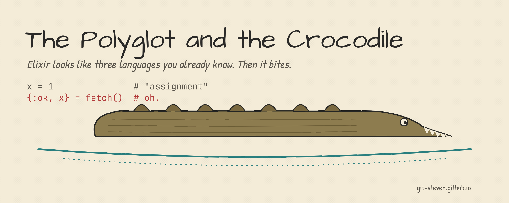
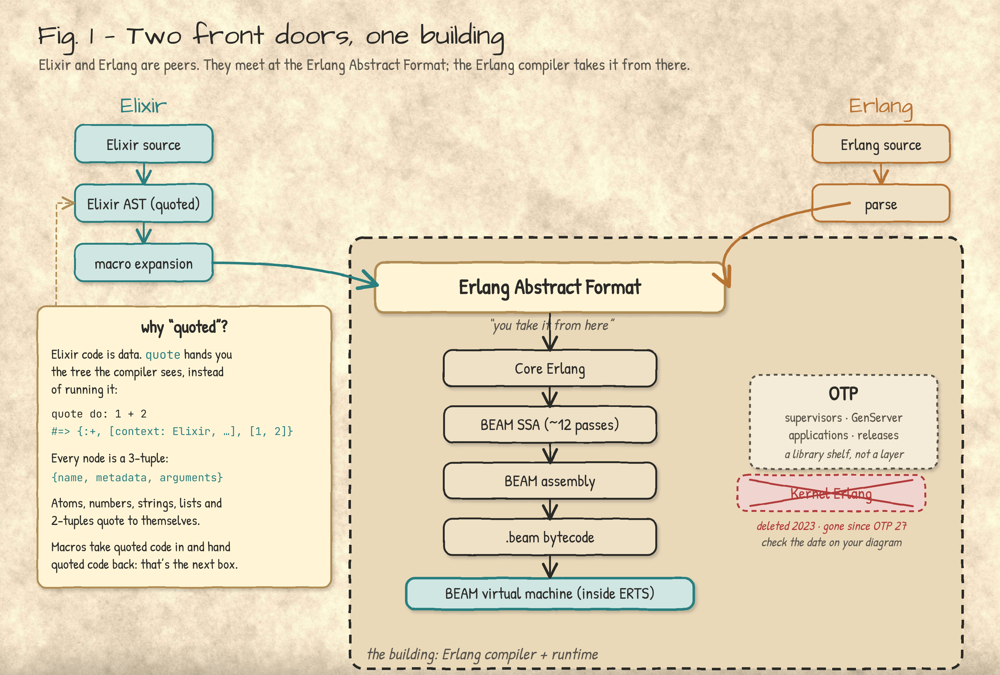
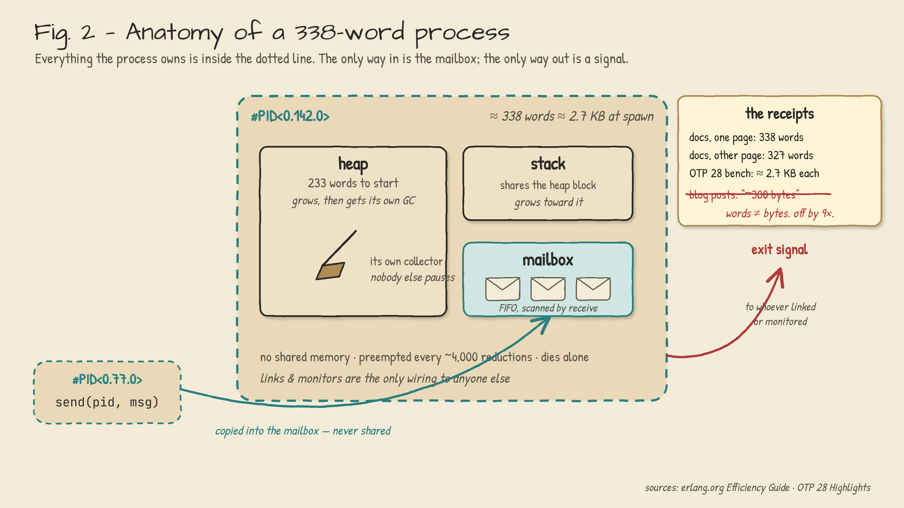
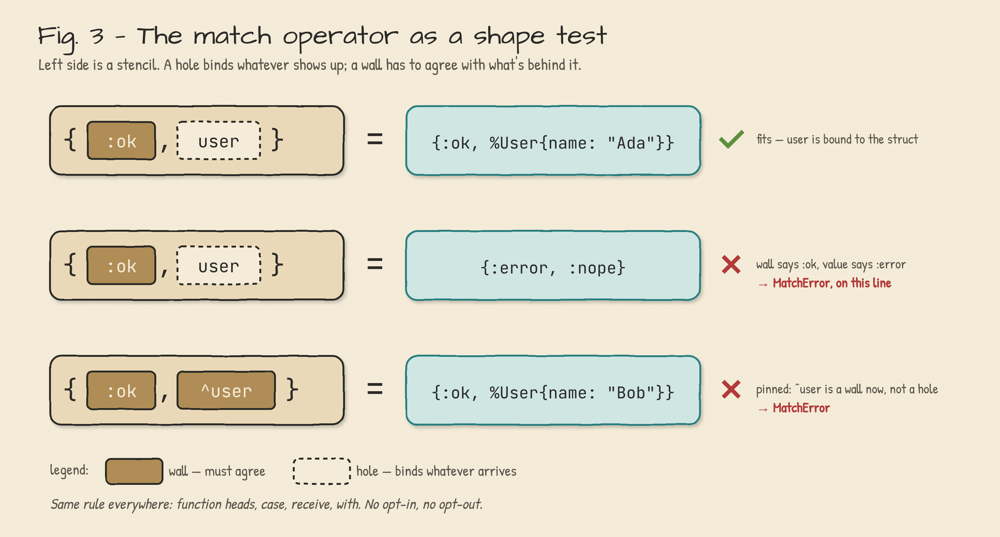
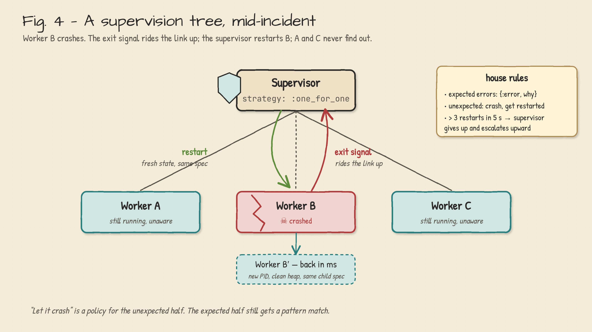
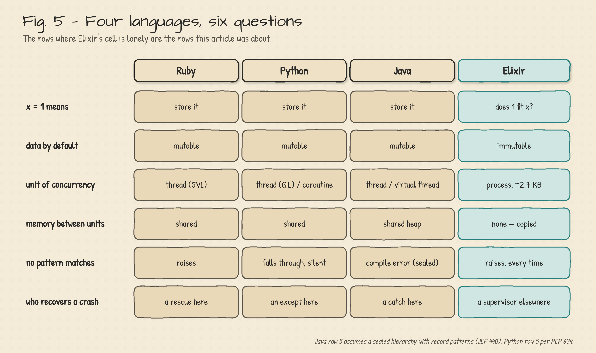

**Elixir looks like three languages you already know. Then it bites.**

*Steven B Miers · November 5, 2026 · v1.09*

## 📝 Introduction

You open an Elixir file and relax a little.

* [`do … end` blocks](https://hexdocs.pm/elixir/modules-and-functions.html), so this is Ruby.
* [Keyword arguments](https://hexdocs.pm/elixir/keywords-and-maps.html) and a [`for` comprehension](https://hexdocs.pm/elixir/comprehensions.html), so maybe Python with better manners.
* Everything lives in a module with a capitalized name, so Java's in here somewhere too.
* There's a web framework called [Phoenix](https://hexdocs.pm/phoenix/overview.html), with a [router](https://hexdocs.pm/phoenix/routing.html), [controllers](https://hexdocs.pm/phoenix/controllers.html) and a [generator](https://hexdocs.pm/phoenix/Mix.Tasks.Phx.Gen.Live.html) that scaffolds a CRUD screen, so Rails is *definitely* in here.
* The creator came off the Rails core team in 2011 [1], and it shows.

Then you write `x = 1` and nothing gets stored. Three things you were sure of are now false:

* **[`=` is a question](https://hexdocs.pm/elixir/Kernel.SpecialForms.html#=/2).** It asks whether `1` fits `x`. If the answer is no, it says so, loudly.
* **There are no objects.** [Modules](https://hexdocs.pm/elixir/modules-and-functions.html) hold functions. Data is data, and it never learns any methods.
* **Nothing is mutable.** You can give a name a new value. You cannot change the old one.

Here is the first one, slowly, because it's the one that bites:

```elixir
x = 1    # x is unbound, so the left side is a hole: 1 fits, and x is now bound to 1
1 = x    # a wall: does the value 1 fit x? It does. Nothing changes, nothing is stored
x = 2    # a bare variable on the left always fits, so this rebinds x to 2
^x = 2   # the pin makes x a wall: compare against the current x. 2 fits 2
^x = 3   # ** (MatchError) no match of right hand side value: 3
```

The thing you took for a log has teeth.

**Elixir borrowed its clothes from languages you know and its body from one you probably don't.**

_This is an introduction, not a sermon. It covers where the body came from, the constructs with no cousin in Ruby, Python or Java, and where the crocodile loses. Part 2 covers what the ecosystem builds out of them; a one-page cheat sheet rides along separately, for interviews._

---

<a id="under-the-clothes"></a>

## 🏛️ What's under the clothes

Eight names, and people use the first four interchangeably, which is how you can tell who's read the docs. From the bottom up:

* **[Erlang](https://www.erlang.org/doc/)** is the language. Ericsson built it in the late 1980s to run telephone switches, which is why it cares about uptime the way a bank cares about decimals. Open-sourced in 1998 [2].
* **BEAM** is the virtual machine Erlang runs on, "Bogdan's Erlang Abstract Machine," after its original author. A register machine, not a stack machine like the JVM [3].
* **ERTS** is the runtime system the BEAM lives inside: schedulers, memory, I/O. It has its own version number that does *not* match the OTP release. OTP 29 ships erts-17, and writing "ERTS 29" is a tell [4].
* **OTP** is the standard library of behaviours for building things that stay up: [supervisors](https://hexdocs.pm/elixir/Supervisor.html), [generic servers](https://hexdocs.pm/elixir/GenServer.html), [applications](https://hexdocs.pm/elixir/Application.html). A library shelf, not a layer.
* **Phoenix** is the web framework, two floors up. Rails-shaped on the outside, process-shaped inside, and [the reason most people are reading this](https://git-steven.github.io/architecture/languages/elixir-four-hats/#phoenix).
* **LiveView** is Phoenix's party trick: the page's state lives in a server process and the browser gets diffs. [Part 2](https://git-steven.github.io/architecture/languages/elixir-four-hats/#liveview), with code.
* **Oban** is background jobs, stored in the database you already have, so enqueueing a job and saving the row it's about is one transaction. [Part 2](https://git-steven.github.io/architecture/languages/elixir-four-hats/#oban).
* **Commanded** is CQRS and event sourcing with every aggregate as its own process, which is the pattern's natural habitat. [Part 2](https://git-steven.github.io/architecture/languages/elixir-four-hats/#commanded).

Elixir, which José Valim started in 2011, is none of the first four. It's a second language aimed at the same machine, and it gets there with less ceremony than you'd guess: it doesn't compile *to* Erlang source. It compiles to what Erlang source becomes *after parsing*, the [Erlang Abstract Format](https://www.erlang.org/doc/apps/erts/absform.html), and hands that to the Erlang compiler with a note that says *you take it from here* [5].



__Fig. 1: Two front doors, one building.__ Peers that meet at the Abstract Format; the Erlang compiler takes it from there to `.beam` bytecode. (The crossed-out box is real [6].)

So "Elixir is fast because the BEAM is fast" is true the way "my apartment has plumbing" is true. Elixir gets the scheduler, the memory model and the fault model for free, because it never left the building. What it adds is the part you type.

*See also:* [Getting started](https://hexdocs.pm/elixir/introduction.html) · [Erlang libraries from Elixir](https://hexdocs.pm/elixir/erlang-libraries.html) · [Mix](https://hexdocs.pm/elixir/introduction-to-mix.html)

---

<a id="338-words"></a>

## 📏 338 Words

Every introduction to Elixir says a process costs about 300 bytes. The Erlang documentation says 338 *words* [7]. One of those is a unit error, and it's the one in the blog posts.

On a 64-bit machine, 338 words is about 2.7 KB, and it buys a heap, a stack, a [mailbox](https://hexdocs.pm/elixir/Kernel.SpecialForms.html#receive/1), and a garbage collector that belongs to this process alone. The collector is the whole trick: when *this* heap fills, *this* process pauses to clean it, and everybody else keeps running. A [process](https://hexdocs.pm/elixir/processes.html) isn't a thread, a green thread or a coroutine. It shares nothing, so it can be collected, crashed or killed and nobody else notices.



__Fig. 2: Anatomy of a 338-word process.__ The only way in is the mailbox; the only way out is a signal.

The receipts, since the blog posts didn't bring any:

* erlang.org, one page: **338 words** at spawn [7]. erlang.org, another page: **327 words** [8]. (The author declines to pick a side; both are still 9× off the blog posts.)
* OTP 28's own benchmark: a million idle processes at roughly 2,687 MB, so **~2.7 KB each**, measured from the other direction [9].

**The number was off by an order of magnitude, and the thing it describes is still the most interesting object in the language.**


---

<a id="match"></a>

## 🧱 `=` is a question, not a statement

In Ruby, Python and Java, `=` means *put this there*. In Elixir [it means *does this fit?*](https://hexdocs.pm/elixir/pattern-matching.html)

```elixir
{:ok, user} = fetch(id)       # fits: binds user
{:ok, user} = {:error, :nope} # MatchError, right here, right now
^user = other_user            # pin: compare, don't rebind
```

The left side is a stencil. A hole binds whatever arrives; a wall has to agree, or the line raises. Not a `nil`, not a warning: [an exception](https://hexdocs.pm/elixir/MatchError.html), on the line where the shape was wrong. That one decision ripples through the whole language:

* **[Function heads are stencils too](https://hexdocs.pm/elixir/patterns-and-guards.html#where-patterns-and-guards-can-be-used).** Three clauses are three stencils; the runtime takes the first that fits, and a [`when` guard](https://hexdocs.pm/elixir/patterns-and-guards.html#guards) narrows a clause without touching the body.
* **[The pin `^`](https://hexdocs.pm/elixir/patterns-and-guards.html#variables) turns a hole into a wall.** "Compare against what `user` already is; don't rebind it."

```elixir
def http(200, body), do: {:ok, body}
def http(code, _) when code in 500..599, do: {:error, :server}
def http(code, _), do: {:error, code}
```

Three conditions, zero `if`s. The nesting problem never shows up because there's nothing to nest. And the rule is the same in [`case`](https://hexdocs.pm/elixir/case-cond-and-if.html), [`receive`](https://hexdocs.pm/elixir/Kernel.SpecialForms.html#receive/1) and [`with`](https://hexdocs.pm/elixir/Kernel.SpecialForms.html#with/1): no fit, it raises.



__Fig. 3: The match operator as a shape test.__ Hole binds, wall must agree.

The other three have all picked up pattern matching lately, and the gap is narrower than Elixir's fans let on:

* **Python 3.10** has `match`, as a *statement*. When no case fits it does nothing. Silently [10].
* **Java 21** has record patterns, final, with nesting and exhaustiveness over sealed types. "Java can't do this" expired in 2023 [11].
* **Ruby 3**'s `case … in` raises `NoMatchingPatternError` on a miss, same as Elixir, and Ruby's pin can do more than Elixir's [12].
* **Scala's** extractors are more extensible than any of the above.

So Elixir's claim isn't expressiveness. It's that matching is the *default* and failure is *loud*. You don't opt in. You can't opt out.

*See also:* [Structs](https://hexdocs.pm/elixir/structs.html) · [Recursion](https://hexdocs.pm/elixir/recursion.html)

---

<a id="concurrency"></a>

## 🧬 Concurrency is grammar, not a library

In Java you import `java.util.concurrent`. In Python you import `asyncio`. In Elixir you import nothing, because the words are in the language:

```elixir
pid = spawn(fn -> receive do {:ping, from} -> send(from, :pong) end end)
send(pid, {:ping, self()})
receive do :pong -> "pong" end
```

That's the whole kit: [make a process](https://hexdocs.pm/elixir/Kernel.html#spawn/1), [put a message in its mailbox](https://hexdocs.pm/elixir/Kernel.html#send/2), [wait for one in yours](https://hexdocs.pm/elixir/Kernel.SpecialForms.html#receive/1). Everything else is built from two more primitives and one pattern:

* **[A link](https://hexdocs.pm/elixir/Process.html#link/1)** ties two processes together. If one dies, the other gets the exit signal and, by default, dies too.
* **[A monitor](https://hexdocs.pm/elixir/Process.html#monitor/1)** is the one-way version. "Tell me if that one dies. Don't take me with it."
* **[A supervisor](https://hexdocs.pm/elixir/Supervisor.html)** is a process whose only job is to link to its children and restart them according to a policy you declared [13].



__Fig. 4: A supervision tree, mid-incident.__ Worker B crashes; the exit signal rides the link up; the supervisor restarts B under a [`:one_for_one` strategy](https://hexdocs.pm/elixir/Supervisor.html#module-strategies), and A and C never find out.

This is what "let it crash" means, and candidates get it wrong in interviews often enough to be precise about it. It does *not* mean "don't handle errors." It means errors come in two kinds, with a tool for each:

* **Expected failures** (file missing, user not found) get a tagged tuple and a pattern match. `{:ok, _}` or `{:error, _}`, right here, same as always.
* **Unexpected failures** (the bug you didn't know you had) crash the process. The recovery policy lives in a supervisor somewhere else, not in a [`rescue` block](https://hexdocs.pm/elixir/try-catch-and-rescue.html) here.

Joe Armstrong's 2003 thesis is titled *Making reliable distributed systems in the presence of software errors* [14]. In the *presence* of. The whole philosophy is in the preposition.

Java 21's virtual threads made a thread as cheap as a BEAM process. They still share one heap, and nobody supervises them [15].

**Loom makes concurrency cheap. The BEAM makes failure cheap. Those are different problems.**

*See also:* [Task](https://hexdocs.pm/elixir/Task.html) · [Agent](https://hexdocs.pm/elixir/agents.html) · [GenServer, by example](https://hexdocs.pm/elixir/genservers.html)

---

<a id="no-cousin"></a>

## 📦 The parts with no cousin

Constructs with no equivalent in the three languages, each with its footgun, since a loaded tool should ship with the warning on the box:

* **[Atoms](https://hexdocs.pm/elixir/basic-types.html#atoms)** (`:ok`, `:error`, `MyModule`) are interned constants in a global, never-collected table capped at about a million entries [16]. Ruby had the same design until 2.2 made symbols collectable [17]. So [`String.to_atom(user_input)`](https://hexdocs.pm/elixir/String.html#to_atom/1) is a denial-of-service with a friendly name, and [`String.to_existing_atom/1`](https://hexdocs.pm/elixir/String.html#to_existing_atom/1) exists.
* **[The pipe](https://hexdocs.pm/elixir/Kernel.html#%7C%3E/2)** `|>` feeds the left value into the *first* argument of the right call, which is why the standard library puts the data first everywhere. People say "like F#," and F# pipes into the *last* argument. Different convention, same relief.
* **[Bitstrings](https://hexdocs.pm/elixir/binaries-strings-and-charlists.html)** are the one with no analogue at all. You can [pattern-match on *bits*](https://hexdocs.pm/elixir/Kernel.SpecialForms.html#%3C%3C%3E%3E/1), and the compiler checks the widths [18]. In Java that's a shift, a mask, and a code review comment.
* **[Macros](https://hexdocs.pm/elixir/macros.html)** operate on the abstract syntax tree, the AST: the tree the compiler builds from your source code, which Elixir exposes as [plain three-element tuples](https://hexdocs.pm/elixir/quote-and-unquote.html). Much of the language (`if`, `def`, `defmodule`) is macros written in Elixir [19]. The official anti-patterns guide then spends a chapter telling you not to write them. Both are right: good for extending the language, wrong for reusing code.

*See also:* [Sigils](https://hexdocs.pm/elixir/sigils.html) · [Enumerables and streams](https://hexdocs.pm/elixir/enumerable-and-streams.html) · [Protocols](https://hexdocs.pm/elixir/protocols.html) · [Module attributes](https://hexdocs.pm/elixir/module-attributes.html)

```elixir
"  Hello, World  " |> String.trim() |> String.downcase() |> String.split(", ")

<<version::4, header_len::4, rest::binary>> = packet   # first byte of an IPv4 header
```

---

<a id="loses"></a>

## ⚖️ Where the crocodile loses

Three fights it doesn't win. The crocodile would like you to know it's not sulking about it:

* **Raw compute.** Immutability has a bill, and on a big, hot, mutable data structure it comes due asymptotically. Discord measured it (640 µs for their best pure-Elixir sorted set, 3.68 µs as a Rust NIF, and the gap grew with size), kept Elixir for the coordination layer, and rewrote one data structure in Rust [20]. That's the right lesson: not "leave," but "know which loop is the hot one."
* **Hiring.** You will not hire Elixir developers (2.6% usage in the 2026 Stack Overflow survey, against Python's 58% [21]). You will convert them. And the documented way Elixir adoptions die is when the one who converted everyone else leaves.
* **[Types](https://hexdocs.pm/elixir/gradual-set-theoretic-types.html).** Elixir 1.20 shipped in June as "now a gradually typed language." The compiler infers types for everything with zero annotations, and there is also zero way to *write* a type signature yet. It's a bug finder, not a contract system, and the team says so [22].



__Fig. 5: Four languages, six questions.__ The rows where Elixir's cell is lonely are the rows this article was about.

---

## 🗝️ The log that bites

The resemblance was never the point. Elixir looks like Ruby so that Rails refugees would read past the first line, and it reads like Python so that nobody flinches at a `for`. Underneath is a 1990s telephone-switch runtime that gives every process its own heap, interrupts it every 4,000 calls [23], and treats a crash as a message with a return address. The syntax is the bait. The process is the animal.

**Try this Monday:** take one function in whatever you're writing now that starts with three `if`-guards and a `return`. Rewrite it in your head as three function heads with the condition in the signature. If the third head is the one that handles the case you forgot, that's your finding.

_Not a telecom engineer, though a very interested one. This is **Part 1** of two. **Part 2**, [Four Hats for One Process](https://git-steven.github.io/architecture/languages/elixir-four-hats/), is what Phoenix, LiveView, Oban and Commanded build out of the 338 words. There's also a sibling, [There Is No Return](https://git-steven.github.io/architecture/languages/eop-no-return/), on why Elixir has no `return` keyword, and a one-page cheat sheet for the day it comes up in an interview._

---

## 📖 References

1. Neto, A. "Why did José Valim create Elixir?" (adapted translation of a 2011 interview). https://adolfont.medium.com/why-did-jos%C3%A9-valim-create-elixir-a6e210b7f2a1
2. Armstrong, J. "A History of Erlang." *HOPL III*, ACM, 2007. https://doi.org/10.1145/1238844.1238850
3. Gustavsson, B. "A Brief History of the BEAM Compiler." erlang.org blog. https://www.erlang.org/blog/beam-compiler-history/
4. Erlang/OTP 29.1.2 patch notes (erts-17.1.1). https://www.erlang.org/patches/otp-29.1.2
5. `elixir_erl.erl`, "Compiler backend to Erlang." elixir-lang/elixir. https://github.com/elixir-lang/elixir/blob/main/lib/elixir/src/elixir_erl.erl
6. erlang/otp commit 83d41bbe, "compiler: Eliminate the Kernel Erlang intermediate representation," 2023. https://github.com/erlang/otp/commit/83d41bbebc7281f72d91eb78c24831c631a92a88
7. Erlang Efficiency Guide, "Advanced: Memory." https://www.erlang.org/doc/system/memory.html
8. Erlang Efficiency Guide, "Processes." https://www.erlang.org/doc/system/eff_guide_processes.html
9. "Erlang/OTP 28 Highlights," erlang.org blog. https://www.erlang.org/blog/highlights-otp-28/
10. PEP 634, Structural Pattern Matching: Specification. https://peps.python.org/pep-0634/
11. JEP 440, Record Patterns. OpenJDK, final in Java 21. https://openjdk.org/jeps/440
12. Ruby documentation, "Pattern matching." https://docs.ruby-lang.org/en/master/syntax/pattern_matching_rdoc.html
13. Elixir `Supervisor` documentation. https://elixir.hexdocs.pm/Supervisor.html
14. Armstrong, J. *Making reliable distributed systems in the presence of software errors.* PhD thesis, KTH, 2003. https://erlang.org/download/armstrong_thesis_2003.pdf
15. JEP 444, Virtual Threads. OpenJDK, final in Java 21. https://openjdk.org/jeps/444
16. Erlang System Limits. https://www.erlang.org/doc/system/system_limits.html
17. "Ruby 2.2.0 Released," ruby-lang.org, 25 Dec 2014. https://www.ruby-lang.org/en/news/2014/12/25/ruby-2-2-0-released/
18. Elixir, "Binaries, strings, and charlists." https://elixir.hexdocs.pm/binaries-strings-and-charlists.html
19. Elixir, "Macro anti-patterns." https://elixir.hexdocs.pm/macro-anti-patterns.html
20. Discord Engineering, "Using Rust to Scale Elixir for 11 Million Concurrent Users," 2019. https://medium.com/discord-engineering/using-rust-to-scale-elixir-for-11-million-concurrent-users-c6f19fc029d3
21. Stack Overflow Developer Survey 2026, Technology → Languages. https://survey.stackoverflow.co/2026/technology/data/languages
22. "Elixir v1.20 released: now a gradually typed language," 3 June 2026. https://elixir-lang.org/blog/2026/06/03/elixir-v1-20-0-released/
23. `CONTEXT_REDS` in `erl_vm.h`, erlang/otp. https://github.com/erlang/otp/blob/master/erts/emulator/beam/erl_vm.h

---

Version 1.09 · November 2026
