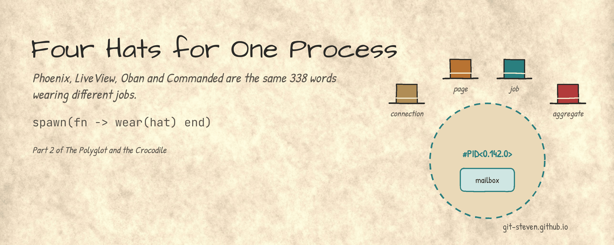
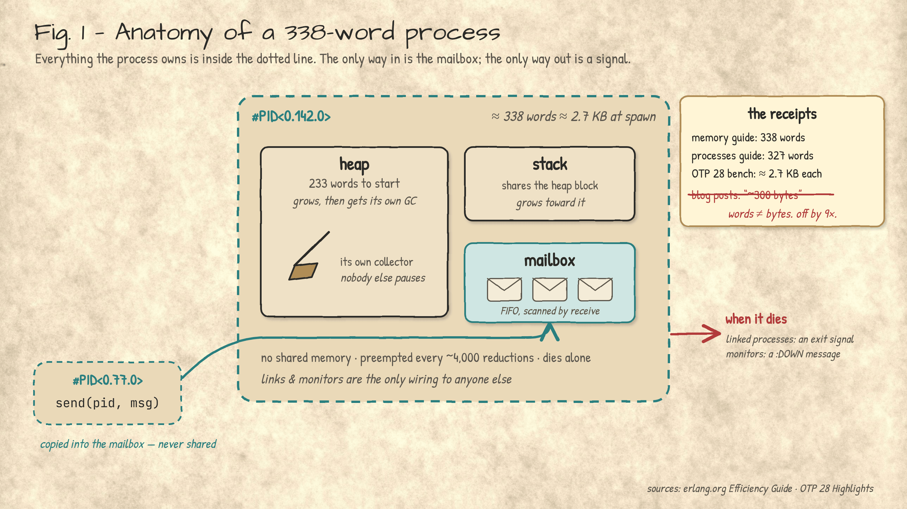
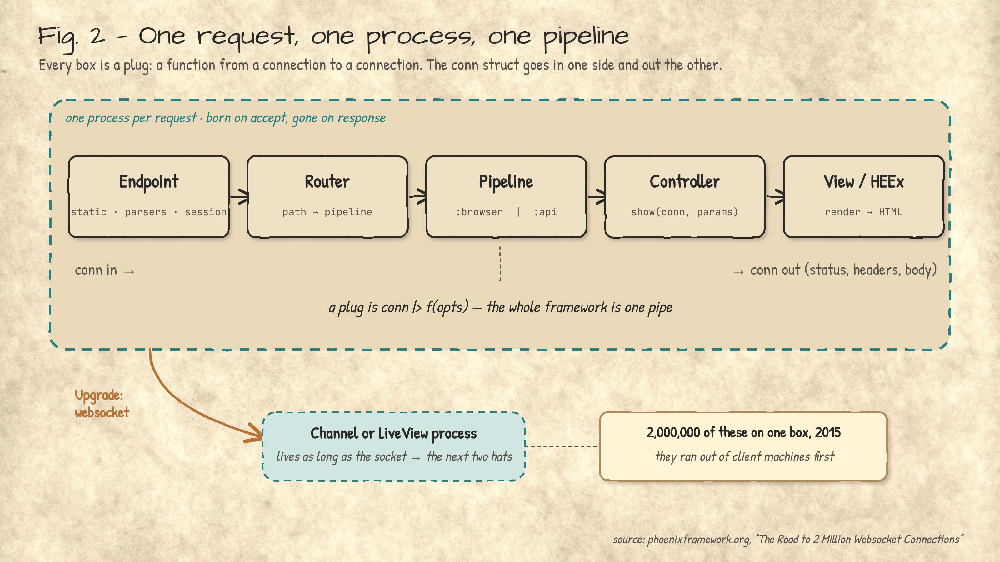
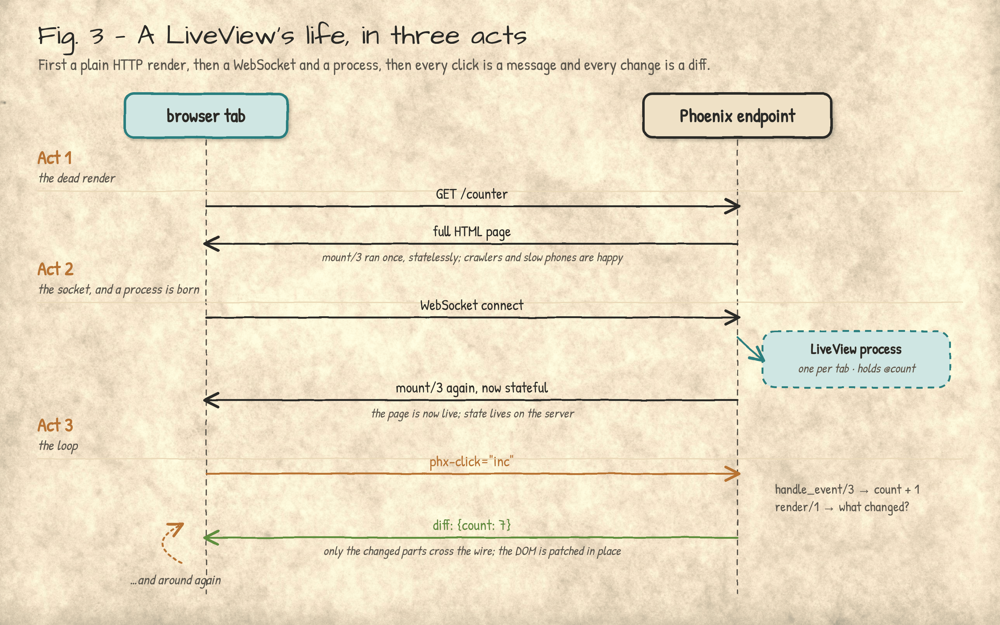
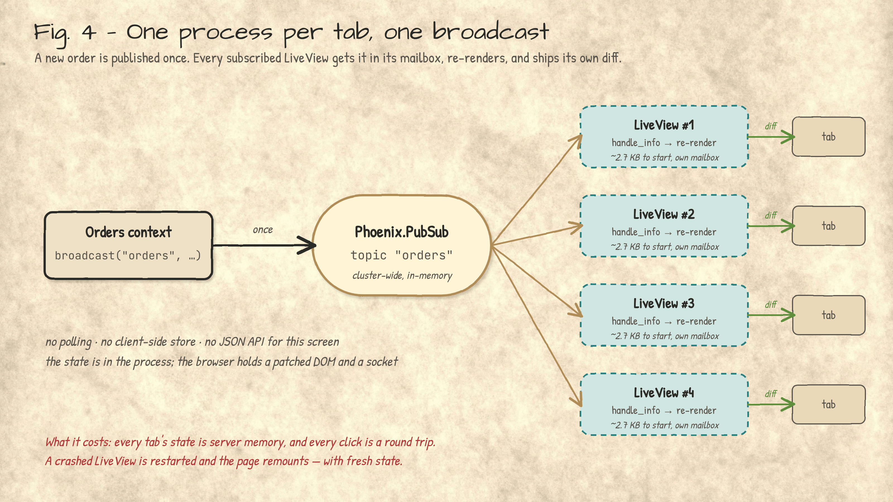
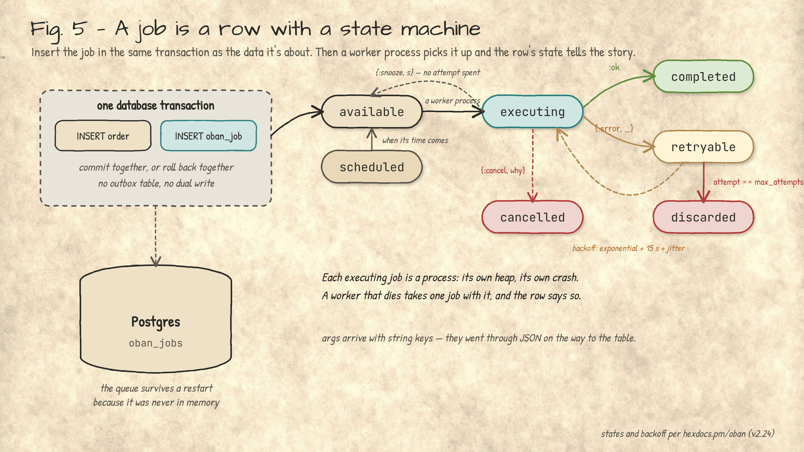
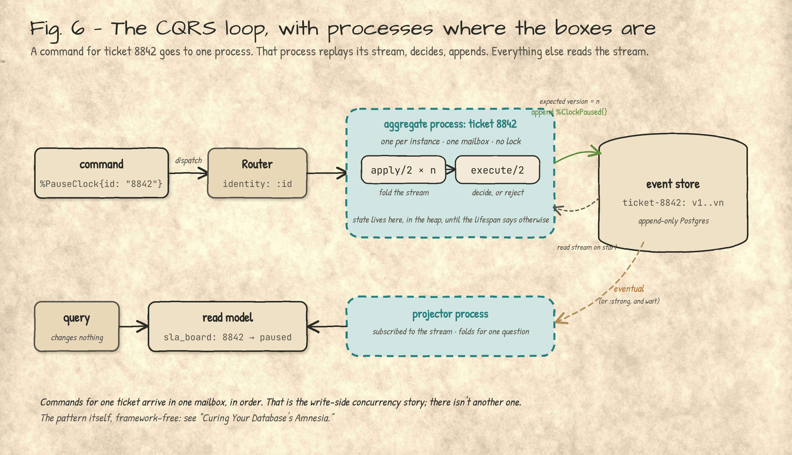

**Phoenix, LiveView, Oban and Commanded are the same 338 words wearing different jobs.**

*Steven B Miers · November 6, 2026 · v1.14*

## 📝 Introduction

[Part 1](https://git-steven.github.io/architecture/languages/elixir-polyglot-crocodile/) was about the language and the machine, and it leaned on one claim the whole way through: a BEAM process is cheap. The first section below settles what *cheap* means ([338 words](#338-words), about 2.7 KB, with its own heap, mailbox and garbage collector), because that number is the whole trick of the platform. It's also the whole trick of the ecosystem, which is less often said. Every library that matters in Elixir is a process wearing a hat:

* **[Phoenix](https://hexdocs.pm/phoenix/overview.html)** puts the hat on a *connection*. Every HTTP request and every WebSocket is a process.
* **[LiveView](https://hexdocs.pm/phoenix_live_view/welcome.html)** puts it on a *page*. Every open browser tab is a process holding that tab's state.
* **[Oban](https://hexdocs.pm/oban/Oban.html)** puts it on a *job*. Every background task runs in a process, with its record in your database.
* **[Commanded](https://hexdocs.pm/commanded/Commanded.html)** puts it on an *aggregate*. Every event-sourced entity is a process replaying its own history.

Four hats. Same head. When one of them crashes, the hat comes off and a supervisor hands out a new one, and that is the entire operational story for all four.

**You don't learn four frameworks. You learn one process model four times, and the fourth is free.**

_This is **Part 2** of two. Part 1 was the language and the machine. This one is what people build on it, with enough code to be dangerous and a diagram per hat. If you skipped Part 1, the only thing you need from it is that a process is cheap, isolated, and supervised, and the first of those gets its receipts below._

---

<a id="338-words"></a>

## 📏 338 Words

Part 1 kept calling a process *cheap* and never produced the bill. Here it is. Ask how much a BEAM process costs and you may well hear "about 300 bytes" [1]. The number is real; the unit isn't. Erlang's docs said **309 words** for years [2], Wikipedia rounds that to "300 words" [3], and today the memory guide says **338 words** [4]. Somewhere between the docs and the blog post, a word became a byte, and the process lost seven-eighths of its weight in transit.

On a 64-bit machine, 338 words is about 2.7 KB, and it buys a heap, a stack, a [mailbox](https://hexdocs.pm/elixir/Kernel.SpecialForms.html#receive/1), and a garbage collector that belongs to this process alone. The collector is the whole trick: when *this* heap fills, *this* process pauses to clean it, and everybody else keeps running. A [process](https://hexdocs.pm/elixir/processes.html) isn't a thread, a green thread or a coroutine. It shares nothing, so it can be collected, crashed or killed and nobody else notices.



__Fig. 1: Anatomy of a 338-word process.__ The only way in is the mailbox; the only way out is a signal.

The receipts, since the 300-byte claim didn't bring any:

* erlang.org, the memory guide: **338 words** at spawn, from a table labelled OTP 19.0 [4]. erlang.org, the processes guide: **327 words**, measured on OTP 27 [5]. (The author declines to pick a side; both are about 9× the "300 bytes.")
* OTP 28's own benchmark: a million idle processes at roughly 2,687 MB, so **~2.7 KB each**, measured from the other direction [6].

**The number was off by an order of magnitude, and the thing it describes is the only object the next four sections are about.**


---

---

<a id="phoenix"></a>

## 🧢 Phoenix: the connection hat

Rails-shaped on the outside. A [router](https://hexdocs.pm/phoenix/routing.html), [controllers](https://hexdocs.pm/phoenix/controllers.html), [generators](https://hexdocs.pm/phoenix/Mix.Tasks.Phx.Gen.Live.html) that scaffold a CRUD screen before the coffee's done. Inside, three things a Rails developer doesn't expect:

* **Everything is a [Plug](https://hexdocs.pm/phoenix/plug.html).** A plug is a function from a connection to a connection. The endpoint is a plug, the router is a plug, each controller action is a plug. The [request lifecycle](https://hexdocs.pm/phoenix/request_lifecycle.html) is a pipeline of them, and you can read it top to bottom.
* **Every connection is a process.** Not a thread from a pool; a 338-word process, born for this request and gone when it's answered. The Phoenix team put two million WebSocket connections on one 40-core box in 2015 and ran out of client machines first [7].
* **[PubSub](https://hexdocs.pm/phoenix_pubsub/Phoenix.PubSub.html) is built in.** Any process [subscribes](https://hexdocs.pm/phoenix_pubsub/Phoenix.PubSub.html#subscribe/3) to a topic; a [broadcast](https://hexdocs.pm/phoenix_pubsub/Phoenix.PubSub.html#broadcast/4) lands in every subscriber's mailbox, across the cluster.



__Fig. 2: One request, one process, one pipeline.__ Every box is a plug; the connection struct goes in one side and comes out the other. The WebSocket branch at the bottom is where the next two hats live.

The router is the one file worth reading first. Pipelines are named lists of plugs; scopes apply them:

```elixir
pipeline :browser do
  plug :accepts, ["html"]
  plug :fetch_session
  plug :protect_from_forgery
end

scope "/", MyAppWeb do
  pipe_through :browser
  get "/orders/:id", OrderController, :show
  live "/counter", CounterLive
end
```

And the controller action is a function head that pattern-matches the params, which is Part 1's `=` doing day-job work:

```elixir
def show(conn, %{"id" => id}), do: render(conn, :show, order: Orders.get!(id))
```

*See also:* [Ecto](https://hexdocs.pm/phoenix/ecto.html) · [Channels](https://hexdocs.pm/phoenix/channels.html) · [Presence](https://hexdocs.pm/phoenix/presence.html) · [Deployment](https://hexdocs.pm/phoenix/deployment.html)

---

<a id="liveview"></a>

## ⚡ LiveView: the page hat

LiveView is the one with no cousin. The server renders the HTML, keeps the page's state in a process, and pushes *diffs* over the socket when that state changes. Rich, real-time UI with no JavaScript framework, because the state never left the server. The docs put it in one sentence: "LiveViews are processes that receive events, update their state, and render updates to a page as diffs" [8].



__Fig. 3: A LiveView's life, in three acts.__ A plain HTTP render first, so the page shows up fast and crawlers see HTML; then a WebSocket and a process; then every click is a message and every change is a diff.

Here's the whole counter, which is the "hello world" of LiveView and about as long as a Rails controller action:

```elixir
defmodule MyAppWeb.CounterLive do
  use MyAppWeb, :live_view

  def mount(_params, _session, socket), do: {:ok, assign(socket, count: 0)}

  def handle_event("inc", _params, socket) do
    {:noreply, update(socket, :count, &(&1 + 1))}
  end

  def render(assigns) do
    ~H"""
    <button phx-click="inc">Clicked {@count} times</button>
    """
  end
end
```

Three callbacks, each doing one thing:

* **[`mount/3`](https://hexdocs.pm/phoenix_live_view/Phoenix.LiveView.html#c:mount/3)** runs twice: once for the dead render, once when the socket connects and the process is born. [`connected?(socket)`](https://hexdocs.pm/phoenix_live_view/Phoenix.LiveView.html#connected?/1) tells you which.
* **[`handle_event/3`](https://hexdocs.pm/phoenix_live_view/Phoenix.LiveView.html#c:handle_event/3)** receives [the click](https://hexdocs.pm/phoenix_live_view/bindings.html#click-events) as a message. Change the state, return the socket; LiveView re-renders and sends only what changed.
* **[`render/1`](https://hexdocs.pm/phoenix_live_view/Phoenix.LiveView.html#c:render/1)** is a [HEEx template](https://hexdocs.pm/phoenix_live_view/Phoenix.Component.html#sigil_H/2), compiled at build time. It knows which parts depend on which assigns, which is how the diffs stay small.

The real-time part is two more functions. Subscribe in `mount`, and [handle the broadcast](https://hexdocs.pm/phoenix_live_view/Phoenix.LiveView.html#c:handle_info/2) like any other message in the mailbox:

```elixir
def mount(_params, _session, socket) do
  if connected?(socket), do: Phoenix.PubSub.subscribe(MyApp.PubSub, "orders")
  {:ok, assign(socket, orders: Orders.recent())}
end

def handle_info({:new_order, order}, socket) do
  {:noreply, update(socket, :orders, &[order | &1])}
end
```

Somewhere else, `Phoenix.PubSub.broadcast(MyApp.PubSub, "orders", {:new_order, order})`, and every open dashboard updates. No polling, no client-side store, no JSON API for this screen.



__Fig. 4: One process per tab, one broadcast.__ Published once; delivered to every subscriber's mailbox; each LiveView re-renders and ships its own diff.

*See also:* [Function components](https://hexdocs.pm/phoenix_live_view/Phoenix.Component.html) · [Assigns and HEEx](https://hexdocs.pm/phoenix_live_view/assigns-eex.html) · [Error and exception handling](https://hexdocs.pm/phoenix_live_view/error-handling.html)

---

<a id="oban"></a>

## 🗓️ Oban: the job hat

Every web app grows a pile of things that shouldn't happen during the request: send the receipt, resize the image, call the slow API, retry the thing that failed at 3 a.m. Sidekiq does this for Ruby with Redis; Celery does it for Python with a broker. [Oban](https://hexdocs.pm/oban/Oban.html) does it for Elixir with *the database you already have*. Jobs are rows in Postgres (MySQL and SQLite work too), and each one runs in its own process [9]. That one design choice buys three things:

* **Enqueueing is transactional.** Save the order and enqueue its receipt in one [`Ecto.Multi`](https://hexdocs.pm/oban/Oban.html#insert/3); if the order rolls back, so does the job. No outbox table, no dual-write bug, no "the email went out but the row didn't commit."
* **The queue survives a restart** because it was never in memory. Jobs have [states](https://hexdocs.pm/oban/Oban.Job.html): `available`, `scheduled`, `executing`, `retryable`, `completed`, `discarded`, `cancelled`, and you can query them with SQL like anything else.
* **Retries are a policy, not a prayer.** A failing job goes `retryable` with exponential backoff and jitter, up to `max_attempts` (default 20), then `discarded` [10].



__Fig. 5: A job is a row with a state machine.__ The grey box is the part other job systems can't give you: the job and the data it's about commit together, or neither does.

A worker is a module with one callback:

```elixir
defmodule MyApp.Workers.SendReceipt do
  use Oban.Worker, queue: :mailers, max_attempts: 5

  @impl Oban.Worker
  def perform(%Oban.Job{args: %{"order_id" => id}}) do
    id |> Orders.get!() |> Mailer.send_receipt()
  end
end
```

And enqueueing it inside the transaction that creates the order:

```elixir
Ecto.Multi.new()
|> Ecto.Multi.insert(:order, Order.changeset(attrs))
|> Oban.insert(:receipt, fn %{order: order} -> SendReceipt.new(%{order_id: order.id}) end)
|> Repo.transaction()
```

Note the `args` arrive as a map with *string* keys, because they went through JSON on the way to the table. Every Oban newcomer matches on `%{order_id: id}` exactly once.

[`perform/1`](https://hexdocs.pm/oban/Oban.Worker.html#c:perform/1) returns `:ok` for done, `{:error, _}` for retry, `{:snooze, seconds}` to come back later without spending an attempt, and `{:cancel, reason}` to stop trying [10]. [Cron](https://hexdocs.pm/oban/Oban.Cron.html), [uniqueness](https://hexdocs.pm/oban/Oban.Worker.html#module-unique-jobs) and scheduling are options on the worker. The dashboard and the fancier workflow features are [Oban Pro](https://oban.pro), which is licensed, and that's the honest footnote on an otherwise free lunch.

*See also:* [Oban.Job](https://hexdocs.pm/oban/Oban.Job.html) · [Testing workers](https://hexdocs.pm/oban/Oban.Testing.html) · [Oban.Cron](https://hexdocs.pm/oban/Oban.Cron.html)

---

<a id="commanded"></a>

## 📜 Commanded: the aggregate hat

[Commanded](https://hexdocs.pm/commanded/Commanded.html) is CQRS and event sourcing for Elixir: commands go to an aggregate, the aggregate emits events, the events are the record, and read models are built from them [11]. If those words are new, the author has a whole article on the pattern with no framework in it, [Curing Your Database's Amnesia](https://git-steven.github.io/architecture/data/curing-your-databases-amnesia/); this section is about what the BEAM adds to it. Which is one thing, and it's a big one:

* **Each aggregate instance is a process.** The docs say it plainly: "Aggregate is a GenServer process used to provide access to an instance of an event sourced aggregate" [12]. Ticket 8842 is a process. Its state is in that process's heap, rebuilt from its events when it starts. Commands for 8842 go to one mailbox, in order, so there's no lock and no race on the write side.
* **The event store is append-only Postgres** via the [EventStore](https://hex.pm/packages/eventstore) library, or [EventStoreDB](https://www.eventstore.com/) if you have one. Appends carry an expected version, which is the whole optimistic-concurrency story.
* **Projections and process managers are event handlers**, which is to say more processes with more mailboxes, subscribed to the stream. Dispatch is `:eventual` by default, or `:strong` if you'd rather wait for the read model [13].



__Fig. 6: The CQRS loop, with processes where the boxes are.__ The aggregate process folds its stream, decides, and appends. The projector is another process reading the same stream. The dashed arrow is the eventual-consistency bill from the CQRS article, now with a return address.

An aggregate is a struct and two functions, and both of them are Part 1's multi-clause pattern matching with guards:

```elixir
defmodule Helpdesk.Ticket do
  defstruct [:id, status: :open, clock: :running]

  # decide: command in, event(s) or error out
  def execute(%Ticket{clock: :paused}, %PauseClock{}), do: {:error, :already_paused}
  def execute(%Ticket{id: id}, %PauseClock{reason: why}), do: %ClockPaused{id: id, reason: why}

  # remember: event in, new state out — must never fail
  def apply(%Ticket{} = t, %ClockPaused{}), do: %{t | clock: :paused}
end
```

[`execute/2`](https://hexdocs.pm/commanded/aggregates.html) may reject a command for a business reason. [`apply/2`](https://hexdocs.pm/commanded/aggregates.html) may not, because it's how state is rebuilt from history, and you can't refuse the past. The router says which aggregate handles which commands, and which field identifies the instance:

```elixir
defmodule Helpdesk.Router do
  use Commanded.Commands.Router
  dispatch [PauseClock, ResumeClock], to: Ticket, identity: :id
end

:ok = Helpdesk.App.dispatch(%PauseClock{id: "8842", reason: "customer at lunch"})
```

Two honest notes. Aggregate processes run indefinitely by default, so a system with millions of tickets wants a [lifespan](https://hexdocs.pm/commanded/Commanded.Aggregates.AggregateLifespan.html) policy and probably [snapshots](https://hexdocs.pm/commanded/aggregates.html) [12]. And Commanded is a community project with a smaller user base than the other three hats; you are adopting a pattern *and* a maintainer.

*See also:* [Commands and routers](https://hexdocs.pm/commanded/commands.html) · [Events and handlers](https://hexdocs.pm/commanded/events.html) · [Process managers](https://hexdocs.pm/commanded/process-managers.html)

---

## ⚖️ Where the hats pinch

Each hat has a place it rubs, and each one is the same place from a different angle: *the state is in a process, on your server*.

* **LiveView:** every tab's state is your RAM, every click is a round trip, and a crashed LiveView remounts with fresh state. Fine for dashboards, forms and chat; not for a game. Keep what matters in the URL or the database.
* **Oban:** the database is the queue, so the queue's throughput ceiling is the database's. Fine for the overwhelming majority of apps; not for a million jobs a minute. The nicest parts of the dashboard cost money.
* **Commanded:** event sourcing is a commitment, not a library choice. Renaming an event is a promise you made to every event already on disk, and read models lag by design. Use it where history is a requirement someone will pay for, which is fewer places than the conference talks suggest.
* **Phoenix:** nothing to confess. It's the Rails you remember, on a runtime that doesn't fall over.

---

## 🎩 Same head, different hat

The four libraries don't share code. They share a *shape*: a process with a mailbox, holding state, supervised. Phoenix hands one to a connection, LiveView to a page, Oban to a job, Commanded to an aggregate. Once you've seen it, every new Elixir library is a question of "what did they put the hat on?" and the answer is usually on the first page of its docs.

**Try this Monday:** pick one background job in whatever you run now and ask where its retry policy lives. If the answer is "in a comment," that's your finding.

_Not a milliner, though a very interested one. This is **Part 2** of two; [Part 1](https://git-steven.github.io/architecture/languages/elixir-polyglot-crocodile/), The Polyglot and the Crocodile, covered the language and the machine. The CQRS pattern itself, framework-free, is in [Curing Your Database's Amnesia](https://git-steven.github.io/architecture/data/curing-your-databases-amnesia/)._

---

## 📖 References

1. Anand, S. "WhatsApp Handled 2 Billion Users With Just 50 Engineers. Here's the System Design That Made It Possible." 13 Feb 2026. https://techie007.substack.com/p/whatsapp-handled-2-billion-users
2. Erlang Efficiency Guide (OTP 17), "Processes." https://www.erlang.org/docs/17/efficiency_guide/processes.html
3. Wikipedia, "Erlang (programming language)." https://en.wikipedia.org/wiki/Erlang_(programming_language)
4. Erlang Efficiency Guide, "Advanced: Memory." https://www.erlang.org/doc/system/memory.html
5. Erlang Efficiency Guide, "Processes." https://www.erlang.org/doc/system/eff_guide_processes.html
6. "Erlang/OTP 28 Highlights," erlang.org blog. https://www.erlang.org/blog/highlights-otp-28/
7. McCord, C. "The Road to 2 Million Websocket Connections in Phoenix." phoenixframework.org, 3 Nov 2015. https://phoenixframework.org/blog/the-road-to-2-million-websocket-connections
8. Phoenix LiveView v1.2 documentation, "Welcome." https://hexdocs.pm/phoenix_live_view/welcome.html
9. Oban v2.24 documentation, `Oban` module. https://hexdocs.pm/oban/Oban.html
10. Oban v2.24 documentation, `Oban.Worker`. https://hexdocs.pm/oban/Oban.Worker.html
11. Commanded v1.4 documentation, `Commanded` module. https://hexdocs.pm/commanded/Commanded.html
12. Commanded v1.4 documentation, `Commanded.Aggregates.Aggregate`. https://hexdocs.pm/commanded/Commanded.Aggregates.Aggregate.html
13. Commanded v1.4 documentation, "Commands." https://hexdocs.pm/commanded/commands.html

---

Version 1.14 · November 2026
